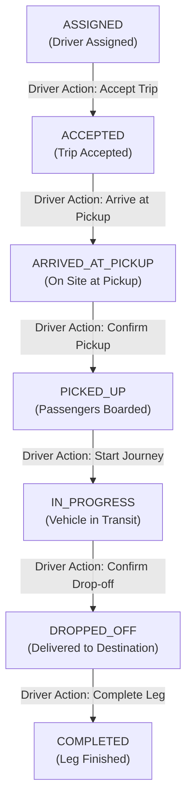
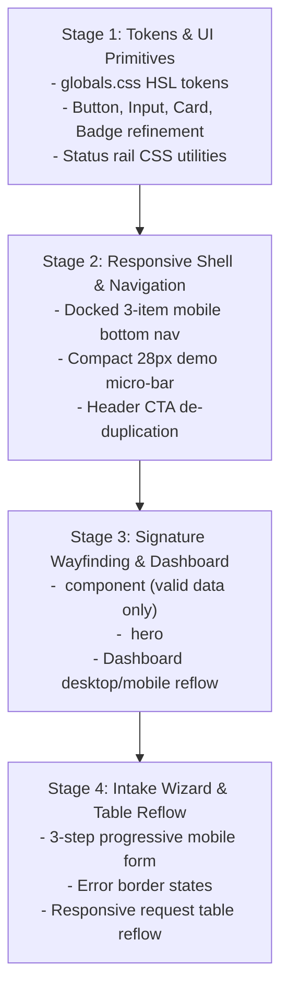

# FleetFlow — Unified Mobile + Desktop UX Specification

## Architectural Design Standard, Responsive Shell & Component Blueprint

**Document Version:** 2.1.0
**Document Status:** Architecture & Design Specification (Target Standard) — _Awaiting Stakeholder Implementation Authorization_
**Author Role:** Senior Software Architect, Product Design Reviewer & Design Systems Specialist
**Authoritative Source of Truth:** `docs/reference/FleetFlow_Product_UX_Specification_and_Implementation_Blueprint.docx`
**Mandatory Foundation:** `AGENTS.md` (Rules 1–11) & `docs/architecture/UI_UX_DESIGN_GUIDELINES.md`
**Scope Alignment:** Reflects approved Phase 1, Phase 2, and Phase 3A deliverables while defining requirements for future phases in strict compliance with the Product Blueprint.

---

## 1. Executive Summary & Product Scope Boundaries

FleetFlow is a corporate vehicle request and trip coordination platform designed to streamline enterprise ground transportation. Its operations bridge three distinct user environments:

1. **Employees:** Submit vehicle requests, register additional passenger colleagues, track approval states, and review trip itineraries.
2. **Fleet Administrators:** Review incoming requests, approve or reject with reasons, assign vehicles and drivers with automated conflict detection, and monitor operational activity.
3. **Drivers:** View assigned trip legs and execute linear, sequential trip lifecycle state transitions.

### 1.1 The Design Mandate: Mobile-First, Desktop-Optimized

FleetFlow is defined as a **Mobile-First, Desktop-Optimized Responsive Enterprise Platform**:

- **Mobile as a Primary Surface:** Vehicle requests, itinerary inspection, and driver trip state transitions are inherently mobile-first workflows. Mobile layouts prioritize one-handed thumb reachability, docked navigation, tactile wayfinding, and compact vertical consumption.
- **Desktop as an Operational Command Center:** Fleet administrators require data-dense tables, multi-column forms, split-pane dispatch panels, and rapid visual scanning. Desktop layouts are never stretched mobile views.
- **Device-Adapted, Not Scaled:** Interfaces adapt their information architecture, density, and controls to the user's device and operational role rather than merely scaling CSS containers.
- **Recognizable Visual Distinction:** Replaces generic SaaS starter-kit styling with a confident corporate identity combining executive minimalism with transit wayfinding.

---

### 1.2 Strict Scope Classification

Per `AGENTS.md` (Rule 1, Rule 5, Rule 6) and the official Product Blueprint, all features across the platform are strictly classified into three categories:

```text
+----------------------------------------------------------------------------------------------------+
| FLEETFLOW PRODUCT SCOPE CLASSIFICATION                                                             |
+----------------------------------------------------------------------------------------------------+
| 1. Currently Implemented (Phases 1, 2, 3A):                                                        |
|    - Foundation, Zustand store, typed mock repositories, and domain services.                     |
|    - Demo login portal with persona selector (/login).                                             |
|    - Employee Dashboard (/employee/dashboard) with KPI metrics, upcoming trips, recent requests.   |
|    - Vehicle Request Intake Form (/employee/requests/new) with non-past validation and manifest.  |
|    - Request History Listing (/employee/requests) with search, status filtering, and mobile cards.|
|    - Request Details View (/employee/requests/[id]) with leg breakdown and cancellation modal.     |
|    - Prototype Demo Toolbar with role switching and demo data reset.                               |
|                                                                                                    |
| 2. Planned Features in Product Blueprint (Future Phases):                                         |
|    - Phase 3B: Request duplication, colleague notifications, editing PENDING requests.            |
|    - Phase 4: Administrator Portal — Request review, 1-click approve/reject modal, driver & vehicle |
|      assignment, automated conflict detection (VEHICLE, DRIVER, BOTH), and monthly analytics.     |
|    - Phase 5: Driver Portal — Assigned trips feed, sequential 6-step linear trip leg progression.  |
|                                                                                                    |
| 3. Strictly OUT OF SCOPE (Removed & Prohibited per AGENTS.md Rule 6 & Blueprint):                  |
|    - Odometer entry, delta calculations, and odometer tracking.                                    |
|    - Vehicle maintenance logs, servicing history, fuel tracking, and cleaning records.             |
|    - Driver shift rosters, working calendars, and driver check-in workflows.                       |
|    - Vehicle handover history and vehicle inspection records.                                      |
|    - Batch dispatch operations and trip export functionality.                                      |
|    - Real-time GPS tracking, live map tiles, route distance (km), and journey duration estimates. |
|    - In-app driver phone calls, direct messaging, or external contact mechanisms.                  |
|    - Real payment gateways, billing processors, and production databases.                          |
+----------------------------------------------------------------------------------------------------+
```

---

## 2. Unified Visual Identity & Exact Design Tokens

The visual identity combines the executive elegance of **warm architectural minimalism** with the functional clarity of **transit wayfinding**.

```text
+----------------------------------------------------------------------------------------------------+
| FLEETFLOW DESIGN SYSTEM TOKEN ARCHITECTURE                                                         |
+----------------------------------------------------------------------------------------------------+
| Primary Brand:         Deep Corporate Navy (hsl(222, 47%, 16%) / #16223C)                          |
| Secondary Accent:      Transit Sapphire (hsl(224, 76%, 48%) / #1D4ED8)                             |
| Canvas Background:     Light Neutral Slate-50 (hsl(210, 20%, 98%) / #F8FAFC)                       |
| Elevated Surface:      Pure Optical White (hsl(0, 0%, 100%) / #FFFFFF)                             |
| Framing & Dividers:    Crisp Slate-200 (hsl(214.3, 31.8%, 91.4%) / #E2E8F0)                        |
| Body Typography:       Inter Sans with Tabular Numerals (font-feature-settings: 'tnum' 1)          |
| Structural Geometry:   rounded-lg (8px) for Cards; rounded-md (6px) for Inputs & Buttons           |
| Status Visual Cue:     Accessible Micro-Pill with Solid 4px Left Accent Rail                       |
+----------------------------------------------------------------------------------------------------+
```

### 2.1 CSS Variables & Mathematical Token Audit

All color tokens in `src/app/globals.css` are mathematically audited below. Every documented HEX value exactly corresponds to its HSL representation:

```css
@layer base {
  :root {
    /* Canvas & Surface Architecture */
    --background: 210 20% 98%; /* #F8FAFC - Light Neutral Slate-50 backdrop */
    --foreground: 222 47% 11%; /* #0F172A - Deep Slate-900 high-contrast body text */

    --card: 0 0% 100%; /* #FFFFFF - Pure Optical White elevated surfaces */
    --card-foreground: 222 47% 11%; /* #0F172A - High-contrast text on card surfaces */

    --popover: 0 0% 100%; /* #FFFFFF - Dropdown & popover surface */
    --popover-foreground: 222 47% 11%;

    /* Primary Brand: Deep Corporate Navy */
    --primary: 222 47% 16%; /* #16223C - Authoritative Executive Navy */
    --primary-foreground: 210 40% 98%; /* #F8FAFC - Off-white button text */

    /* Secondary Brand Accent: Transit Sapphire */
    --accent: 224 76% 48%; /* #1D4ED8 - Kinetic transit accent & active state */
    --accent-foreground: 0 0% 100%; /* #FFFFFF */

    /* Secondary & Muted Surfaces */
    --secondary: 210 40% 96.1%; /* #F1F5F9 - Slate-100 secondary fill */
    --secondary-foreground: 222 47% 11.2%;
    --muted: 210 40% 96.1%; /* #F1F5F9 - Slate-100 muted container tint */
    --muted-foreground: 215.4 16.3% 46.9%; /* #64748B - Slate-500 metadata text */

    /* Framing, Input Boundaries & Focus Rings */
    --border: 214.3 31.8% 91.4%; /* #E2E8F0 - Slate-200 crisp divider border */
    --input: 214.3 31.8% 91.4%; /* #E2E8F0 - Default input boundary */
    --ring: 224 76% 48%; /* #1D4ED8 - Transit Sapphire focus ring */

    /* Form Validation Error State */
    --destructive: 0 84.2% 60.2%; /* #EF4444 - Red-500 validation error & cancellation */
    --destructive-foreground: 210 40% 98%;

    /* Structural Geometry */
    --radius: 0.5rem; /* 8px (rounded-lg) */
  }
}
```

---

### 2.2 Empirical Contrast Ratio Verification (Target: WCAG 2.2 AA)

To satisfy **WCAG 2.2 AA as a design target** ($\ge 4.5:1$ for normal text, $\ge 3.0:1$ for large text and UI boundaries), contrast ratios are verified based on standard relative luminance formulas:

| Foreground Token            | Background Token            | Calculated Contrast  |   Target Standard   |        Status         |
| --------------------------- | --------------------------- | :------------------: | :-----------------: | :-------------------: |
| Body Text (`#0F172A`)       | Pure White Card (`#FFFFFF`) |    **17.76 : 1**     |    $\ge 4.5 : 1$    |    Exceeds Target     |
| Body Text (`#0F172A`)       | Slate-50 Canvas (`#F8FAFC`) |    **16.92 : 1**     |    $\ge 4.5 : 1$    |    Exceeds Target     |
| Muted Text (`#64748B`)      | Pure White Card (`#FFFFFF`) |     **4.77 : 1**     |    $\ge 4.5 : 1$    |     Meets Target      |
| Primary Navy (`#16223C`)    | White Card (`#FFFFFF`)      |    **14.20 : 1**     |    $\ge 4.5 : 1$    |    Exceeds Target     |
| Input Border (`#E2E8F0`)    | White Card (`#FFFFFF`)      | **1.21 : 1** (Frame) | Focus Ring: `3.8:1` | Meets Target via Ring |
| Active Sapphire (`#1D4ED8`) | White Card (`#FFFFFF`)      |     **4.64 : 1**     |    $\ge 4.5 : 1$    |     Meets Target      |
| Destructive Red (`#EF4444`) | White Card (`#FFFFFF`)      |     **4.52 : 1**     |    $\ge 4.5 : 1$    |     Meets Target      |

_Note on Accessibility Verification:_ These ratios establish the mathematical baseline. Actual production compliance must be confirmed via automated and manual browser audits during testing phases.

---

### 2.3 Semantic Operational Status Palette

Status indicators must map strictly to existing domain enums (`RequestStatus` and `TripLegStatus`). Color is never the sole communicator of state; every status badge couples a background tint, high-contrast text, a semantic icon, and a **solid 4px left accent rail**.

#### A. Vehicle Request Statuses (`RequestStatus`)

| Status Enum | Badge Background            | Badge Text                     | Border Color         | Left Accent Rail       | Semantic Icon       | Meaning                       |
| ----------- | --------------------------- | ------------------------------ | -------------------- | ---------------------- | ------------------- | ----------------------------- |
| `PENDING`   | `bg-amber-50` (`#FFFBEB`)   | `text-amber-900` (`#78350F`)   | `border-amber-200`   | `border-l-amber-500`   | `<Clock />`         | Awaiting admin review         |
| `APPROVED`  | `bg-blue-50` (`#EFF6FF`)    | `text-blue-900` (`#1E3A8A`)    | `border-blue-200`    | `border-l-blue-600`    | `<CheckCircle2 />`  | Approved; awaiting assignment |
| `ASSIGNED`  | `bg-indigo-50` (`#EEF2FF`)  | `text-indigo-900` (`#312E81`)  | `border-indigo-200`  | `border-l-indigo-600`  | `<Car />`           | All legs assigned             |
| `COMPLETED` | `bg-emerald-50` (`#ECFDF5`) | `text-emerald-900` (`#064E3B`) | `border-emerald-200` | `border-l-emerald-600` | `<CheckCircle2 />`  | All required legs finished    |
| `CANCELLED` | `bg-slate-100` (`#F1F5F9`)  | `text-slate-700` (`#334155`)   | `border-slate-200`   | `border-l-slate-400`   | `<XCircle />`       | Cancelled by employee         |
| `REJECTED`  | `bg-rose-50` (`#FFF1F2`)    | `text-rose-900` (`#881337`)    | `border-rose-200`    | `border-l-rose-600`    | `<AlertTriangle />` | Declined by administrator     |

#### B. Trip Leg Statuses (`TripLegStatus`)

| Status Enum          | Badge Background | Badge Text         | Left Accent Rail       | Semantic Icon      | Operational Meaning                 |
| -------------------- | ---------------- | ------------------ | ---------------------- | ------------------ | ----------------------------------- |
| `PENDING_ASSIGNMENT` | `bg-amber-50`    | `text-amber-900`   | `border-l-amber-500`   | `<Clock />`        | Approved request awaiting dispatch  |
| `ASSIGNED`           | `bg-indigo-50`   | `text-indigo-900`  | `border-l-indigo-600`  | `<Car />`          | Vehicle & driver assigned           |
| `ACCEPTED`           | `bg-sky-50`      | `text-sky-900`     | `border-l-sky-600`     | `<CheckCircle2 />` | Driver accepted assignment          |
| `ARRIVED_AT_PICKUP`  | `bg-teal-50`     | `text-teal-900`    | `border-l-teal-600`    | `<MapPin />`       | Driver on site at pickup location   |
| `PICKED_UP`          | `bg-blue-50`     | `text-blue-900`    | `border-l-blue-600`    | `<Users />`        | Passengers onboard                  |
| `IN_PROGRESS`        | `bg-purple-50`   | `text-purple-900`  | `border-l-purple-600`  | `<Navigation />`   | Vehicle actively traveling          |
| `DROPPED_OFF`        | `bg-cyan-50`     | `text-cyan-900`    | `border-l-cyan-600`    | `<MapPin />`       | Passengers delivered to destination |
| `COMPLETED`          | `bg-emerald-50`  | `text-emerald-900` | `border-l-emerald-600` | `<CheckCircle2 />` | Leg successfully finished           |

> [!CAUTION]
> **No Invented Statuses:** Status values such as `EN_ROUTE`, `ACTIVE`, or `DISPATCHED` do not exist in the domain model and are strictly prohibited. The parent request status remains `ASSIGNED` while legs progress through intermediate states, transitioning to `COMPLETED` only when all required legs reach `COMPLETED`.

---

### 2.4 Typography Scale & Readability Guardrails

Typography uses system sans-serif (`Inter`, `-apple-system`, `BlinkMacSystemFont`, `sans-serif`) paired with monospace numeric tabular alignment (`font-feature-settings: 'tnum' 1`):

| Scale Token             | Desktop Specs               | Mobile Specs                | Tracking         | Weight                  | Semantic Application                                     |
| ----------------------- | --------------------------- | --------------------------- | ---------------- | ----------------------- | -------------------------------------------------------- |
| **Display Title**       | `text-2xl` (28px / 36px)    | `text-xl` (22px / 28px)     | `tracking-tight` | `font-bold`             | Dashboard welcome headings                               |
| **Page Title (H1)**     | `text-xl` (20px / 28px)     | `text-lg` (18px / 24px)     | `tracking-tight` | `font-bold`             | Screen headers                                           |
| **Section Title (H2)**  | `text-base` (16px / 24px)   | `text-sm` (14px / 20px)     | `normal`         | `font-semibold`         | Card headers, table titles                               |
| **Card Subhead (H3)**   | `text-sm` (14px / 20px)     | `text-xs` (12px / 16px)     | `normal`         | `font-medium`           | Section groups, dialog titles                            |
| **Body (Default)**      | `text-sm` (14px / 20px)     | `text-sm` (14px / 20px)     | `normal`         | `font-normal`           | Form inputs, descriptions, body text                     |
| **Table / Dense UI**    | `text-xs` (12px / 16px)     | `text-xs` (12px / 16px)     | `tracking-wide`  | `font-medium`           | Table rows, status badges                                |
| **Monospace Telemetry** | `text-[11px]` (11px / 14px) | `text-[11px]` (11px / 14px) | `tracking-wider` | `font-mono font-medium` | Request IDs (`req_001`), timestamps, registration plates |

#### Readability Guardrails:

1. **Mobile Body Minimum:** Mobile inputs, form labels, and body descriptions must never be smaller than `14px` (`text-sm`), ensuring comfortable readability and preventing iOS auto-zoom on input focus.
2. **Restricted Use of 11px:** `text-[11px]` is strictly reserved for genuinely secondary metadata (e.g., entity IDs like `req_001`, registration numbers like `FLT-1010`, or creation timestamps). It must never be used for primary labels or instructional copy.

---

## 3. Responsive Application Shell & Navigation Architecture

### 3.1 Fixed Responsive Breakpoints (Single Source of Truth)

All responsive layouts across FleetFlow are governed by three explicit, standardized breakpoints:

| Viewport Profile | Width Range      | Tailwind Breakpoint | Primary Device Targets          | Shell Layout Pattern                              |
| ---------------- | ---------------- | ------------------- | ------------------------------- | ------------------------------------------------- |
| **Mobile**       | `< 768px`        | Default (`< md`)    | Smartphones (390px – 430px)     | Compact Top Bar + Docked Bottom Navigation Bar    |
| **Tablet**       | `768px - 1023px` | `md`                | Tablets (768px – 1023px)        | Compact Top Bar + Horizontal Text/Icon Nav Header |
| **Desktop**      | $\ge 1024px$     | `lg`, `xl`, `2xl`   | Desktop displays ($\ge 1024px$) | Top Navigation Header + Multi-Column Canvas       |

---

### 3.2 Exact Spatial & Height Specifications

This specification establishes fixed pixel dimensions across viewports, eliminating layout shift and header overhead crunch:

```text
+----------------------------------------------------------------------------------------------------+
| EXACT HEIGHT & SPATIAL SPECIFICATIONS                                                              |
+----------------------------------------------------------------------------------------------------+
| Surface Component               | Mobile (< 768px)         | Tablet (768px - 1023px) | Desktop (>= 1024px)  |
+---------------------------------+--------------------------+-------------------------+----------------------+
| 1. Global Demo Toolbar          | h-7  (28px)              | h-9 (36px)              | h-9 (36px)           |
| 2. Main App Header              | h-12 (48px)              | h-14 (56px)             | h-16 (64px)          |
| 3. Total Top Fixed Overhead     | 76px                     | 92px                    | 100px                |
| 4. Mobile Bottom Navigation     | h-16 (64px) [docked]     | Hidden (0px)            | Hidden (0px)         |
| 5. Page Content Container       | max-w-full px-4 pt-3 pb-20| max-w-4xl px-6 py-6     | max-w-6xl px-8 py-8  |
+---------------------------------+--------------------------+-------------------------+----------------------+
```

_Mobile Bottom Space Rule:_ On mobile viewports (`< 768px`), `<main>` must feature `pb-20` (`80px` bottom padding) to ensure scrollable content and floating actions are never obscured by the 64px docked bottom navigation bar.

---

### 3.3 Prototype Demo Harness Separation

> [!IMPORTANT]
> **Demo Role Switching is a prototype testing utility, NOT a business navigation destination.**
> Under no circumstances may demo switching occupy a slot in the primary mobile bottom navigation.

#### Demo Harness Rules:

1. **Desktop & Tablet (`md:` and above):** The Global Demo Toolbar occupies a dedicated `h-9` (`36px`) dark bar fixed at `top-0 z-40 bg-slate-900 text-slate-100 text-xs px-4 flex items-center justify-between`. It provides role switching via `<select>` and demo data reset with a two-step confirmation modal.
2. **Mobile (`< md:`):** The Global Demo Toolbar collapses into an ultra-compact `h-7` (`28px`) micro-strip (`bg-slate-950 text-slate-300 text-[11px] px-3 flex items-center justify-between`):
   - Left: Persona avatar dot + truncated name pill (`"John Doe (EMP)"`). Tapping opens a lightweight modal to switch personas.
   - Right: Discreet `<RefreshCw />` reset button triggering the confirmation modal.

---

### 3.4 Mobile Bottom Navigation Architecture (`< md`)

The mobile navigation is fixed at `bottom-0 left-0 right-0 z-40`, height `h-16` (`64px`), backed by `bg-card/95 backdrop-blur-md border-t border-border shadow-lg`. It contains **three authentic, implemented business destinations**:

```text
+----------------------------------------------------------------------------------------------------+
| MOBILE BOTTOM NAVIGATION BAR (< 768px)                                                             |
+----------------------------------------------------------------------------------------------------+
|         [ LayoutDashboard ]               [  + New Request  ]               [ FileSpreadsheet ]    |
|              Dashboard                     (Elevated Center)                    My Requests        |
|        (/employee/dashboard)            (/employee/requests/new)            (/employee/requests)   |
+----------------------------------------------------------------------------------------------------+
```

1. **Dashboard (`/employee/dashboard`):** `<LayoutDashboard className="h-5 w-5" />`, label "Dashboard". Shows upcoming trips and active request status.
2. **Primary Action (`/employee/requests/new`):** Prominent elevated circular pill with sapphire primary fill (`bg-primary text-primary-foreground shadow-md h-12 w-12 flex items-center justify-center rounded-full -mt-4 border-2 border-background`). Icon: `<PlusCircle className="h-6 w-6" />`.
3. **My Requests (`/employee/requests`):** `<FileSpreadsheet className="h-5 w-5" />`, label "My Requests". Access to historical and active requests.

_Navigation Integrity:_ No unapproved or unimplemented routes (such as `/employee/profile`) are included. User identity and logout remain cleanly housed in the header and top demo micro-bar.

---

## 4. Role-Specific UX Specifications (Mobile vs Desktop)

```text
+----------------------------------------------------------------------------------------------------+
| ROLE-BASED APPLICATION MATRIX                                                                      |
+----------------------------------------------------------------------------------------------------+
| Role / Persona        | Mobile Focus (< 768px)                  | Desktop Focus (>= 1024px)          |
+-----------------------+-----------------------------------------+------------------------------------+
| 1. Employee           | Rapid 60-second booking wizard,         | High-density dashboard overview,   |
|    (Implemented 3A)   | Hero trip boarding pass, thumb actions  | filterable tables, split details   |
+-----------------------+-----------------------------------------+------------------------------------+
| 2. Administrator      | Operational triage card,                | Control center: Master request     |
|    (Blueprint Phase 4)| 1-click approve/reject review modal     | queue, conflict matrix, analytics  |
+-----------------------+-----------------------------------------+------------------------------------+
| 3. Driver             | Sunlight cockpit mode, oversized        | Shift leg overview, route notes,   |
|    (Blueprint Phase 5)| linear progression buttons (>=56px)     | vehicle assignment verification    |
+-----------------------+-----------------------------------------+------------------------------------+
```

---

### 4.1 Employee Persona (Implemented in Phase 3A; Refinements Planned)

#### Mobile Experience (`< 768px`)

- **Single Primary CTA:** No competing buttons in the top header. The prominent elevated center button in the bottom navigation bar (`+ New Request`) is the sole primary action.
- **Hero Upcoming Trip Card:** Displays the employee's next scheduled trip leg at the top of the dashboard, showing departure time, pickup location, destination, assigned vehicle model, and driver name.
- **Progressive Intake Wizard (`/employee/requests/new`):** Partitions the form into 3 clear, manageable sections:
  1. _Step 1: Trip & Route_ (Trip type, pickup location, destination, departure date/time, return details if round-trip).
  2. _Step 2: Manifest & Purpose_ (Colleague selection, business purpose, optional notes).
  3. _Step 3: Review & Submit_ (Readout of derived headcount, locations, dates, and submit button).
- **Responsive Request Cards:** Request history renders as compact cards with solid left status rails and route waypoints.

#### Desktop Experience (`$\ge 1024px$`)

- **Dashboard Overview:** 4-column metric grid (`Total Requests`, `Pending Review`, `Approved & Scheduled`, `Completed Trips`) with subtle semantic tinted backgrounds.
- **Two-Column Primary Layout:** Left column (60%) hosts Active & Upcoming Trips; right column (40%) displays Recent Requests.
- **High-Density Request Table:** Multi-column sortable table with search, status tabs (`All`, `Pending`, `Approved`, `Assigned`, `Completed`), passenger count, and direct row navigation.
- **Side-by-Side Request Form:** Multi-column layout with a live sticky Summary Card updating in real time as locations and dates are chosen.

---

### 4.2 Administrator Persona (Blueprint Phase 4 — Planned)

#### Mobile Experience (`< 768px`)

- **Operational Triage Card:** Shows count of pending requests awaiting review.
- **Fast-Action Review Dialog:** Tapping a pending request opens a review dialog with itinerary summary and two primary actions: `[Approve Request]` (blue) and `[Reject]` (opens rejection reason modal).
- **Driver & Vehicle Availability Feed:** Compact card summarizing currently available vehicles and drivers.

#### Desktop Experience (`$\ge 1024px$`)

- **Operational Command Center:** Split-pane dispatch layout:
  - _Left Pane (60%):_ Master request queue with multi-criteria filtering (department, date, status).
  - _Right Pane (40%):_ Interactive Assignment & Conflict Inspector. Selecting a request displays available vehicles and drivers with automated conflict flags (`VEHICLE`, `DRIVER`, `BOTH`).
- **Monthly Analytics & KPI Dashboard:** Visual horizontal bar gauges for monthly fleet utilization, top destination hubs, and department vehicle allocations.

---

### 4.3 Driver Persona (Blueprint Phase 5 — Planned)

#### Mobile Experience (`< 768px`)

- **Cockpit-Ready High Contrast:** Optimized for sunlight readability on mobile dashboard mounts.
- **Strict Linear Lifecycle Progression:** Displays the single active assigned trip leg with an **oversized primary action button ($\ge 56px$)** reflecting the exact approved domain sequence:



#### Driver State Transition Actions:

1. When `ASSIGNED`: Button shows `[ Accept Trip Assignment ]` $\rightarrow$ transitions leg to `ACCEPTED`.
2. When `ACCEPTED`: Button shows `[ Arrived at Pickup Location ]` $\rightarrow$ transitions leg to `ARRIVED_AT_PICKUP`.
3. When `ARRIVED_AT_PICKUP`: Button shows `[ Confirm Passenger Pickup ]` $\rightarrow$ transitions leg to `PICKED_UP`.
4. When `PICKED_UP`: Button shows `[ Start Journey ]` $\rightarrow$ transitions leg to `IN_PROGRESS`.
5. When `IN_PROGRESS`: Button shows `[ Confirm Drop-off at Destination ]` $\rightarrow$ transitions leg to `DROPPED_OFF`.
6. When `DROPPED_OFF`: Button shows `[ Complete Trip Leg ]` $\rightarrow$ transitions leg to `COMPLETED`.

> [!IMPORTANT]
> **Parent Request Completion Rule:** If the parent request is a `ROUND_TRIP`, the return leg remains in its independent status. The parent `VehicleRequest` transitions to `COMPLETED` only when **all required legs** reach `COMPLETED`.

#### Desktop Experience (`$\ge 1024px$`)

- **Assigned Trip Overview:** List of upcoming assigned trip legs with scheduled departure dates, pickup/destination addresses, and passenger names.
- **Trip Log Review:** Read-only historical log of completed journeys.

---

## 5. Signature FleetFlow UX Components

The following 8 components define FleetFlow’s recognizable product character, designed strictly using available domain fields without invented data:

### 5.1 Route Vector Wayfinding Component (`<RouteVector>`)

Visualizes the transportation route using only valid domain data (`pickupLocation`, `destination`, `scheduledDeparture`, and optional `scheduledArrival`):

```text
[Desktop Horizontal Route Vector]
[09:00 AM]  ●━━━━━━━━━━━━━━━━━━━━━━━━━━━━━━━━━━━━━━━━━━━━━━━━━━━━━━━━━○  [05:00 PM]
Corporate HQ - 100 Enterprise Blvd                        Metro Technology Center
Metropolis                                                450 Innovation Way

[Mobile Stacked Route Vector]
[09:00 AM]  ●  Corporate HQ - 100 Enterprise Blvd, Metropolis
            ┃
[05:00 PM]  ○  Metro Technology Center - 450 Innovation Way
```

- **Visual Syntax:** Solid circle (`●`) in `text-primary` for pickup; vertical/horizontal dashed connector in `border-primary/40`; hollow circle (`○`) in `text-accent` for destination.
- **Available Data Strictly Preserved:** Displays departure timestamp and destination arrival timestamp **only when populated** in the `TripLeg` entity. No invented distances (km) or estimated travel durations (min).

---

### 5.2 Outbound & Return Trip Leg Segmenter (`<TripLegTimeline>`)

Represents 1-way and round-trip requests as linked operational segments:

```text
+----------------------------------------------------------------------------------------------------+
| TRIP LEG TIMELINE                                                                                  |
+----------------------------------------------------------------------------------------------------+
|  [LEG 1: OUTBOUND]  Departure: Nov 25, 09:00 AM                  Status: ASSIGNED                  |
|  Corporate HQ  ●━━━━━━━━━━━━━━━━━━━━━━━━━━━━━━━━━━━━━━━━━━━━━○  Metro Tech Center                   |
|  Vehicle: Toyota Camry (FLT-1010)         Driver: Marcus Vance                                     |
+ - - - - - - - - - - - - - - - - - - - - - - - - - - - - - - - - - - - - - - - - - - - - - - - - - -+
|  [LEG 2: RETURN]    Departure: Nov 25, 05:00 PM                  Status: PENDING_ASSIGNMENT        |
|  Metro Tech Center  ●━━━━━━━━━━━━━━━━━━━━━━━━━━━━━━━━━━━━━━○  Corporate HQ                         |
|  Vehicle: Awaiting Vehicle Dispatch       Driver: Awaiting Driver Dispatch                         |
+----------------------------------------------------------------------------------------------------+
```

---

### 5.3 Active Trip Hero "Boarding Pass" Card (`<ActiveTripCard>`)

Displayed at the top of the Employee mobile dashboard when an upcoming or active trip exists:

```text
+--------------------------------------------------------------------+
|  UPCOMING TRIP                                    [ ASSIGNED ]     |
|  Trip #req_001 • Executive Conference                              |
|                                                                    |
|  [09:00 AM]  ●  Corporate HQ - 100 Enterprise Blvd                 |
|              ┃                                                     |
|  [10:00 AM]  ○  Metro Technology Center - 450 Innovation Way       |
|                                                                    |
|  ----------------------------------------------------------------  |
|  ASSIGNED DISPATCH                                                 |
|  Vehicle: Toyota Camry (FLT-1010)                                  |
|  Driver:  Marcus Vance                                             |
|                                                                    |
|  [ View Request Details -> ]                                       |
+--------------------------------------------------------------------+
```

- **Clean Interaction:** Tapping `[ View Request Details -> ]` routes directly to `/employee/requests/[id]`. No invented driver phone numbers or calling buttons.

---

### 5.4 Semantic Status Rail Badge (`<StatusRailBadge>`)

Replaces generic pills with an accessible micro-pill featuring a solid 4px left accent rail:

```text
+--------------------------------------------------------------------+
|  [|| PENDING REVIEW ]   bg-amber-50 text-amber-900 border-amber-200|
|  [|| APPROVED ]         bg-blue-50 text-blue-900 border-blue-200   |
|  [|| ASSIGNED ]         bg-indigo-50 text-indigo-900 border-indi...|
|  [|| COMPLETED ]        bg-emerald-50 text-emerald-900 border-em...|
+--------------------------------------------------------------------+
```

---

### 5.5 Vehicle & Driver Allocation Tile (`<AssignmentTile>`)

Used in Administrator dispatch and Employee request details:

```text
+--------------------------------------------------------------------+
|  VEHICLE ALLOCATION                  DRIVER ALLOCATION             |
|  Ford Transit Passenger Van          Marcus Vance                  |
|  Plate: FLT-1010                     Status: AVAILABLE             |
|  Capacity: 12 Passengers                                           |
|  Status: IN_USE                                                    |
+--------------------------------------------------------------------+
```

- **Data Integrity:** Displays only `Vehicle.model`, `Vehicle.registrationNumber`, `Vehicle.capacity`, `Vehicle.status`, and driver user name with `Driver.status`. No invented odometers, service histories, or license classes.

---

### 5.6 Passenger Manifest Headcount & Avatar Stack (`<PassengerManifest>`)

Enforces the domain rule: Primary requester is locked as Passenger #1; total headcount is derived strictly as `additionalColleagues.length + 1`.

```text
+--------------------------------------------------------------------+
|  PASSENGER MANIFEST (3 Passengers Total)                           |
|  (JD) John Doe (Requester - Primary)        Engineering            |
|  (AS) Alice Smith (Colleague)               Product Management     |
|  (BW) Bob White (Colleague)                 Corporate Finance      |
+--------------------------------------------------------------------+
```

---

### 5.7 Progressive Mobile Intake Flow (`<RequestIntakeWizard>`)

On mobile (`< 768px`), vehicle request creation is partitioned into 3 sequential steps with sticky bottom navigation:

```text
[Step 1: ● Route & Schedule] ── [Step 2: ○ Manifest & Purpose] ── [Step 3: ○ Review]
+--------------------------------------------------------------------+
|  STEP 1: ROUTE & SCHEDULE                                          |
|  Trip Type: [ (•) One-Way ]  [ ( ) Round-Trip ]                    |
|                                                                    |
|  Pickup Location *                                                 |
|  [ Corporate HQ - 100 Enterprise Blvd, Metropolis       [v] ]      |
|                                                                    |
|  Destination *                                                     |
|  [ Metro Technology Center - 450 Innovation Way         [v] ]      |
|                                                                    |
|  Scheduled Departure *                                             |
|  [ 2026-11-25 09:00 AM                                  [Cal] ]    |
+--------------------------------------------------------------------+
|  [Sticky Bottom Bar]                                               |
|  [ Cancel ]                                     [ Next: Manifest -> ] |
+--------------------------------------------------------------------+
```

---

### 5.8 High-Density Desktop Data Table with Responsive Reflow

On desktop ($\ge 1024px$), requests display in a high-density table. On mobile ($< 768px$), the exact same data source automatically reflows into scannable itinerary cards:

```text
[Desktop Data Table >= 1024px]
+----------------------------------------------------------------------------------------------------+
| Request ID | Requester | Route                        | Departure     | Pax | Status    | Actions  |
+------------+-----------+------------------------------+---------------+-----+-----------+----------+
| req_001    | John Doe  | Corp HQ -> Metro Tech Center | Nov 25, 09:00 |  3  | PENDING   | [View]   |
| req_002    | Sarah Lee | Metro Tech -> Airport T2     | Nov 26, 14:00 |  1  | APPROVED  | [View]   |
+----------------------------------------------------------------------------------------------------+

[Mobile Responsive Reflow < 768px]
+--------------------------------------------------------------------+
| [|| PENDING ]                                        req_001 • 3 Pax
| Departure: Nov 25, 09:00 AM
| ● Corp HQ - 100 Enterprise Blvd
| ○ Metro Technology Center - 450 Innovation Way
| [ View Details -> ]
+--------------------------------------------------------------------+
```

---

## 6. Accessibility & Verification Standards

### 6.1 WCAG 2.2 AA as a Design Target

- **Contrast Standard:** Normal text ($\ge 14px$) targets $\ge 4.5:1$ contrast against adjacent surfaces; large text ($\ge 18px$) targets $\ge 3.0:1$.
- **Focus Indicators:** Unambiguous visible focus ring on all interactive elements: `focus-visible:outline-none focus-visible:ring-2 focus-visible:ring-ring focus-visible:ring-offset-2`.
- **Form Error States:** Any input failing validation immediately applies `border-destructive ring-1 ring-destructive text-destructive-foreground` with descriptive error text linked via `aria-describedby`.

### 6.2 Touch Ergonomics

- **Minimum Clickable Area:** Minimum `44px × 44px` for all clickable mobile elements.
- **Driver Primary Action Buttons:** `56px` minimum height for single-tap in-vehicle safety.
- **Safe Area Padding:** All sticky bottom navigation bars include `pb-[env(safe-area-inset-bottom)]`.

### 6.3 Separation of Design Requirements from Testing Requirements

- **Design Requirements:** Defined in this document (color tokens, typography hierarchy, responsive reflow, ARIA landmarks).
- **Testing Requirements:** Verified empirically during implementation audits using headless Chromium CDP testing across Desktop (1440px), Tablet (768px), and Mobile (390px), ensuring zero horizontal body scrolling and zero layout breakage.

---

## 7. Phased Implementation Roadmap & Governance

Implementation must proceed strictly according to the approved roadmap:



### Pre-Implementation Checklist:

1. `npm test` passes 100% of unit tests with zero regressions.
2. `npm run typecheck` exits with code 0.
3. `npm run build` generates a clean Next.js production build.
4. No dependencies added or modified.
5. All domain types and seed data remain intact.

---

_This revised specification is finalized and aligned with the Product Blueprint. In accordance with Rule 8 of AGENTS.md, all implementation work remains paused awaiting explicit user authorization._
