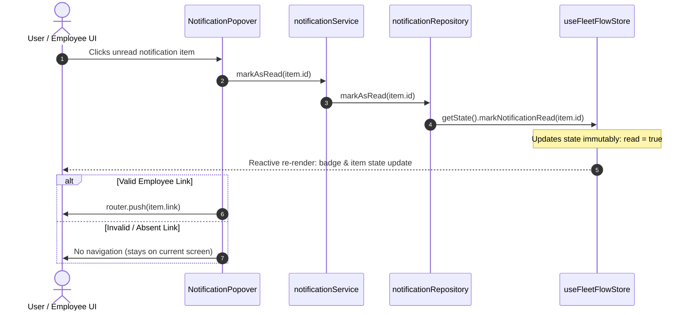
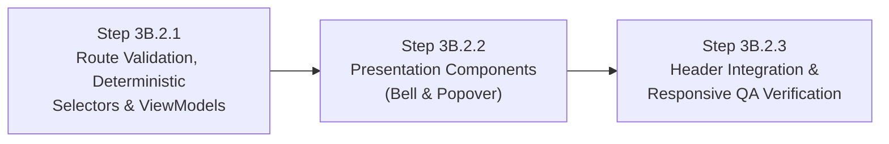

# FleetFlow — Phase 3B.2 Architecture Audit & Implementation Plan
## Notification Bell & Popover (Employee Portal)

**Document Version:** 1.2.1 (Final Architecture Specification & Contract Refinements)  
**Status:** DRAFT FOR CLIENT APPROVAL — PLANNING ONLY (NO IMPLEMENTATION AUTHORIZED)  
**Date:** November 2026  
**Author:** Senior Software Architect, Product Analyst & UX Engineer  
**Primary Reference:** `docs/reference/FleetFlow_Product_UX_Specification_and_Implementation_Blueprint.docx`  
**Binding Architecture Guidelines:** `AGENTS.md`, `docs/architecture/UNIFIED_UX_SPECIFICATION.md`, `docs/architecture/UI_UX_DESIGN_GUIDELINES.md`, `docs/reports/PHASE_3B_PLANNING_AND_GAP_ANALYSIS.md`

---

## 1. Executive Summary

### 1.1 Context and Scope
Step 3B.1 (Activity Timeline & Request Detail Integration) has been successfully implemented, audited, corrected for architectural compliance, and verified with 85 passing Vitest tests.

This document presents the finalized architectural audit and implementation plan for **Phase 3B.2: Notification Bell & Popover**. The objective is to design an employee-facing notification indicator and interactive popover/panel embedded directly within the responsive Employee application header (`src/app/employee/layout.tsx`).

In accordance with strict architectural governance and client instructions:
- **Scope Discipline:** Only confirmed Blueprint requirements are included in the mandatory initial implementation scope. "Mark all as read" is excluded from Step 3B.2 and documented as an architectural proposal for future enhancement.
- **Layered Architecture:** The strict architectural dependency chain is enforced:
  $$\text{UI Component} \longrightarrow \text{NotificationService} \longrightarrow \text{NotificationRepository} \longrightarrow \text{MockNotificationRepository} \longrightarrow \text{Zustand Store}$$
  UI components never invoke Zustand mutation actions directly.
- **Mandatory Deterministic Selectors:** All time-dependent view-model transformations require an explicit, mandatory `referenceTime` parameter (`string | Date | number`) to guarantee 100% deterministic, testable behavior without implicit system clock side-effects. The selector never calls `Date.now()` or `new Date()` internally to obtain the current time.
- **Precise Hydration-Controlled State Derivation:** Notification badge and personalized notification content remain suppressed until Zustand persistence hydration completes. Initial server and client rendering follows the established hydration-safe pattern (`isHydrated: false`). After hydration, notification data is derived strictly for the active `EMPLOYEE` persona.
- **Exact Mobile Viewport Clearance:** The mobile panel geometry strictly accounts for the Global Demo Toolbar ($28\text{px}$), sticky Employee Header ($48\text{px}$), docked Mobile Bottom Navigation ($64\text{px}$), and dynamic hardware safe-area insets (`env(safe-area-inset-bottom)`), preventing any overlap or clipping.

### 1.2 Core Capabilities Planned for Step 3B.2
1. **Header Notification Bell Trigger:** Viewport-adaptive bell icon button with high-contrast unread counter badge.
2. **Interactive Notification Popover / Panel:** Accessible floating dropdown (desktop/tablet) and viewport-anchored panel (mobile) displaying chronologically ordered in-app alerts.
3. **Safe Employee Deep-Link Navigation:** Strict route validation that permits only approved internal Employee request-detail routes (`/employee/requests/req_[id]`), rejecting external URLs, script injection, Admin routes, and Driver routes.
4. **Targeted Read Status Mutations via Service Layer:** Targeted mark-as-read interaction per unread notification routed strictly through `notificationService.markAsRead(id)`, preserving navigation on already-read notifications without redundant store mutations.
5. **Strict Persona Recipient Isolation:** Notifications are strictly filtered by `recipientId === currentUser.id`. Employee users will never see notifications intended for Administrative Dispatchers or Drivers.
6. **Hydration-Controlled State Derivation:** Follows the established `isHydrated` pattern; badge and content remain suppressed until Zustand persistence hydration completes, preventing unhydrated default persona data leakage.
7. **Deterministic Time Formatting via Mandatory `referenceTime`:** Pure selectors require a mandatory `referenceTime` parameter for relative timestamps, enabling reproducible unit testing and safe, documented fallback handling for invalid dates.
8. **Polished Empty State:** Clean, branded empty state using FleetFlow's `EmptyState` design component when no notifications exist for the active user.

> [!IMPORTANT]
> **Strict Planning-Only Authorization:** This document authorizes architecture inspection and planning ONLY. No application source code, styles, components, routes, stores, repositories, services, tests, dependencies, or configuration files are modified during this turn. Implementation will begin only upon explicit user approval of this plan.

---

## 2. Official Blueprint Requirements & Traceability

The authoritative product source of truth is `docs/reference/FleetFlow_Product_UX_Specification_and_Implementation_Blueprint.docx`. The document establishes the following binding mandates:

### 2.1 Confirmed Client Requirements (Blueprint Table 2.1)
- **Table 2.1 (Row 11):** *"Receive in-app notifications"* — Confirmed client requirement for employee tracking.

### 2.2 Functional Specifications (Blueprint Section 5.1 & Section 5.13)
- **Section 5.1 (Employee Dashboard):**
  > *"Show a welcome header, date, notifications, and a prominent Request a Vehicle action."*
- **Section 5.13 (Notifications):**
  > *"Generate in-app notifications for request submission, approval, rejection, driver assignment, assignment acceptance, pickup, trip start, drop-off, and completion. Store notifications locally with recipient and read/unread state. Email, SMS, and push notifications are out of scope."*

### 2.3 Domain Model & Service Definitions (Blueprint Section 7 & Section 13)
- **Section 7 (Entity Model):**
  > *"Notification: id, recipientId, title, message, read, createdAt"*  
  > *"Relationship: A user can receive multiple notifications."*
- **Section 10 (Component & Design System):**
  > *"Notification bell/panel shows unread badge and mark-as-read action."*
- **Section 13 (Feature Services):**
  > *"Notification Service: createNotification, getNotifications, markAsRead. Business logic belongs in feature services, not duplicated in UI components."*

### 2.4 Final Scope Prioritization (Blueprint Section 21)
- **Should Have:** Notifications and in-app alerts.
- **Explicitly Excluded:** Push notifications, Email, SMS, Real-time multi-user WebSockets, and External Notification Delivery APIs.

---

## 3. Mandatory Codebase Inspection & Layer Boundary Audit

### 3.1 Domain and Data Model (`src/types/domain.ts`)
- **Location:** Lines 123–132 of `src/types/domain.ts`.
- **Exact Schema:**
  ```typescript
  export interface Notification {
    id: string;              // e.g., 'notif_001'
    recipientId: string;     // References User.id
    title: string;           // Short title
    message: string;         // Descriptive message
    read: boolean;           // Read/unread flag
    createdAt: string;       // ISO 8601 string
    link?: string;           // Optional deep link route (e.g. '/employee/requests/req_002')
  }
  ```
- **Field Analysis:**
  - `id` (required, string): Unique identifier (`notif_...`).
  - `recipientId` (required, string): Matches `User.id` exactly (e.g. `usr_emp_01`, `usr_adm_01`, `usr_drv_01`).
  - `title` (required, string): Human-readable event title.
  - `message` (required, string): Narrative details.
  - `read` (required, boolean): State flag (`true` = read, `false` = unread).
  - `createdAt` (required, string): ISO 8601 creation timestamp.
  - `link` (optional, string): Deep-link navigation URL.
- **Navigation Reference Findings:**
  - `Notification` does **not** have a standalone `requestId` property.
  - Navigation targets are stored in `link?: string` (e.g., `/employee/requests/req_002`, `/admin/requests/req_001`, `/driver/trips/leg_003_out`).
  - Narrative messages frequently embed the request ID in text (e.g., `(req_001)`).
- **Scope Rule:** No new domain fields will be added to `Notification`.

### 3.2 Zustand Store (`src/stores/fleetflow-store.ts`)
- **Location:** Lines 29, 33, 56–57, 77, 81, 124–132, 144–157, 160.
- **State Inventory:**
  - `notifications: Notification[]`: Initialized from `initialSeedData.notifications`.
  - `isHydrated: boolean`: Flag tracking whether localStorage persist rehydration has completed.
  - `currentUserId: string`: Active demo persona ID.
- **Existing Actions / Mutations:**
  - `addNotification: (notification: Notification) => void`: Prepends to the notifications array (`[notification, ...state.notifications]`).
  - `markNotificationRead: (notificationId: string) => void`: Updates only the targeted record (`n.id === notificationId ? { ...n, read: true } : n`).
  - `createRequestBundle: (bundle: RequestBundle) => void`: Atomic bundle intake, prepending `bundle.notification`.
  - `resetData: () => void`: Resets state from `getSeedData()`, restoring the 5 initial demo notifications.
- **Layer Boundary Rule:**
  - `markNotificationRead` already exists in the store and works cleanly.
  - **Zero Store Changes for Step 3B.2:** Because bulk mark-as-read is removed from the initial scope, `src/stores/fleetflow-store.ts` requires **zero modifications** for Step 3B.2.
  - Application UI components must **never** call `useFleetFlowStore.getState().markNotificationRead(id)` directly. All mutations must flow through `NotificationService`.

### 3.3 Repository Layer (`src/repositories/`)
- **Interface:** `src/repositories/interfaces/notification-repository.interface.ts`:
  ```typescript
  export interface INotificationRepository {
    getAll(): Promise<Notification[]>;
    getByRecipientId(recipientId: string): Promise<Notification[]>;
    create(notification: Notification): Promise<Notification>;
    markAsRead(id: string): Promise<boolean>;
  }
  ```
- **Mock Implementation:** `src/repositories/mock/mock-notification-repository.ts`:
  - `getAll()`: Reads `[...useFleetFlowStore.getState().notifications]`.
  - `getByRecipientId(recipientId)`: Reads `useFleetFlowStore.getState().notifications.filter(n => n.recipientId === recipientId).map(n => ({ ...n }))`.
  - `create(notification)`: Dispatches `addNotification(notification)` to Zustand store.
  - `markAsRead(id)`: Dispatches `markNotificationRead(id)` to Zustand store.
- **Audit Findings:**
  - The repository layer cleanly encapsulates store access.
  - `markAsRead(id)` is already implemented, tested, and available.
  - No repository changes are required for Step 3B.2.

### 3.4 Service Layer (`src/services/notification-service.ts`)
- **Location:** Lines 1–34 of `src/services/notification-service.ts`.
- **Existing Implementation:**
  ```typescript
  export class NotificationService {
    async getNotifications(recipientId: string): Promise<Notification[]> {
      return notificationRepository.getByRecipientId(recipientId);
    }

    async createNotification(input: CreateNotificationInput): Promise<Notification> {
      const notification: Notification = {
        id: `notif_${Date.now()}`,
        recipientId: input.recipientId,
        title: input.title.trim(),
        message: input.message.trim(),
        read: false,
        createdAt: new Date().toISOString(),
        link: input.link,
      };
      return notificationRepository.create(notification);
    }

    async markAsRead(id: string): Promise<boolean> {
      return notificationRepository.markAsRead(id);
    }
  }

  export const notificationService = new NotificationService();
  ```
- **Layer Boundary Enforcement:**
  - `notificationService.markAsRead(id)` already exists and correctly delegates to `notificationRepository.markAsRead(id)`.
  - In Step 3B.2, the UI component calls `notificationService.markAsRead(id)`.
  - No service layer modifications are required for Step 3B.2.



---

## 4. Notification Generation Matrix across Existing Workflows

We audited every notification creation call site across all existing services and seed data to ensure complete domain compatibility:

| Workflow Event | Service & Call Site | Trigger Condition | Intended Recipient | Recipient Role | Notification Title | Deep Link Target | Implementation Status |
| :--- | :--- | :--- | :--- | :--- | :--- | :--- | :--- |
| **Request Submission** | `request-service.ts`<br/>(lines 153–171) | Employee submits new request form | `usr_adm_01` | **ADMIN** | `New Vehicle Request Submitted` | `/admin/requests/{requestId}` | **Implemented** *(Admin only; employee receives none)* |
| **Request Approval** | `request-service.ts`<br/>(lines 202–210) | Admin reviews & approves request | `request.requesterId` | **EMPLOYEE** | `Vehicle Request Approved` | `/employee/requests/{requestId}` | **Implemented** |
| **Request Rejection** | `request-service.ts`<br/>(lines 249–257) | Admin rejects request with reason | `request.requesterId` | **EMPLOYEE** | `Vehicle Request Rejected` | `/employee/requests/{requestId}` | **Implemented** |
| **Driver Assignment (Driver)** | `assignment-service.ts`<br/>(lines 239–247) | Admin dispatches vehicle & driver | `driver.userId` | **DRIVER** | `New Trip Leg Assignment` | `/driver/trips/{leg.id}` | **Implemented** *(Driver only)* |
| **Driver Assignment (Employee)** | `assignment-service.ts`<br/>(lines 249–257) | Admin dispatches vehicle & driver | `request.requesterId` | **EMPLOYEE** | `Driver and Vehicle Dispatched` | `/employee/requests/{request.id}` | **Implemented** |
| **Trip Accepted** | `trip-service.ts`<br/>(lines 62–70 via `acceptTrip`) | Driver accepts dispatch assignment | `request.requesterId` | **EMPLOYEE** | `Trip Update: TRIP ACCEPTED` | `/employee/requests/{request.id}` | **Implemented** |
| **Driver at Pickup** | `trip-service.ts`<br/>(lines 62–70 via `markArrivedAtPickup`) | Driver stages vehicle at pickup | `request.requesterId` | **EMPLOYEE** | `Trip Update: ARRIVED AT PICKUP` | `/employee/requests/{request.id}` | **Implemented** |
| **Passengers Boarded** | `trip-service.ts`<br/>(lines 62–70 via `confirmPickup`) | Driver confirms passenger boarding | `request.requesterId` | **EMPLOYEE** | `Trip Update: PASSENGERS PICKED UP` | `/employee/requests/{request.id}` | **Implemented** |
| **Trip Started** | `trip-service.ts`<br/>(lines 62–70 via `startTrip`) | Driver begins transit | `request.requesterId` | **EMPLOYEE** | `Trip Update: TRIP STARTED` | `/employee/requests/{request.id}` | **Implemented** |
| **Passengers Dropped Off** | `trip-service.ts`<br/>(lines 62–70 via `confirmDropoff`) | Driver confirms destination arrival | `request.requesterId` | **EMPLOYEE** | `Trip Update: PASSENGERS DROPPED OFF` | `/employee/requests/{request.id}` | **Implemented** |
| **Trip Leg Completed** | `trip-service.ts`<br/>(lines 62–70 via `completeTrip`) | Driver finalizes trip leg | `request.requesterId` | **EMPLOYEE** | `Trip Update: TRIP LEG COMPLETED` | `/employee/requests/{request.id}` | **Implemented** |
| **Request Full Completion** | `trip-service.ts`<br/>(lines 122–130 via `handleTripLegCompletion`)| All required trip legs completed | `request.requesterId` | **EMPLOYEE** | `Transportation Request Completed` | `/employee/requests/{request.id}` | **Implemented** |
| **Request Cancellation** | `request-service.ts`<br/>(lines 262–296 via `cancelRequest`)| Employee cancels PENDING request | *None* | *None* | *None* | *None* | **Not Implemented** *(ActivityLog is created, but no notification is generated)* |

---

## 5. Employee Persona Isolation & Seed Data Audit

### 5.1 Seed Data Inventory (`src/data/seed/seed-data.ts`, lines 760–813)
The initial seed dataset contains exactly 5 notifications distributed across distinct user roles:

| Notification ID | Recipient ID | Recipient Name | User Role | Status | Title | Deep Link |
| :--- | :--- | :--- | :--- | :--- | :--- | :--- |
| `notif_001` | `usr_adm_01` | Alex Morgan | **ADMIN** | Unread (`read: false`) | New Vehicle Request Submitted | `/admin/requests/req_001` |
| `notif_002` | `usr_emp_02` | David Chen | **EMPLOYEE** | Unread (`read: false`) | Vehicle Request Approved | `/employee/requests/req_002` |
| `notif_003` | `usr_drv_01` | Marcus Vance | **DRIVER** | Unread (`read: false`) | New Trip Assignment | `/driver/trips/leg_003_out` |
| `notif_004` | `usr_emp_01` | Sarah Jenkins | **EMPLOYEE** | Read (`read: true`) | Driver En Route | `/employee/requests/req_004` |
| `notif_005` | `usr_emp_03` | Emily Rodriguez | **EMPLOYEE** | Read (`read: true`) | Vehicle Request Rejected | `/employee/requests/req_009` |

### 5.2 Persona Isolation Requirements
- When **Sarah Jenkins (`usr_emp_01`)** is active:
  - Total Notifications: **1** (`notif_004`).
  - Unread Count: **0**.
  - Bell Badge: **Hidden**.
- When **David Chen (`usr_emp_02`)** is active:
  - Total Notifications: **1** (`notif_002`).
  - Unread Count: **1**.
  - Bell Badge: **Displays "1"** with high-visibility accent.
- When **Emily Rodriguez (`usr_emp_03`)** is active:
  - Total Notifications: **1** (`notif_005`).
  - Unread Count: **0**.
  - Bell Badge: **Hidden**.
- **Security & Data Isolation Rule:**
  Notifications for `usr_adm_01` (Admin) and `usr_drv_01` (Driver) must **never** be rendered in the Employee Portal header or popover. The selector must strictly filter `notification.recipientId === currentUser.id`. Switching personas in the Global Demo Toolbar must instantly recalculate and render the active employee's isolated alerts.

---

## 6. Refined Architecture & Behavioral Specifications

### 6.1 Safe Employee Deep-Link Navigation Strategy

#### Route Validation Strategy
We define a pure, deterministic validation helper:
```typescript
/**
 * Strictly validates that a navigation link belongs to an authorized
 * Employee internal request-detail route.
 * Rejects external URLs, protocol-relative links, script injection,
 * and Admin/Driver routes.
 * Approved Pattern: /employee/requests/req_[a-zA-Z0-9_-]+
 */
export function isValidEmployeeRequestLink(link?: string | null): boolean {
  if (!link || typeof link !== 'string') return false;
  const trimmed = link.trim();
  const employeeRequestRegex = /^\/employee\/requests\/req_[a-zA-Z0-9_\-]+$/;
  return employeeRequestRegex.test(trimmed);
}
```

#### Click & Read-State Interaction Lifecycle
1. **Unread Notification Clicked:**
   - If `!item.read`, invoke `notificationService.markAsRead(item.id)`.
   - If `isValidEmployeeRequestLink(item.link)` is `true`:
     - Close the notification popover (`onClose()`).
     - Execute client navigation: `router.push(item.link!)`.
   - If `isValidEmployeeRequestLink(item.link)` is `false` or `link` is undefined:
     - The notification is marked as read via service, but **no navigation occurs**.
2. **Already-Read Notification Clicked:**
   - If `item.read` is `true`:
     - Do **not** invoke `notificationService.markAsRead` (avoids redundant store mutation and re-render).
     - If `isValidEmployeeRequestLink(item.link)` is `true`:
       - Close the popover and navigate: `router.push(item.link!)`.
     - If invalid or absent, do nothing.

#### Explicit Route Validation Test Cases:
- `"/employee/requests/req_002"` $\to$ **Valid** (navigates).
- `"/employee/requests/req_dtl_01"` $\to$ **Valid** (navigates).
- `"/admin/requests/req_001"` $\to$ **Rejected** (no navigation; marked read if unread).
- `"/driver/trips/leg_003_out"` $\to$ **Rejected** (no navigation; marked read if unread).
- `"https://malicious-external-site.com"` $\to$ **Rejected** (no navigation).
- `"//evil.com/phish"` $\to$ **Rejected** (no navigation).
- `"javascript:alert(1)"` $\to$ **Rejected** (no navigation).
- `undefined` or `null` $\to$ **Rejected** (no navigation).
- `""` (empty string) $\to$ **Rejected** (no navigation).

---

### 6.2 Correct Mobile Panel Positioning & Shell Clearance

#### Shell Geometry & Viewport Dimensions
The application shell layout (`src/app/employee/layout.tsx` lines 56–61) establishes:
- **Global Demo Toolbar:** Height = `28px` (`h-7`) on mobile, `36px` (`h-9`) on tablet/desktop.
- **Sticky Employee Header:** Positioned at `sticky top-7 md:top-9 z-40`, height = `48px` (`h-12`) on mobile, `56px` (`h-14`) on tablet, `64px` (`h-16`) on desktop.
- **Mobile Bottom Navigation (`MobileBottomNav`):** Rendered docked at bottom, height = `64px` (`h-16` / `4rem`) + `env(safe-area-inset-bottom)`.

```
Viewport Top (0px)
┌────────────────────────────────────────────────────────────────────────┐
│ Global Demo Toolbar (h-7 = 28px)                                       │
├────────────────────────────────────────────────────────────────────────┤  ◄── Top of Header: top-7 (28px)
│ Sticky Header (h-12 = 48px)                                            │
│ [Brand]                                          [Bell Trigger] [User] │
├────────────────────────────────────────────────────────────────────────┤  ◄── Bottom of Header: 28px + 48px = 76px
│ 4px Visual Gap                                                         │
├────────────────────────────────────────────────────────────────────────┤  ◄── Panel Top: top-[80px]
│                                                                        │
│  Notification Popover / Panel (Mobile Anchored)                        │
│  Fixed: top-[80px]  left-2  right-2                                    │
│  Layout: flex flex-col                                                 │
│  Header: flex-shrink-0 (Notifications Title, Unread Count, Close)      │
│  Body: flex-1 overflow-y-auto overscroll-contain                       │
│                                                                        │
├────────────────────────────────────────────────────────────────────────┤  ◄── Panel Bottom
│ 8px Visual Gap                                                         │
├────────────────────────────────────────────────────────────────────────┤  ◄── Bottom Clearance: calc(4rem + env(safe-area-inset-bottom, 0px) + 8px)
│ Docked Mobile Bottom Navigation (h-16 = 64px / 4rem)                   │
├────────────────────────────────────────────────────────────────────────┤
│ Hardware Safe-Area Inset: env(safe-area-inset-bottom) (0px to 34px)   │
└────────────────────────────────────────────────────────────────────────┘
```

#### Why a Fixed `bottom-20` is Defective & Inconsistent
1. `bottom-20` in Tailwind represents `5rem` = $80\text{px}$ (not $72\text{px}$).
2. On modern mobile devices (e.g., iPhone 12/13/14/15/16 Pro), `env(safe-area-inset-bottom)` is $34\text{px}$.
3. When `MobileBottomNav` renders `h-16 pb-[env(safe-area-inset-bottom)]`, its total height from the bottom of the viewport is:
   $$\text{Total Nav Height} = 64\text{px} + 34\text{px} = 98\text{px}$$
4. A static `bottom-20` ($80\text{px}$) would place the panel bottom edge **underneath** the bottom navigation bar by $18\text{px}$, causing severe UI overlap and obscuring notifications!

#### Correct Mathematical Formula for Panel Placement:
$$\text{Top Offset} = 28\text{px (toolbar)} + 48\text{px (header)} + 4\text{px (gap)} = 80\text{px} \implies \texttt{top-[80px]}$$
$$\text{Bottom Offset} = \text{calc}(4\text{rem} + \text{env}(\text{safe-area-inset-bottom}, 0\text{px}) + 8\text{px}) \implies \texttt{bottom-[calc(4rem+env(safe-area-inset-bottom,0px)+8px)]}$$
$$\text{Horizontal Margins} = \texttt{left-2 right-2} \quad (8\text{px margins on each side})$$

#### Responsive Viewport Alignment Matrix:
1. **Desktop & Tablet Viewports ($\ge 768\text{px}$):**
   - Popover is positioned as an anchored dropdown directly below the bell trigger:
     `md:absolute md:top-full md:right-0 md:mt-2 md:w-[380px] md:max-h-[480px] md:shadow-lg md:rounded-xl md:border md:bg-card`.
   - Never overlaps header controls or the demo toolbar.
2. **Compact Mobile Viewports ($< 768\text{px}$, down to $360\text{px}$):**
   - Panel is anchored with `fixed top-[80px] left-2 right-2 bottom-[calc(4rem+env(safe-area-inset-bottom,0px)+8px)] z-50`.
   - The header and bell trigger remain fully visible at all times.
   - The panel content is structured as:
     - Header: `flex-shrink-0 px-4 py-3 border-b border-border flex items-center justify-between`.
     - Body: `flex-1 overflow-y-auto overscroll-contain p-2 divide-y divide-border/40`.
     - Empty State: Centered in `flex-1`.

#### Viewport-Specific Verification Matrix:

| Viewport | Device Profile | Dimensions | Safe-Area Bottom | Top Offset | Bottom Offset | Usable Panel Height | Scroll Behavior | Overlap Status |
| :--- | :--- | :--- | :--- | :--- | :--- | :--- | :--- | :--- |
| **360×640** | Compact Android / Galaxy S | $360\text{px} \times 640\text{px}$ | $0\text{px}$ | $80\text{px}$ | $72\text{px}$ ($64+8$) | $488\text{px}$ | Body scrolls internally if $> 3$ alerts | **Zero Overlap** (4px gap top, 8px gap bottom) |
| **390×844** | Modern iPhone (12–16) | $390\text{px} \times 844\text{px}$ | $34\text{px}$ | $80\text{px}$ | $106\text{px}$ ($64+34+8$) | $658\text{px}$ | Body scrolls internally if $> 5$ alerts | **Zero Overlap** (Panel ends 8px above bottom nav) |
| **768×1024**| iPad Mini / Tablet Portrait | $768\text{px} \times 1024\text{px}$| $0\text{px}$ | Dropdown below bell | N/A (Floating) | Max $480\text{px}$ | Dropdown list scrolls if $> 4$ alerts | **Zero Overlap** (Anchored to trigger) |
| **1440×900**| Desktop Standard | $1440\text{px} \times 900\text{px}$ | $0\text{px}$ | Dropdown below bell | N/A (Floating) | Max $480\text{px}$ | Dropdown list scrolls if $> 4$ alerts | **Zero Overlap** (Anchored to trigger) |

---

### 6.3 Zustand Persist Hydration-Safe State Derivation

#### The Architectural Context
Zustand persist middleware stores state in `window.localStorage`. On the initial Server-Side Render (SSR) and the initial client render pass prior to hydration:
- State evaluates using initial seed defaults (`initialSeedData`), where default `currentUserId = 'usr_adm_01'` (Admin) and `isHydrated: false`.
- If notification selectors were to execute unconditionally against unhydrated state, an employee page could briefly read default persona notifications or flash unread badges before localStorage is read.

#### Precise, Verifiable Hydration Behavior
Following the existing hydration-safe pattern established by `EmployeeAuthGuard`:
1. **Store Subscription:** The layout subscribes to:
   ```typescript
   const isHydrated = useFleetFlowStore((s) => s.isHydrated);
   const currentUserId = useFleetFlowStore((s) => s.currentUserId);
   const notifications = useFleetFlowStore((s) => s.notifications);
   const users = useFleetFlowStore((s) => s.users);
   ```
2. **Hydration-Guarded Derivation:**
   ```typescript
   // Only derive employee alerts when the store is hydrated and active user is an EMPLOYEE
   const currentUser = users.find((u) => u.id === currentUserId);
   const isEmployeeActive = isHydrated && currentUser?.role === 'EMPLOYEE';

   // Reference instant explicitly provided by the UI caller
   const [referenceTime] = React.useState<Date>(() => new Date());

   const unreadCount = React.useMemo(() => {
     if (!isEmployeeActive) return 0;
     return selectUnreadNotificationCount(notifications, currentUserId);
   }, [isEmployeeActive, notifications, currentUserId]);

   const userNotifications = React.useMemo(() => {
     if (!isEmployeeActive) return [];
     return selectEmployeeNotifications(notifications, currentUserId, referenceTime);
   }, [isEmployeeActive, notifications, currentUserId, referenceTime]);
   ```
3. **Verifiable Hydration Guarantees:**
   - **Pre-Hydration Content Suppression:** While `isHydrated: false` (during SSR and initial client mount prior to localStorage read), `unreadCount` evaluates to `0` and `userNotifications` evaluates to `[]`. The unread badge remains completely hidden, and personalized notifications remain suppressed.
   - **Post-Hydration Persona Isolation:** When `isHydrated: true`, notification data is derived only if the hydrated user has the `EMPLOYEE` role. If the active persona is an Admin (`usr_adm_01`) or Driver (`usr_drv_01`), employee notifications remain suppressed (`unreadCount = 0`, `userNotifications = []`).
   - **Persona Switch Reactivity:** When the persona is switched in the Global Demo Toolbar, `currentUserId` updates in the store, triggering reactive re-derivation for the new active user.
   - **Demo Reset Reactivity:** When `resetData()` is invoked, `notifications` resets to initial seed data, and notification counts/items update reactively.

---

### 6.4 Deterministic Selector & Transformation Architecture

Pure selectors must be mathematically deterministic. Relative time calculations (`"2 hours ago"`, `"yesterday"`) depend on a reference point in time. If a selector implicitly calls `new Date()` or `Date.now()`, the selector is no longer pure, making automated unit tests prone to time drift and clock flakiness.

#### Selector Design Specifications:
1. **Mandatory `referenceTime` Parameter:**
   `selectEmployeeNotifications(notifications, recipientId, referenceTime)` requires an explicit `referenceTime: string | Date | number`.
   - The selector **never** calls `Date.now()` or `new Date()` to obtain the current time internally.
   - The UI caller must explicitly supply the reference instant (e.g. `const [referenceTime] = React.useState(() => new Date())` or a state timestamp).
   - Unit tests must supply fixed reference instants (e.g. `const FIXED_REFERENCE_TIME = '2026-11-24T12:00:00.000Z'`).
2. **Deterministic Failure Policy for Invalid `referenceTime`:**
   If `referenceTime` is invalid, unparseable, null, undefined, or empty (i.e. `isNaN(new Date(referenceTime).getTime())`):
   - The selector will **never throw or crash**.
   - Relative time calculations safely degrade to the fallback string `'—'`.
   - Absolute date formatting (`displayDateTime`) continues to format `n.createdAt` independently if `n.createdAt` is a valid date.
   - Deterministic sorting by `createdAt` and ID tie-breaking remains fully functional.
3. **Invalid Notification Timestamp Policy:**
   If `n.createdAt` is missing, unparseable, or invalid:
   - Does not throw or crash.
   - Both `relativeTime` and `displayDateTime` evaluate to `'—'`.
   - Sorting treats the invalid timestamp as `0`, placing it at the bottom of the list.
4. **Deterministic Tie-Breaking:**
   When two notifications have identical timestamps, sorting falls back to descending alphabetical ID comparison: `(b.id || '').localeCompare(a.id || '')`.
5. **Immutability Guarantee:**
   Input arrays and notification entity objects are never mutated. All operations work on shallow clones (`[...userAlerts]`).

#### Complete TypeScript Implementation Signature:
```typescript
/**
 * Selects, filters, and transforms in-app notifications for the active employee.
 * Strictly isolates recipient notifications, orders them newest-first with
 * deterministic tie-breaking, validates deep links, and formats timestamps.
 * 
 * @param notifications Raw notifications array from Zustand store
 * @param recipientId Active user ID (e.g. 'usr_emp_01')
 * @param referenceTime Mandatory reference instant for relative time calculations
 */
export function selectEmployeeNotifications(
  notifications: Notification[],
  recipientId: string,
  referenceTime: string | Date | number
): NotificationViewModel[] {
  if (!Array.isArray(notifications) || !recipientId) return [];

  const userAlerts = notifications.filter(
    (n) => n && n.recipientId === recipientId
  );

  const sorted = [...userAlerts].sort((a, b) => {
    const timeA = new Date(a.createdAt).getTime();
    const timeB = new Date(b.createdAt).getTime();
    const safeA = isNaN(timeA) ? 0 : timeA;
    const safeB = isNaN(timeB) ? 0 : timeB;
    if (safeB !== safeA) {
      return safeB - safeA;
    }
    return (b.id || '').localeCompare(a.id || '');
  });

  return sorted.map((n) => {
    const hasValidLink = isValidEmployeeRequestLink(n.link);
    const createdDate = new Date(n.createdAt);
    const isValidDate = !isNaN(createdDate.getTime());

    return {
      id: n.id,
      recipientId: n.recipientId,
      title: n.title,
      message: n.message,
      read: Boolean(n.read),
      createdAt: n.createdAt,
      relativeTime: isValidDate
        ? calculateRelativeTime(n.createdAt, referenceTime)
        : '—',
      displayDateTime: isValidDate
        ? formatDisplayDateTime(n.createdAt)
        : '—',
      link: hasValidLink ? n.link : undefined,
      hasValidLink,
    };
  });
}

/**
 * Deterministically computes relative time against an explicit reference instant.
 * NEVER calls Date.now() or new Date() to get the current time.
 * If referenceTime is invalid (e.g. isNaN), returns '—' as deterministic failure policy.
 */
export function calculateRelativeTime(
  isoStr: string,
  referenceTime: string | Date | number
): string {
  if (!isoStr || referenceTime == null) return '—';
  const targetDate = new Date(isoStr);
  const refDate = new Date(referenceTime);
  const targetMs = targetDate.getTime();
  const refMs = refDate.getTime();

  // Deterministic failure policy: if reference instant or target instant is unparseable
  if (isNaN(targetMs) || isNaN(refMs)) {
    return '—';
  }

  const diffMs = targetMs - refMs;
  const diffMinutes = Math.round(diffMs / (1000 * 60));
  const diffHours = Math.round(diffMs / (1000 * 60 * 60));
  const diffDays = Math.round(diffMs / (1000 * 60 * 60 * 24));

  const rtf = new Intl.RelativeTimeFormat('en', { numeric: 'auto' });
  if (Math.abs(diffMinutes) < 1) {
    return 'just now';
  }
  if (Math.abs(diffMinutes) < 60) {
    return rtf.format(diffMinutes, 'minute');
  }
  if (Math.abs(diffHours) < 24) {
    return rtf.format(diffHours, 'hour');
  }
  return rtf.format(diffDays, 'day');
}

/**
 * Counts unread notifications strictly for the active recipient.
 */
export function selectUnreadNotificationCount(
  notifications: Notification[],
  recipientId: string
): number {
  if (!Array.isArray(notifications) || !recipientId) return 0;
  return notifications.reduce((count, n) => {
    if (n && n.recipientId === recipientId && !n.read) {
      return count + 1;
    }
    return count;
  }, 0);
}
```

---

## 7. Product & UX Requirements Classification

Every capability is classified according to official product governance:

| Item | Requirement / Behavior | Governance Classification | Justification / Source |
| :--- | :--- | :--- | :--- |
| **1** | Notification bell in Employee header | **Blueprint Requirement** | Blueprint Sec 5.1 & Sec 10 explicitly specify header notifications and bell. |
| **2** | Unread notification count badge | **Blueprint Requirement** | Blueprint Sec 10 specifies: *"Notification bell/panel shows unread badge"*. |
| **3** | Employee-specific notification list | **Blueprint Requirement** | Blueprint Sec 5.13 mandates local storage with recipient isolation. |
| **4** | Mark notification as read on click | **Blueprint Requirement** | Blueprint Sec 10 explicitly mandates mark-as-read interaction via feature service. |
| **5** | Deep-link routing to related request | **Blueprint Requirement** | Notifications link directly to `/employee/requests/[id]` per seed data and service logic. |
| **6** | Visual distinction between Read and Unread | **Blueprint Requirement** | Blueprint Sec 5.13 requires tracking read/unread state. |
| **7** | Responsive interaction (Desktop, Tablet, Mobile) | **Blueprint Requirement** | Blueprint Sec 18.3 & AGENTS.md Rule 11 mandate responsive testing down to 360px. |
| **8** | Persona isolation (no Admin/Driver leakage) | **Blueprint Requirement** | Strict domain requirement: recipient isolation prevents privilege and context leaks. |
| **9** | Safe route validation (rejecting external/admin links) | **Recommended UX Decision** | Defense-in-depth security best practice; prevents broken navigation or protocol injection. |
| **10** | Deterministic selector with mandatory `referenceTime` | **Recommended UX Decision** | Pure functional contract: requires explicit reference instant from caller; eliminates internal clock side-effects. |
| **11** | Newest-first chronological ordering with tie-breaker | **Recommended UX Decision** | Standard enterprise UX convention; ensures actionable alerts appear at the top. |
| **12** | Empty state when 0 notifications exist | **Recommended UX Decision** | Conforms to FleetFlow empty-state design token standard (`EmptyState` component). |
| **13** | Keyboard navigation & focus restoration | **Recommended UX Decision** | WCAG 2.1 AA requirement: Escape closes popover, focus returns to bell button. |
| **14** | Mobile panel with dynamic safe-area clearance | **Recommended UX Decision** | Eliminates UI overlap with 64px bottom nav + home indicators on iPhone/Android. |
| **15** | "Mark all as read" bulk action | **Future Enhancement (Deferred)** | **EXCLUDED FROM STEP 3B.2 SCOPE.** Documented as an optional future architecture proposal. |

---

## 8. Proposed Exact File Change List for Step 3B.2

### New Files to Create:
1. [`src/features/notifications/types/view-models.ts`](file:///c:/Projects/Level-2/FleetFlow-Company-Vehicle-Management/src/features/notifications/types/view-models.ts):
   - Defines `NotificationViewModel`:
     ```typescript
     export interface NotificationViewModel {
       id: string;
       recipientId: string;
       title: string;
       message: string;
       read: boolean;
       createdAt: string;
       relativeTime: string;
       displayDateTime: string;
       link?: string;
       hasValidLink: boolean;
     }
     ```
2. [`src/features/notifications/selectors/notification-selectors.ts`](file:///c:/Projects/Level-2/FleetFlow-Company-Vehicle-Management/src/features/notifications/selectors/notification-selectors.ts):
   - Pure deterministic selectors:
     - `selectEmployeeNotifications(notifications, recipientId, referenceTime)`
     - `selectUnreadNotificationCount(notifications, recipientId)`
     - `isValidEmployeeRequestLink(link)`
   - Pure sorting: descending by `createdAt`, with ID tie-breaker.
   - Safe timestamp formatting with mandatory `referenceTime` parameter and invalid date fallback policy.
3. [`src/features/notifications/components/notification-bell.tsx`](file:///c:/Projects/Level-2/FleetFlow-Company-Vehicle-Management/src/features/notifications/components/notification-bell.tsx):
   - Dumb presentation component for the header bell button with badge. Exposes `count`, `isOpen`, `onClick`.
4. [`src/features/notifications/components/notification-popover.tsx`](file:///c:/Projects/Level-2/FleetFlow-Company-Vehicle-Management/src/features/notifications/components/notification-popover.tsx):
   - Accessible floating/viewport-anchored panel displaying notification list, unread indicators, mark-as-read triggers, deep-link navigation, and empty states.
   - Dynamic mobile safe-area bottom offset.
5. [`src/features/notifications/selectors/__tests__/notification-selectors.test.ts`](file:///c:/Projects/Level-2/FleetFlow-Company-Vehicle-Management/src/features/notifications/selectors/__tests__/notification-selectors.test.ts):
   - Comprehensive unit tests for route validation, persona isolation, unread counting, deterministic sorting, fixed reference time formatting, invalid reference time failure policy, and non-mutation.
6. [`src/features/notifications/components/__tests__/notification-popover.test.tsx`](file:///c:/Projects/Level-2/FleetFlow-Company-Vehicle-Management/src/features/notifications/components/__tests__/notification-popover.test.tsx):
   - Component tests for popover rendering, empty states, keyboard dismissal, deep-link navigation, and service delegation for individual mark-as-read.

### Existing Files to Modify:
1. [`src/app/employee/layout.tsx`](file:///c:/Projects/Level-2/FleetFlow-Company-Vehicle-Management/src/app/employee/layout.tsx):
   - Subscribe to notifications slice, active user ID, and `isHydrated`.
   - Wire `NotificationBell` into the header action clusters across desktop, tablet, and mobile.
   - Wire `NotificationPopover` with safe positioning and clearance.
   - Implement `handleMarkAsRead` invoking `notificationService.markAsRead(id)`.
   - Provide explicit `referenceTime` state to `selectEmployeeNotifications`.

> [!NOTE]
> **Zero Store & Service Modifications Required:** Because individual `markAsRead` is already implemented across `NotificationService`, `MockNotificationRepository`, and `useFleetFlowStore`, and because bulk mark-as-read is excluded from the initial scope, no existing stores or services need to be modified.

---

## 9. Implementation Sequence Broken into Small Steps

Following the project rule of working on one small reviewable step at a time:



### Step 3B.2.1 — Route Validation, Deterministic Selectors & ViewModels
1. Create `src/features/notifications/types/view-models.ts` with `NotificationViewModel`.
2. Create `src/features/notifications/selectors/notification-selectors.ts` with pure deterministic selectors (`selectEmployeeNotifications(notifications, recipientId, referenceTime)`, `selectUnreadNotificationCount`, `isValidEmployeeRequestLink`).
3. Write unit tests in `src/features/notifications/selectors/__tests__/notification-selectors.test.ts` covering:
   - Valid internal request links vs. rejected external/admin/driver routes.
   - Persona isolation across Employee, Admin, and Driver.
   - Unread counting and newest-first chronological sorting with tie-breaker.
   - Deterministic relative time calculation with fixed `referenceTime`.
   - Deterministic failure policy: safe fallback to `'—'` when `referenceTime` is invalid or missing.
   - Safe fallback on invalid or missing notification timestamps.
   - Non-mutation of input arrays.
4. Verify tests pass (`npm test`). Stop and report results for Step 3B.2.1 approval.

### Step 3B.2.2 — Presentation Components (`NotificationBell` & `NotificationPopover`)
1. Create `src/features/notifications/components/notification-bell.tsx` with accessible ARIA attributes, touch-target sizing, and unread badge logic.
2. Create `src/features/notifications/components/notification-popover.tsx`:
   - Incorporates route validation on item click.
   - Invokes `onMarkAsRead(item.id)` only when unread (`!item.read`).
   - Navigates on valid link whether already read or newly marked read.
   - Click-outside listener and `Escape` key dismissal.
   - Full-width mobile positioning with `top-[80px]` and dynamic `bottom-[calc(4rem+env(safe-area-inset-bottom,0px)+8px)]`.
   - Internal vertical scrolling (`flex-1 overflow-y-auto overscroll-contain`) on short viewports.
   - Clean `EmptyState` when items array is empty.
3. Write component unit tests in `src/features/notifications/components/__tests__/notification-popover.test.tsx`.
4. Verify tests pass (`npm test`). Stop and report results for Step 3B.2.2 approval.

### Step 3B.2.3 — Header Integration & Responsive QA
1. Integrate `NotificationBell` and `NotificationPopover` into `src/app/employee/layout.tsx` across desktop, tablet, and mobile header slots.
2. Wire hydration-safe store subscription (`isHydrated`, `currentUserId`, `notifications`).
3. Supply explicit `referenceTime` instant from component state to `selectEmployeeNotifications`.
4. Wire individual mark-as-read handler calling `notificationService.markAsRead(id)`.
5. Verify responsive layout at 360px, 390px, 768px, and 1440px without horizontal overflow or collision with mobile bottom nav.
6. Run full test suite, TypeScript compilation (`tsc --noEmit`), and production build (`next build`).

---

## 10. Scenario-Based Test Plan & Edge-Case Coverage

The test suite must cover the following scenarios:

### 10.1 Selector & Route Validation Unit Tests
1. **Valid Employee Request Links:**
   - Input: `"/employee/requests/req_002"`, `"/employee/requests/req_dtl_01"`.
   - Result: `isValidEmployeeRequestLink` returns `true`.
2. **Rejection of Admin and Driver Routes:**
   - Input: `"/admin/requests/req_001"`, `"/driver/trips/leg_003_out"`.
   - Result: `isValidEmployeeRequestLink` returns `false`.
3. **Rejection of External & Insecure URLs:**
   - Input: `"https://malicious.com"`, `"//evil.com"`, `"javascript:alert(1)"`, `"data:text/html,..."`.
   - Result: `isValidEmployeeRequestLink` returns `false`.
4. **Missing or Malformed Link Handling:**
   - Input: `undefined`, `null`, `""`, `"/employee/requests/"` (missing ID), `"/employee/dashboard"`.
   - Result: `isValidEmployeeRequestLink` returns `false`.
5. **Persona Isolation & Filtering:**
   - Given a notification array containing records for `usr_emp_01`, `usr_adm_01`, and `usr_drv_01`.
   - When active user is `usr_emp_01`, only notifications with `recipientId === 'usr_emp_01'` are returned.
6. **Unread Count Accuracy:**
   - Accurately counts alerts where `recipientId === activeUserId && !read`.
   - Returns `0` when all notifications are read or when array is empty.
7. **Descending Chronological Sorting & Deterministic Tie-Breaker:**
   - Sorts newest first by `createdAt`.
   - Uses `(b.id || '').localeCompare(a.id || '')` as deterministic tie-breaker for identical timestamps.
8. **Deterministic Time Formatting via Mandatory Fixed Reference Time:**
   - Fixed `referenceTime = '2026-11-24T12:00:00.000Z'`.
   - Event at `'2026-11-24T10:00:00.000Z'` produces relative time `"2 hours ago"`.
   - Selector never calls `Date.now()` internally; output is 100% reproducible.
9. **Deterministic Failure Policy for Invalid `referenceTime`:**
   - When `referenceTime` is `'invalid-date'`, `NaN`, `null`, or unparseable:
   - Selector does not crash; returns `relativeTime: '—'`.
   - Absolute `displayDateTime` still renders if `createdAt` is valid.
10. **Safe Fallback for Invalid Notification Timestamps:**
    - Given invalid ISO strings (e.g. `"not-a-date"`, `""`, `null`).
    - Selector returns `relativeTime: '—'`, `displayDateTime: '—'`.
    - Sorting treats invalid timestamp as `0`, placing it at the bottom.
11. **Non-Mutation of Source Data:**
    - Verifies input arrays and entity objects are not mutated (`Object.freeze` verified).

### 10.2 Component & Interaction Tests
1. **Unread Notification Click:**
   - Invokes `onMarkAsRead(item.id)`.
   - Verifies handler calls `notificationService.markAsRead(item.id)`.
   - If link is valid, closes popover and invokes `router.push(item.link)`.
2. **Already-Read Notification Click:**
   - Does **not** invoke `onMarkAsRead`.
   - If link is valid, closes popover and invokes `router.push(item.link)`.
3. **Click on Notification with Missing / Invalid Link:**
   - If unread, marks as read.
   - Does **not** invoke `router.push`.
4. **Empty State Display:**
   - Renders `EmptyState` ("No Notifications", "You're all caught up") when `items.length === 0`.
5. **Keyboard Dismissal & Accessibility:**
   - Pressing `Escape` invokes `onClose()`.
   - Focus is restored to the trigger button upon close.
   - Trigger exposes correct `aria-label` including current unread count.
6. **Hydration-Controlled Derivation & Persona Switching:**
   - When `isHydrated: false`, badge is hidden and notifications array is empty, keeping content suppressed.
   - When `isHydrated: true`, notifications are derived only for the active employee.
   - Switching `currentUserId` immediately updates the rendered alerts and badge count.
7. **Responsive Geometry & Viewport Measurements:**
   - Mobile viewports ($< 768\text{px}$) render panel below $76\text{px}$ header and clear $64\text{px}$ bottom nav.
   - Zero horizontal overflow on $360\text{px}$ viewport.

---

## 11. Step 3B.2 Acceptance Criteria

Upon implementation approval, Step 3B.2 will be accepted if and only if:
- [ ] Notification bell is visible in the Employee header across desktop, tablet, and mobile viewports.
- [ ] High-contrast badge accurately shows the unread notification count for the active employee.
- [ ] When all notifications are read or when the store has not yet hydrated (`isHydrated: false`), the unread badge is cleanly hidden.
- [ ] Notification badge and personalized notification content remain suppressed until Zustand persistence hydration completes.
- [ ] After hydration completes (`isHydrated: true`), notification data is derived strictly for the active `EMPLOYEE` persona.
- [ ] Persona switching in the Global Demo Toolbar and demo reset (`resetData()`) update notification data reactively.
- [ ] Clicking the bell toggles an accessible popover/panel.
- [ ] Only notifications matching `recipientId === currentUser.id` are displayed; Admin and Driver alerts are strictly excluded.
- [ ] Notifications are ordered chronologically with newest first, using ID as tie-breaker.
- [ ] Read and unread notifications are visually distinguished.
- [ ] Individual mark-as-read interaction is routed strictly through `notificationService.markAsRead(id)`.
- [ ] Clicking an unread notification with an approved employee link marks it as read and routes to `/employee/requests/[id]`.
- [ ] Clicking an already-read notification with an approved link navigates without redundant service/store mutations.
- [ ] Clicking a notification with a missing, invalid, external, or admin/driver link marks it as read (if unread) but prevents navigation.
- [ ] Selectors require a mandatory `referenceTime: string | Date | number` parameter and produce 100% deterministic relative time outputs without internal `Date.now()` calls.
- [ ] Invalid `referenceTime` values adhere to the documented failure policy (safe fallback to `'—'` without throwing).
- [ ] Invalid notification timestamps are handled gracefully with fallback display without crashing.
- [ ] When 0 notifications exist for the user, a polished empty state is displayed.
- [ ] `Escape` key dismisses the popover and restores focus to the trigger.
- [ ] On compact mobile screens (360px and 390px), the panel starts at `top-[80px]` and ends at `bottom-[calc(4rem+env(safe-area-inset-bottom,0px)+8px)]`, leaving the header visible and completely clearing the docked bottom navigation without horizontal overflow.
- [ ] Short mobile screens support internal scrolling (`overflow-y-auto`) inside the panel body.
- [ ] All existing 85 tests continue to pass; all new scenario-based unit and component tests pass.
- [ ] `tsc --noEmit` and `next build` compile with 0 errors.

---

## 12. Future Enhancement Proposal: Bulk Mark-All-as-Read

> [!NOTE]
> **Status:** Deferred / Optional. This capability is **NOT** included in Step 3B.2 implementation and requires separate client approval before scheduling.

If client approval is granted in a future phase to add a "Mark all as read" bulk action, it must be implemented as a complete, coherent architectural package across all layers:

1. **Repository Interface (`src/repositories/interfaces/notification-repository.interface.ts`):**
   ```typescript
   export interface INotificationRepository {
     // ... existing methods ...
     markAllAsRead(recipientId: string): Promise<boolean>;
   }
   ```
2. **Mock Repository Implementation (`src/repositories/mock/mock-notification-repository.ts`):**
   ```typescript
   async markAllAsRead(recipientId: string): Promise<boolean> {
     useFleetFlowStore.getState().markAllNotificationsRead(recipientId);
     return true;
   }
   ```
3. **Feature Service (`src/services/notification-service.ts`):**
   ```typescript
   async markAllAsRead(recipientId: string): Promise<boolean> {
     return notificationRepository.markAllAsRead(recipientId);
   }
   ```
4. **Zustand Store Mutation (`src/stores/fleetflow-store.ts`):**
   ```typescript
   markAllNotificationsRead: (recipientId: string) =>
     set((state) => ({
       notifications: state.notifications.map((n) =>
         n.recipientId === recipientId ? { ...n, read: true } : n
       ),
     })),
   ```
5. **UI Integration (`NotificationPopover`):**
   - Add "Mark all as read" button to popover header when unread count $> 0$.
   - Invoke `notificationService.markAllAsRead(currentUserId)`.

---
*End of Refined Phase 3B.2 Planning Report — FleetFlow Company Vehicle Management*
