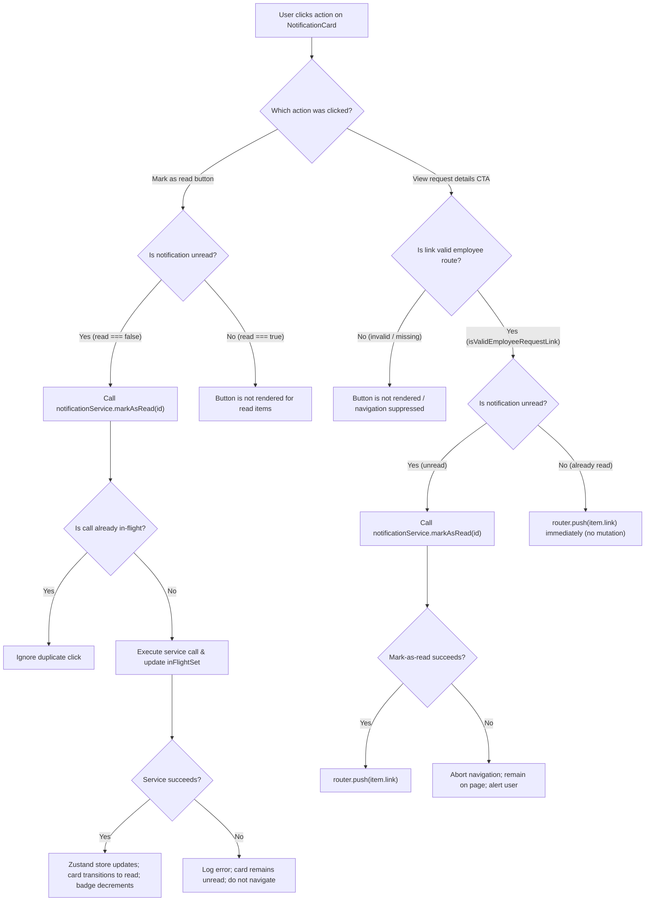
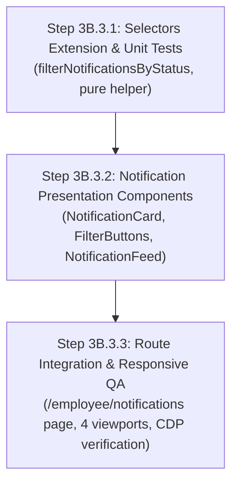

# FleetFlow — Phase 3B.3 Planning & Gap Analysis
## Employee Dedicated Notifications Page

**Document Version:** 1.1.0 (Corrected Planning Specification)  
**Document Status:** Pending Architecture Approval  
**Role:** Senior Software Architect, Product Analyst, and Enterprise UI/UX Architect  
**Project:** FleetFlow — Company Vehicle Request & Trip Coordination Platform  
**Target Route:** `/employee/notifications`  
**Governing Documents:**
- Root `AGENTS.md`
- Official FleetFlow Product Blueprint (`FleetFlow_Product_UX_Specification_and_Implementation_Blueprint.docx`)
- `docs/architecture/UI_UX_DESIGN_GUIDELINES.md`
- `docs/architecture/UNIFIED_UX_SPECIFICATION.md`
- `docs/reports/PHASE_3B_2_NOTIFICATION_BELL_PLANNING.md` (v1.2.1)
- `docs/reports/STEP_3B_2_3_FINAL_VISUAL_QA.md`

---

## 1. Executive Summary

Phase 3B.2 delivered the **NotificationBell**, **NotificationPopover**, deterministic selectors, safe deep-link navigation, and responsive header integration.

Phase 3B.3 plans the **Dedicated Employee Notifications Page** (`/employee/notifications`). While the header popover serves as an ephemeral, glanceable triaging panel for immediate notices, the dedicated page provides a permanent, searchable notification feed where employees can:
1. Review their complete notification history across all vehicle requests and trip milestones.
2. Filter notifications by read status (`All`, `Unread`, `Read`) using accessible button controls.
3. Inspect timestamps (both formatted absolute calendar datetime and relative time).
4. Perform individual mark-as-read operations inline without being forced to navigate away.
5. Safely navigate to approved Employee request-detail routes.
6. Experience responsive usability from $360\text{px}$ compact mobile to $1440\text{px}$ widescreen desktop, maintaining full clearance above the docked mobile navigation.

---

## 2. Blueprint Requirement Traceability & Feature Classification

The official Product Blueprint establishes feature priorities in **Section 21: Final Scope Prioritization**. Features in FleetFlow are categorized into:
- **Explicit functional requirement in the Blueprint:** Mandatory functionality described in the narrative text or service contracts.
- **Blueprint Must Have:** Core MVP requirements in Section 21 (Lines 501–514) required for the primary intake, assignment, and trip lifecycle demo.
- **Blueprint Should Have:** Secondary operational features in Section 21 (Lines 515–522), which explicitly includes **Notifications** (Line 517).
- **Blueprint Could Have:** Nice-to-have capabilities in Section 21 (Lines 523–528) such as exportable reports or advanced analytics.
- **UI/UX guideline requirement:** Mandatory enterprise design system standards from `UI_UX_DESIGN_GUIDELINES.md`.
- **Optional UX recommendation:** Recommended design enhancements not mandated by the Blueprint text.

> [!IMPORTANT]
> **Priority Correction:** In Section 21 (Line 517), the **Notifications** feature is formally classified as **Should Have**, not Must Have. Furthermore, appearance of `/employee/notifications` in the Section 4 routing sitemap indicates route placement, but does not promote the capability above its Section 21 priority.

```
+---------------------------------------------------------------------------------------------------------------------------------------------+
| Feature / Capability             | Blueprint Citation                  | Strict Priority Classification       | Scope Status                |
+----------------------------------+-------------------------------------+--------------------------------------+-----------------------------+
| Route /employee/notifications    | Section 4 (Line 133)                | Explicit functional route (Sitemap)  | Mandatory Phase 3B.3 Scope  |
| Full Notification History Feed   | Section 5.13 (Line 198)             | Blueprint Should Have (Sec. 21, L517)| Mandatory Phase 3B.3 Scope  |
| Recipient Persona Isolation      | Section 5.13 (Line 198)             | Explicit functional requirement      | Mandatory Phase 3B.3 Scope  |
| Read / Unread State Tracking     | Section 5.13 (Line 198)             | Explicit functional requirement      | Mandatory Phase 3B.3 Scope  |
| NotificationService.markAsRead   | Section 6 & 13 (Lines 351–352)      | Explicit functional requirement      | Mandatory Phase 3B.3 Scope  |
| Safe Request Detail Navigation   | Section 4 (Line 133), Sec 5.13      | Explicit functional requirement      | Mandatory Phase 3B.3 Scope  |
| Responsive Shell & Layout        | Sec. 21 (Line 503), UI/UX Sec. 8    | Blueprint Must Have & UI Guideline   | Mandatory Phase 3B.3 Scope  |
| Accessible Empty States          | Section 5.16 (Line 383)             | Explicit UI requirement              | Mandatory Phase 3B.3 Scope  |
| Status Filters (All/Unread/Read) | Enterprise SaaS UX Pattern          | Optional UX recommendation           | Included in Phase 3B.3 Plan |
| Create Request Empty State CTA   | Convenience Action                  | Optional UX recommendation           | Included in Phase 3B.3 Plan |
| Popover "View all" Footer Link   | Header-to-Page Continuity           | Optional UX recommendation           | DEFERRED (Separate Scope)   |
| Date Grouping (Today/Earlier)    | Visual Feed Partitioning            | Optional UX recommendation           | DEFERRED (Excessive Density)|
| Bulk "Mark all as read"          | Deferred in Phase 3B.2              | Optional UX recommendation           | EXCLUDED & DEFERRED         |
+---------------------------------------------------------------------------------------------------------------------------------------------+
```

### Supporting Citations from Official Product Blueprint
1. **Section 21 (Line 515 & 517):**
   *`Should Have: Activity timeline; Notifications; Assignment conflict detection; Vehicle capacity validation; Request search and filters; Status distribution analytics; Demo data reset.`*
2. **Section 4 (Line 133):**
   *`Employee Portal Routes: /employee/dashboard; /employee/requests; /employee/requests/new; /employee/requests/[id]; /employee/trips; /employee/notifications`*
3. **Section 5.13 (Line 198):**
   *`Generate in-app notifications for request submission, approval, rejection, driver assignment, assignment acceptance, pickup, trip start, drop-off, and completion. Store notifications locally with recipient and read/unread state. Email, SMS, and push notifications are out of scope.`*
4. **Section 6 & 13 (Lines 351–352):**
   *`Notification Service: createNotification, getNotifications, markAsRead`*
5. **Section 5.16 (Line 383):**
   *`Reusable components: ... empty state, loading state, and toast notification.`*

---

## 3. Current Implementation Gap Analysis

```
+---------------------------------------------------------------------------------------------------------------+
| Architectural Layer          | Current Implementation State             | Phase 3B.3 Implementation Delta     |
+------------------------------+------------------------------------------+-------------------------------------+
| App Router Page              | Does not exist (404 on /employee/notif.) | Create /employee/notifications/page |
| Feature Selectors            | selectEmployeeNotifications exists       | Add filterNotificationsByStatus     |
| Feature ViewModels           | NotificationViewModel exists             | 100% Reused (Zero modifications)    |
| Presentation Components      | Bell & Popover exist                     | Create Card, FilterButtons, Feed    |
| Deep-Link Route Validation   | isValidEmployeeRequestLink exists        | 100% Reused (Zero modifications)    |
| Service Layer                | NotificationService.markAsRead exists    | 100% Reused (Zero modifications)    |
| Repository Layer             | MockNotificationRepository exists        | 100% Reused (Zero modifications)    |
| Zustand Store Mutation       | markNotificationRead(id) exists          | 100% Reused (Zero modifications)    |
| Popover Continuity           | Popover has no footer link to page       | Separated into optional scope       |
+------------------------------+------------------------------------------+-------------------------------------+
```

### High-Fidelity Reusable Assets
- `selectEmployeeNotifications`: Completely handles newest-first sorting, ID tie-breaking, recipient isolation, safe deep-link detection, and relative timestamp calculations against a caller-supplied reference instant.
- `selectUnreadNotificationCount`: Accurately computes active recipient unread notifications.
- `isValidEmployeeRequestLink`: Guarantees navigation strictly targets approved `/employee/requests/req_[id]` paths.
- `NotificationService.markAsRead`: Fully wired to repository and Zustand store.
- `<EmptyState>`: Reusable component complying with `UI_UX_DESIGN_GUIDELINES.md`.

---

## 4. Product and UX Planning

### 4.1 Page Layout & Visual Hierarchy

Adhering to `UI_UX_DESIGN_GUIDELINES.md` Section 2:

```text
[ Global Demo Toolbar (Sticky Top) ]
[ Responsive Application Header (Sticky Below Toolbar) ]
[ Breadcrumb / Back Link: "← Back to Dashboard" ]
[ Page Title: "Notifications" (H1) + Unread Badge Pill ("X unread") ]
[ Subtitle / Contextual Narrative ]
[ Filter Button Group: All (count) | Unread (count) | Read (count) ]
[ Notification Cards Feed (Stacked List, space-y-3) ]
  ├── NotificationCard 1 (Unread: Accent border, primary dot glyph, bold title, timestamps, actions)
  ├── NotificationCard 2 (Read: Neutral border, regular title, timestamps, actions)
  └── ...
[ Empty State (When no notifications match the active filter or zero exist) ]
[ Docked Mobile Bottom Navigation (< md) - pb-24 clearance preserved ]
```

### 4.2 Page Components & Sizing Specifications

1. **Breadcrumb / Return Link:**
   - `<Link href="/employee/dashboard">` with left chevron (`← Back to Dashboard`).
   - Styling: `text-xs text-muted-foreground hover:text-foreground font-medium transition-colors`.
2. **Page Header:**
   - Single `<h1>`: `Notifications` (`text-2xl sm:text-3xl font-bold tracking-tight text-foreground`).
   - Accompanying summary pill: `<Badge variant="pending">X unread</Badge>` when $X > 0$, or `<Badge variant="outline">All caught up</Badge>` when $X = 0$.
   - Narrative subtitle: `text-sm text-muted-foreground` explaining that this feed tracks all vehicle request updates, administrative approvals, and trip execution alerts.
3. **Filter Button Group (Accessible Button Pattern):**
   - Implemented as an accessible button group with `role="group"` and `aria-label="Filter notifications by read status"`:
     ```tsx
     export type NotificationFilterStatus = 'ALL' | 'UNREAD' | 'READ';
     ```
   - **Interaction & Accessibility Specifications:**
     - Uses standard `<button>` elements (not `role="tablist"`).
     - Communicates selected state via `aria-pressed="true"` (and `aria-pressed="false"` for unselected).
     - Standard keyboard operability: `Tab` navigates between buttons; `Space` or `Enter` activates the filter.
     - High-contrast visible focus ring: `focus-visible:ring-2 focus-visible:ring-ring focus-visible:ring-offset-2`.
     - Minimum interactive touch target footprint: $44 \times 44\text{px}$ on touch devices (`min-h-[44px]`).
     - Selected styling: `bg-primary text-primary-foreground shadow-sm font-semibold`.
     - Unselected styling: `bg-background text-muted-foreground hover:text-foreground hover:bg-muted border border-border`.
4. **Stable Count Calculations:**
   - Filter button counts are derived from the **complete recipient-filtered notification collection**, not from the currently filtered subset:
     - `allCount = userNotifications.length`
     - `unreadCount = userNotifications.filter((n) => !n.read).length`
     - `readCount = userNotifications.filter((n) => n.read).length`
   - These counts remain stable and predictable regardless of which filter button is currently active.
5. **Notification Card (`NotificationCard`):**
   - Elevated container: `<Card className="p-4 sm:p-5 transition-colors">`.
   - **Unread Card Visual Hierarchy:**
     - Glyph indicator: `w-2.5 h-2.5 rounded-full bg-primary flex-shrink-0 mt-1` (distinct visual shape, not relying solely on color).
     - Surface: `bg-card border-border hover:border-primary/40 shadow-sm`.
     - Title typography: `font-semibold text-foreground text-sm`.
     - Message typography: `text-sm text-foreground/90 leading-relaxed`.
   - **Read Card Visual Hierarchy:**
     - Glyph indicator: Spacer element preserving identical left alignment.
     - Surface: `bg-muted/20 border-border/70 hover:bg-muted/30`.
     - Title typography: `font-medium text-foreground/80 text-sm`.
     - Message typography: `text-sm text-muted-foreground leading-relaxed`.
   - **Timestamps:**
     - Relative time: `font-semibold text-xs text-muted-foreground` (e.g. `2 hours ago`).
     - Absolute datetime: `text-xs text-muted-foreground font-normal` (e.g. `Nov 24, 2026, 10:00 AM`).
   - **Action Controls:**
     - **Inline "Mark as read" Button:** Rendered **only** when `read === false`. Clicking marks the notification as read via `NotificationService.markAsRead(id)` without navigating away.
     - **"View request details →" CTA:** Rendered **only** when `hasValidLink === true`. Clicking navigates to `/employee/requests/req_[id]` (marking as read first if currently unread).

### 4.3 Notification Card Interaction Rules



#### Detailed Interaction Contracts
1. **Inline Mark-as-Read:**
   - Available **only** for unread notifications.
   - Delegates strictly to `NotificationService.markAsRead(id)`.
   - Does **not** navigate away from `/employee/notifications`.
   - Updates the notification's read state reactively in place through the Zustand store subscription.
   - Prevents duplicate concurrent service calls using an in-flight `Set<string>` guard.
2. **View Request Details Navigation:**
   - Appears **only** when `hasValidLink === true` (validated via `isValidEmployeeRequestLink`).
   - For **unread** notifications: calls `NotificationService.markAsRead(id)`. If the service succeeds, executes `router.push(item.link)`. If the service fails or throws, navigation is **aborted** and the user remains on `/employee/notifications`.
   - For **already-read** notifications: executes `router.push(item.link)` immediately without issuing a redundant mutation.
   - Missing, external, Admin, or Driver links never navigate.

### 4.4 Four Distinct Empty States

The feed handles four distinct empty/zero scenarios cleanly:

1. **Global Empty State (No notifications exist):**
   - **Condition:** `userNotifications.length === 0`.
   - **Component:** `<EmptyState icon={Bell} title="No Notifications Yet" description="You have no notifications in your history. Updates regarding your vehicle requests and trip milestones will appear here." />`.
   - **Supporting CTA:** Optional convenience button `"Create Vehicle Request"` (`/employee/requests/new`), classified as an **Optional UX Recommendation**.
2. **Unread Filter Empty State (All caught up):**
   - **Condition:** `activeFilter === 'UNREAD'` and `unreadCount === 0` (while `allCount > 0`).
   - **Component:** `<EmptyState icon={CheckCircle2} title="No Unread Notifications" description="You're all caught up! You have no unread notifications to review." />`.
   - **Supporting CTA:** Optional action button `"View All Notifications"` that switches the active filter to `'ALL'`.
3. **Read Filter Empty State (No archived notifications):**
   - **Condition:** `activeFilter === 'READ'` and `readCount === 0` (while `allCount > 0`).
   - **Component:** `<EmptyState icon={Inbox} title="No Read Notifications" description="You have no notifications marked as read. Reviewed notifications will appear here." />`.
   - **Supporting CTA:** Optional action button `"View All Notifications"` that switches the active filter to `'ALL'`.
4. **Empty Filter Search/Zero Match Fallback:**
   - Explicit distinction: An empty state container is an **Explicit UI Requirement** in the Blueprint (Section 5.16 Line 383), whereas action CTAs (e.g. "Create Vehicle Request") are **Optional UX Recommendations**.

### 4.5 Popover-to-Page Continuity (Separated Scope)
- **Concept:** Adding a footer bar to `NotificationPopover`: `<Link href="/employee/notifications">View all notifications →</Link>`.
- **Classification:** **Optional UX Recommendation (Separately Authorizable).**
- **Decision:** Moved **outside** the mandatory Step 3B.3.2 scope. The dedicated page must be fully implemented, tested, and verifiable without requiring modifications to the approved popover.

---

## 5. Architecture & 5-Layer Boundary Compliance

The implementation preserves the established 5-layer architecture without bypassing any layer:

$$\text{UI (/employee/notifications)} \longrightarrow \text{NotificationService} \longrightarrow \text{NotificationRepository} \longrightarrow \text{MockNotificationRepository} \longrightarrow \text{Zustand Store}$$

```
+-----------------------------------------------------------------------------------------------------------------+
| Layer                        | Implementation Target                             | Responsibility               |
+------------------------------+---------------------------------------------------+------------------------------+
| 1. UI Route & Presentation   | /employee/notifications/page.tsx, Feed, Card      | Pure rendering, local state  |
| 2. Feature Selectors         | selectEmployeeNotifications, filterByStatus       | Sorting, filtering, pure DTO |
| 3. Feature Service           | notificationService.markAsRead(id)                | Business validation, orchestr|
| 4. Repository                | notificationRepository.markAsRead(id)             | Storage abstraction boundary |
| 5. Single Source of Truth    | useFleetFlowStore.getState().markNotificationRead | Zustand state persistence    |
+-----------------------------------------------------------------------------------------------------------------+
```

### Architectural Rules
1. **Zero Direct Store Mutation:**
   `src/app/employee/notifications/page.tsx` and all child components never call `useFleetFlowStore.getState().markNotificationRead(id)`. All mutations delegate strictly to `notificationService.markAsRead(id)`.
2. **Deterministic Selectors:**
   `referenceTime` remains mandatory. The page caller passes its own state instant (`React.useState(() => new Date())`).
3. **In-Flight Duplicate Guard:**
   `inFlightMarkAsReadRef` (`Set<string>`) prevents concurrent service calls from rapid clicking.
4. **Service Failure Safety:**
   If `notificationService.markAsRead(id)` fails or throws, navigation is aborted and the notification remains unread.

---

## 6. Deferred Scope: Bulk "Mark All as Read"

During Phase 3B.2 planning, bulk mark-as-read was classified as an **Optional Future Enhancement** and was explicitly deferred. The Blueprint does not mandate bulk mark-as-read.

### Architectural Decision for Phase 3B.3
- **Decision:** **Bulk mark-as-read is EXCLUDED from Phase 3B.3.**
- **Rationale:** Strict adherence to Phase 3B.2 architectural decisions and Rule 10 (avoid unnecessary abstractions and scope creep). Individual mark-as-read satisfies all Blueprint requirements.

---

## 7. Responsive Design & Multi-Device Strategy

```
+-----------------------------------------------------------------------------------------------------------------+
| Viewport             | Container Width | Card Layout      | Action Controls Layout      | Bottom Nav Clearance  |
+----------------------+-----------------+------------------+-----------------------------+-----------------------+
| Desktop (1440x900)   | max-w-4xl       | Spacious card    | Side-by-side right-aligned  | Standard pb-8         |
| Tablet (768x1024)    | max-w-3xl       | Comfortable card | Side-by-side right-aligned  | Standard pb-8         |
| Mobile (390x844)     | 100% (px-4)     | Compact stacked  | Wrapped full-width buttons  | pb-24 (clear 64px nav)|
| Compact (360x640)    | 100% (px-4)     | Dense stacked    | Stacked buttons (>= 44px)   | pb-24 (clear 64px nav)|
+-----------------------------------------------------------------------------------------------------------------+
```

### Responsive Clearance Guardrails
1. **Mobile Bottom Navigation Clearance:**
   - `EmployeeLayout` wraps `<main>` in `pb-24 md:pb-8`.
   - On mobile viewports ($< 768\text{px}$), the $96\text{px}$ (`pb-24`) bottom padding guarantees that the bottom-most notification card is never obscured by the $64\text{px}$ docked `MobileBottomNav`.
2. **Touch Targets ($\ge 44\text{px}$):**
   - Filter buttons maintain a minimum $44 \times 44\text{px}$ interactive footprint.
   - Card action buttons ("View request details" and "Mark as read") maintain $\ge 44\text{px}$ touch targets on mobile.
3. **Zero Horizontal Overflow:**
   - Card content incorporates `break-words` and `max-w-full`. Long text wraps naturally without horizontal scrolling.

---

## 8. Exact File Inventory

### Files to Create (Phase 3B.3)
1. `src/features/notifications/components/notification-card.tsx`
   - Reusable notification card presentation component with read/unread styling, timestamp rendering, inline mark-as-read action, and deep-link CTA.
2. `src/features/notifications/components/notification-filter-buttons.tsx`
   - Accessible button group component for `ALL`, `UNREAD`, and `READ` filters with stable count badges.
3. `src/features/notifications/components/notification-feed.tsx`
   - Feed orchestrator managing active filter state, empty state dispatching, and list rendering.
4. `src/app/employee/notifications/page.tsx`
   - Thin Next.js App Router route page connecting Zustand store subscriptions, selectors, and `NotificationFeed`.
5. `src/features/notifications/components/__tests__/notification-card.test.tsx`
   - Unit tests for card rendering, unread dot glyph, inline mark-as-read click, and deep-link click.
6. `src/features/notifications/components/__tests__/notification-feed.test.tsx`
   - Unit tests for filter button switching, empty state rendering, and recipient isolation.
7. `src/features/notifications/components/__tests__/employee-notifications-page.test.tsx`
   - Full integration tests for `/employee/notifications` page.

### Files to Modify (Phase 3B.3)
1. `src/features/notifications/selectors/notification-selectors.ts`
   - Add pure helper:
     ```ts
     export type NotificationFilterStatus = 'ALL' | 'UNREAD' | 'READ';
     export function filterNotificationsByStatus(
       items: NotificationViewModel[],
       filter: NotificationFilterStatus
     ): NotificationViewModel[];
     ```
2. `src/features/notifications/selectors/__tests__/notification-selectors.test.ts`
   - Add unit tests for `filterNotificationsByStatus`.

### Files NOT Modified in Core Scope (Strict Invariance)
- `src/features/notifications/components/notification-popover.tsx` (Unchanged — optional footer enhancement kept separate)
- `src/features/notifications/components/__tests__/notification-popover.test.tsx` (Unchanged)
- `src/stores/fleetflow-store.ts` (Unchanged)
- `src/services/notification-service.ts` (Unchanged)
- `src/repositories/interfaces/notification-repository.interface.ts` (Unchanged)
- `src/repositories/mock/mock-notification-repository.ts` (Unchanged)
- `src/types/domain.ts` (Unchanged)
- `src/data/seed/seed-data.ts` (Unchanged)
- Dependencies (`package.json`) (Unchanged)

---

## 9. Staged Implementation Breakdown



### Step 3B.3.1 — Selectors Extension & Deterministic Filter Tests
- **Objective:** Add pure filter selector `filterNotificationsByStatus` to `notification-selectors.ts` with unit tests.
- **Files Modified:**
  - `src/features/notifications/selectors/notification-selectors.ts`
  - `src/features/notifications/selectors/__tests__/notification-selectors.test.ts`
- **Logic:**
  - Given a `NotificationViewModel[]` and status `ALL` | `UNREAD` | `READ`:
    - `ALL`: returns all items.
    - `UNREAD`: returns items where `item.read === false`.
    - `READ`: returns items where `item.read === true`.
  - Pure, deterministic, immutable input handling.
- **Acceptance Criteria:**
  - 100% unit test coverage for filtering.
  - Zero modifications to domain types, repositories, services, or stores.

### Step 3B.3.2 — Presentation Components (Card, FilterButtons, Feed)
- **Objective:** Build accessible, responsive presentation components for the dedicated notifications feed without modifying the existing popover.
- **Files Created:**
  - `src/features/notifications/components/notification-card.tsx`
  - `src/features/notifications/components/notification-filter-buttons.tsx`
  - `src/features/notifications/components/notification-feed.tsx`
  - `src/features/notifications/components/__tests__/notification-card.test.tsx`
  - `src/features/notifications/components/__tests__/notification-feed.test.tsx`
- **Logic:**
  - Card presents unread dot glyph, bold/normal title, formatted timestamps, inline mark-as-read, and deep-link CTA.
  - Filter buttons switch between All, Unread, and Read with stable count badges and `aria-pressed`.
  - Feed handles four distinct empty states.
- **Acceptance Criteria:**
  - Components render cleanly in SSR and client.
  - Keyboard accessible with visible focus rings.
  - Popover code remains 100% untouched.
  - All component unit tests pass.

### Step 3B.3.3 — Employee Notifications Route & Responsive QA
- **Objective:** Implement `/employee/notifications/page.tsx`, wire service delegation, and verify responsive layout across all 4 viewports.
- **Files Created:**
  - `src/app/employee/notifications/page.tsx`
  - `src/features/notifications/components/__tests__/employee-notifications-page.test.tsx`
- **Logic:**
  - Connects to `useFleetFlowStore` subscriptions.
  - Passes caller-owned `referenceTime`.
  - Implements `handleMarkAsRead` delegating strictly to `notificationService.markAsRead(id)`.
  - Implements `handleNavigate` validating via `isValidEmployeeRequestLink(link)`.
  - Implements in-flight deduplication via `Set<string>`.
- **Acceptance Criteria:**
  - Responsive verification across $1440 \times 900$, $768 \times 1024$, $390 \times 844$, and $360 \times 640$.
  - Zero horizontal overflow.
  - $\ge 8\text{px}$ clearance above mobile bottom nav.
  - `npx tsc --noEmit` clean.
  - `npm run build` clean.
  - Full Vitest test suite passing.

---

## 10. Comprehensive Test Matrix

```
+---------------------------------------------------------------------------------------------------------------+
| Test Category             | Test Scenario                                             | Expected Behavior     |
+---------------------------+-----------------------------------------------------------+-----------------------+
| 1. Recipient Isolation    | usr_emp_01 visits page                                    | Shows Sarah's alerts  |
|                           | usr_emp_02 visits page                                    | Shows David's alerts  |
|                           | Admin/Driver alerts present in store                      | Never leaked to page  |
| 2. Read State Filtering   | Filter = 'ALL'                                            | All items displayed   |
|                           | Filter = 'UNREAD'                                         | Only read=false items |
|                           | Filter = 'READ'                                           | Only read=true items  |
| 3. Stable Filter Counts   | Active filter is switched                                 | Counts do not change  |
| 4. Four Empty States      | Persona with 0 notifications (e.g. cleared in demo)       | "No Notifications Yet"|
|                           | Filter = 'UNREAD' with 0 unread                           | "No Unread Notif."    |
|                           | Filter = 'READ' with 0 read                               | "No Read Notif."      |
| 5. Inline Mark-as-Read    | Click "Mark as read" button on unread card                | Calls service.markAsRead|
|                           | In-flight duplicate clicks                                | Second click rejected |
|                           | Item transitions to read styling                          | Dot removed, text norm|
|                           | Badge counter in header and page decrements               | Instant reactive sync |
| 6. Deep-Link Navigation   | Click "View request details" (valid link)                 | Navigates to request  |
|                           | Click "View request details" on unread item               | Marks read + navigates|
|                           | Click on item with invalid/admin link                     | Navigation suppressed |
|                           | Service markAsRead throws/fails                           | Navigation aborted    |
| 7. Persona Switching      | Switch from David (usr_emp_02) to Sarah (usr_emp_01)      | Feed updates instantly|
| 8. Reset Demo Data        | Click "Reset Demo Data" in toolbar                        | Seed alerts restored  |
| 9. Responsive Clearance   | Mobile viewport 360x640 & 390x844                         | pb-24 clears 64px nav |
| 10. Accessibility & Keys  | Tab navigation through cards and filter buttons           | Focus rings visible   |
+---------------------------------------------------------------------------------------------------------------+
```

---

## 11. Optional Future Enhancements (Separately Authorizable)

The following capabilities are classified as **Optional UX Recommendations** and are intentionally separated from Phase 3B.3 core scope:

1. **Popover "View all notifications" Footer Link:**
   - Adds a footer link inside `NotificationPopover` that routes to `/employee/notifications`.
   - Requires separate authorization after Phase 3B.3 core delivery.
2. **Date Grouping Headers (Today / Yesterday / Earlier):**
   - Introduces date-based cluster headers in the feed.
   - Evaluated as unnecessary for current prototype data volume, but architecturally feasible.
3. **Bulk Mark-All-as-Read:**
   - Requires changes to Store, Repository, Mock Repository, Service, and UI. Remains deferred.

---

## 12. Final Authorization Gate

This revised document completes the planning phase for **Phase 3B.3 — Employee Dedicated Notifications Page**.

**In accordance with project rules, NO application code has been modified or implemented.**

Awaiting your explicit review and authorization to proceed with **Step 3B.3.1**.
