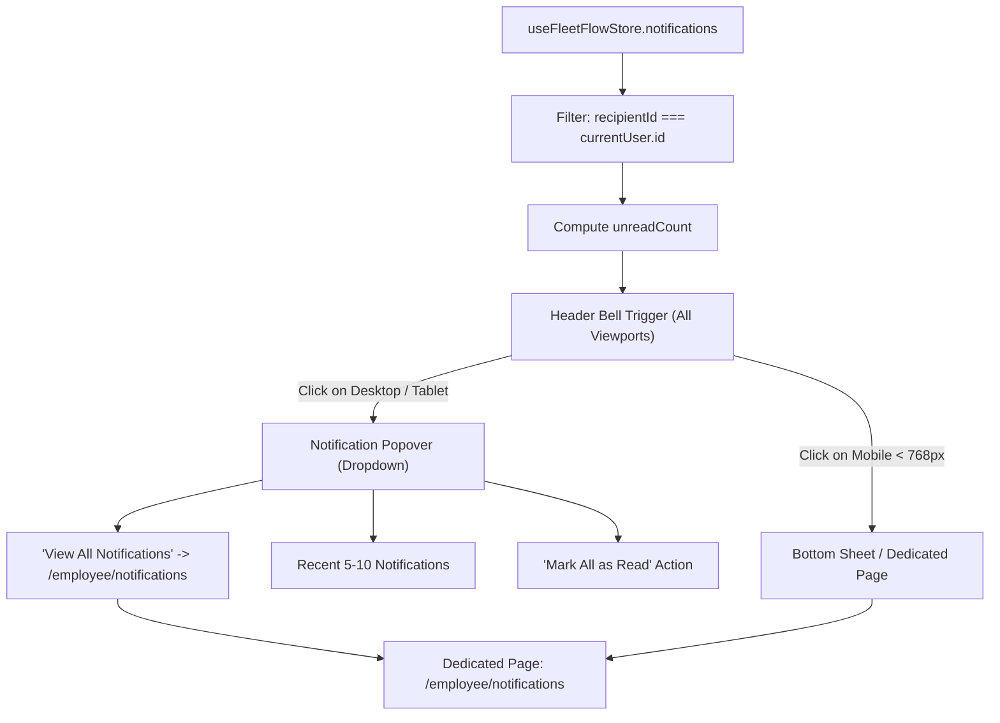
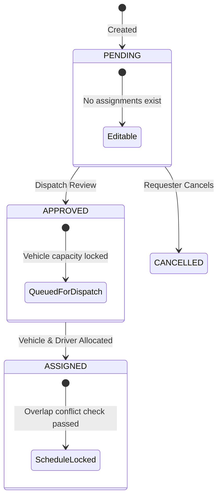
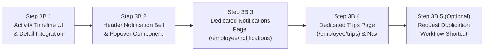

# FleetFlow — Phase 3B Planning & Gap Analysis
## Comprehensive Architecture Review, Gap Analysis, and Implementation Blueprint

**Document Version:** 1.0.0  
**Status:** DRAFT FOR CLIENT APPROVAL — READ-ONLY ANALYSIS (NO IMPLEMENTATION AUTHORIZED)  
**Date:** November 2026  
**Author:** Senior Software Architect, Product Analyst & Enterprise UI/UX Specialist  
**Primary Reference:** `docs/reference/FleetFlow_Product_UX_Specification_and_Implementation_Blueprint.docx`  
**Authoritative Architectural Rules:** `AGENTS.md`, `docs/architecture/UNIFIED_UX_SPECIFICATION.md`, `docs/architecture/UI_UX_DESIGN_GUIDELINES.md`

---

## 1. Executive Summary

### 1.1 Context and Background
FleetFlow is an enterprise company vehicle management and internal transportation dispatch web application built with Next.js 14 (App Router), TypeScript, Tailwind CSS, and Zustand. The project enforces strict domain integrity, single-source-of-truth state persistence, and mobile-first responsive design.

The engineering team has successfully executed and verified all foundational phases:
- **Phase 1 (Foundation):** Clean architecture, TypeScript strict domain models, and mock repository layer.
- **Phase 2 (Data and State):** Zustand store single source of truth, persistent storage, conflict validation, and lifecycle state machines.
- **Phase 3A (Employee Portal Core):** Request intake form (`/employee/requests/new`), tabular request tracking (`/employee/requests`), and request detail inspection (`/employee/requests/[id]`).
- **Stage 1 (Design Foundation):** Semantic design tokens, typography, and responsive primitives.
- **Stage 2 (Responsive Shell):** Mobile-first application layout, viewport-adaptive header, and docked bottom navigation (`MobileBottomNav`).
- **Stage 3 (Dashboard & Route Experience):**
  - **Step 3.1:** Reusable `RouteVector` and canonical 8-milestone `TripLifecycleStepper`.
  - **Step 3.2:** Pure deterministic trip selectors and ViewModels (`selectEmployeeTripOverview`, `selectTripLegTimeline`, `resolveDriverPhone`).
  - **Step 3.3:** Mobile-first trip cards (`ActiveTripCard`, `SecondaryActiveAlert`, `DroppedOffTripCard`, `UpcomingTripCard`, `PastUnfinishedCard`, `TripLegTimeline`).
  - **Step 3.4:** Full integration into Employee Dashboard (`/employee/dashboard`) and Request Detail (`/employee/requests/[id]`).

### 1.2 Purpose of Phase 3B Planning
Phase 3B represents the final completion phase for the **Employee Portal**. Before proceeding to administrative dispatch (Phase 4) and driver execution (Phase 5), all employee-facing capabilities outlined in the authoritative Product Blueprint must be analyzed, planned, and approved.

This planning report conducts a rigorous gap analysis between the authoritative Blueprint requirements, the current Phase 3A implementation inventory, and the remaining user capabilities. Specifically, this analysis addresses:
1. **Activity Timeline / Audit Trail:** Chronological workflow and dispatch log on Request Detail (`/employee/requests/[id]`).
2. **In-App Notification Center:** Unread count indicator, header popover/drawer, and dedicated notifications view (`/employee/notifications`).
3. **Dedicated Employee Trips View:** Dedicated itinerary schedule and history page (`/employee/trips`).
4. **Request Editing and Duplication:** Policy requirements, lifecycle risks, and recommended workflows.

> [!IMPORTANT]
> **Strict Read-Only Analysis:** This document authorizes planning and architectural gap analysis ONLY. No application code, components, styles, tests, or configurations are modified during this turn. Implementation will begin only upon explicit user approval of this plan.

---

## 2. Official Blueprint Scope for Employee Portal

The authoritative product source of truth is `docs/reference/FleetFlow_Product_UX_Specification_and_Implementation_Blueprint.docx`. The document establishes strict requirements for the Employee persona across multiple sections:

### 2.1 Confirmed Client Requirements (Blueprint Table 2.1)
- **Employee Request Creation:** One-way and round-trip booking, passenger manifest with colleague names/departments, destination, scheduled departure/return, purpose, and special notes.
- **Employee Request Tracking:** View status of requests (`PENDING`, `APPROVED`, `REJECTED`, `ASSIGNED`, `COMPLETED`, `CANCELLED`). View driver and vehicle assignments once dispatched.
- **Activity Timeline:** Chronological audit log showing timestamp, event type, actor, and narrative description on the request detail page.
- **In-App Notifications:** Notification alerts on request submission, approval, rejection, assignment, trip start, drop-off, and completion.

### 2.2 Application Sitemap and Route Structure (Blueprint Section 4)
The Blueprint defines the canonical route hierarchy for the Employee portal:
- `/employee/dashboard`: Employee Dashboard (KPI cards, active trips, recent requests).
- `/employee/requests`: Request List (search, filters, tabular tracking).
- `/employee/requests/new`: Request Intake Form.
- `/employee/requests/[id]`: Request Detail View (manifest, route, itinerary, activity timeline).
- `/employee/trips`: Dedicated Employee Trips View (Active, Upcoming, Completed).
- `/employee/notifications`: Dedicated In-App Notification Center.

### 2.3 MoSCoW Prioritization Matrix (Blueprint Section 3)
- **Must Have:**
  - Employee vehicle request intake form (one-way and round-trip).
  - Passenger manifest with colleague headcount and details.
  - Employee request tracking with status badges.
  - Driver and vehicle assignment visibility.
  - Responsive application shell with role-based demo access.
- **Should Have:**
  - **Activity Timeline** with timestamp, event, actor, and description on Request Detail.
  - **In-App Notification Center** with unread count badge, mark-as-read, and deep links.
  - Assignment conflict detection and vehicle capacity validation.
  - Search, status filtering, and sorting on request and trip tables.
  - Demo data reset button.
- **Could Have:**
  - Request duplication shortcut.
  - Subtle Framer Motion micro-interactions.
  - Advanced trip filtering and exportable itineraries.
- **Explicitly Excluded (Out of Scope):**
  - GPS live tracking and telematics.
  - External mapping APIs (Google Maps, Mapbox, Leaflet).
  - Vehicle maintenance, servicing, and inspection scheduling.
  - Fuel expense logging and mileage tracking.
  - Payment processing, billing, or cost center invoicing.
  - Production authentication and real database backends.

---

## 3. Current Phase 3A Implementation Inventory

A comprehensive code inspection of the FleetFlow workspace reveals the following asset inventory:

### 3.1 Domain Types and State Architecture
- `src/types/domain.ts`:
  - `VehicleRequest`: Request entity tracking `requesterId`, `tripType`, `passengerCount`, `purpose`, `notes`, `status`, `rejectionReason`.
  - `TripLeg`: Physical leg tracking `legType` (`OUTBOUND` | `RETURN`), `pickupLocation`, `destination`, `scheduledDeparture`, `scheduledArrival`, `status`.
  - `Passenger`: Colleague passenger records (`requestId`, `name`, `employeeId`, `department`).
  - `Assignment`: Dispatch entity linking `tripLegId`, `vehicleId`, `driverId`, `status`.
  - `ActivityLog`: Audit record schema (`id`, `requestId`, `tripLegId?`, `actorId`, `action`, `description`, `timestamp`).
  - `Notification`: In-app alert schema (`id`, `recipientId`, `title`, `message`, `read`, `createdAt`, `link?`).
- `src/stores/fleetflow-store.ts`:
  - Single source of truth managed via Zustand `persist`.
  - Contains collections: `users`, `vehicles`, `drivers`, `requests`, `tripLegs`, `assignments`, `passengers`, `activityLogs`, `notifications`.
  - Mutation actions: `addActivityLog`, `addNotification`, `markNotificationRead`, `createRequestBundle`, `resetData`.

### 3.2 Repositories and Services
- `src/repositories/mock/mock-activity-log-repository.ts`:
  - Implements `getByRequestId(requestId: string): Promise<ActivityLog[]>`.
  - Implements `create(log: ActivityLog): Promise<ActivityLog>`.
- `src/repositories/mock/mock-notification-repository.ts`:
  - Implements `getByRecipientId(recipientId: string): Promise<Notification[]>`.
  - Implements `markAsRead(id: string): Promise<boolean>`.
  - Implements `create(notification: Notification): Promise<Notification>`.
- `src/services/activity-service.ts`:
  - Exposes `getActivityHistory(requestId)`.
  - Exposes `createActivityLog(input)`.
- `src/services/notification-service.ts`:
  - Exposes `getNotifications(recipientId)`.
  - Exposes `createNotification(input)`.
  - Exposes `markAsRead(id)`.
- `src/services/trip-service.ts`:
  - Automatically emits `activityLogs` and `notifications` on trip lifecycle advancements (`ACCEPTED`, `ARRIVED_AT_PICKUP`, `PICKED_UP`, `IN_PROGRESS`, `DROPPED_OFF`, `COMPLETED`).
- `src/services/request-service.ts`:
  - Automatically emits `activityLogs` and `notifications` on request creation, cancellation, and approvals.

### 3.3 Selectors, ViewModels, and Presentation Components
- `src/features/vehicle-requests/selectors/trip-selectors.ts`:
  - Pure deterministic classification: `selectEmployeeTripOverview`, `selectActiveTrips`, `selectDroppedOffTrips`, `selectUpcomingTrips`, `selectPastUnfinishedTrips`, `selectCompletedTrips`, `selectTripLegTimeline`.
- `src/components/shared/`:
  - `route-vector.tsx`: High-contrast route graphic (`RouteVector`).
  - `trip-lifecycle-stepper.tsx`: Canonical 8-milestone lifecycle progress stepper.
  - `mobile-bottom-nav.tsx`: Mobile 3-tab navigation bar (`Dashboard`, `New Request`, `My Requests`).
  - `employee-auth-guard.tsx`: Role verification and session protection.
- `src/features/vehicle-requests/components/`:
  - `active-trip-card.tsx`: Primary active leg hero card.
  - `secondary-active-alert.tsx`: Compact warning banner for concurrent active legs.
  - `dropped-off-trip-card.tsx`: Dropped-off leg awaiting completion card.
  - `upcoming-trip-card.tsx`: Upcoming departure card.
  - `past-unfinished-card.tsx`: Operational exception banner.
  - `trip-leg-timeline.tsx`: Complete multi-leg journey timeline.
  - `request-detail-card.tsx`: Request identity, status badge, business notes, passenger manifest, and `TripLegTimeline`.
  - `request-table.tsx`: Searchable, filterable table for `/employee/requests`.
  - `request-creation-form.tsx`: Multi-passenger request booking form for `/employee/requests/new`.

### 3.4 Page Routes (Current Inventory)
- `src/app/employee/dashboard/page.tsx`: Fully integrated in Step 3.4.
- `src/app/employee/requests/page.tsx`: Implemented.
- `src/app/employee/requests/new/page.tsx`: Implemented.
- `src/app/employee/requests/[id]/page.tsx`: Implemented.
- `src/app/employee/trips/page.tsx`: **MISSING (404)**.
- `src/app/employee/notifications/page.tsx`: **MISSING (404)**.

---

## 4. Phase 3B Gap Matrix

The following matrix identifies all missing features, architectural components, priorities, and dependencies for Phase 3B:

| Feature / Screen | Blueprint Reference | Current Workspace State | Implementation Gap | MoSCoW Priority | Core Dependencies |
| :--- | :--- | :--- | :--- | :--- | :--- |
| **Activity Timeline UI** | Sec 5.5 (line 198, 330, 504) | Domain model & mock repo exist. No UI component. | No component renders `activityLogs` on `/employee/requests/[id]`. Need `ActivityTimeline` component. | **Should Have** | `activityService`, `users` store, `RequestDetailCard` |
| **Notification Bell Trigger** | Sec 5.13 (lines 410–412) | No notification trigger in `EmployeeLayout` header. | Header lacks bell icon, unread counter badge, and click handler across mobile, tablet, and desktop viewports. | **Should Have** | `EmployeeLayout`, `useFleetFlowStore.notifications` |
| **Notification Popover / Drawer** | Sec 5.13 (lines 412, 722) | No interactive dropdown or drawer in layout. | Floating popover (desktop/tablet) and drawer/sheet (mobile) displaying unread notifications, mark-as-read action, and deep link navigation. | **Should Have** | Radix Popover/Dialog, `notificationService` |
| **Dedicated Notifications Page** | Sec 4 (line 278: `/employee/notifications`) | Route does not exist (`404`). | New page `src/app/employee/notifications/page.tsx` with filter tabs (`All`, `Unread`), bulk "Mark All as Read", and empty state. | **Should Have** | `notificationService`, `EmptyState`, `Badge` |
| **Dedicated Employee Trips View** | Sec 4 (line 278: `/employee/trips`) | Route does not exist (`404`). | New page `src/app/employee/trips/page.tsx`. Reuses Step 3.2 selectors and Step 3.3 cards with tabbed filtering (`Active`, `Upcoming`, `Completed`). | **Should Have** | Step 3.2 selectors, Step 3.3 cards, `Tabs` component |
| **Header Navigation Update** | Sec 4, Sec 5.1 | Header only links to Dashboard and Requests. | Add "My Trips" link to desktop/tablet header. Add notification bell trigger to right header actions. | **Should Have** | `EmployeeLayout` |
| **Request Duplication Shortcut** | `UNIFIED_UX_SPECIFICATION.md` | Not implemented. | "Duplicate Request" CTA on `/employee/requests/[id]` and `RequestTable` row action. Copies locations, purpose, and passengers to `/employee/requests/new`. | **Could Have** | `RequestCreationForm`, URL query param prefill |
| **Request Editing Workflow** | `UNIFIED_UX_SPECIFICATION.md` | Not implemented (only cancellation supported for `PENDING`). | Policy evaluation: editing permitted ONLY for `PENDING` requests before admin approval. | **Could Have** | Architectural policy decision required |

---

## 5. Activity Timeline Analysis

### 5.1 Blueprint Requirement (Section 5.5)
Section 5.5 of the Blueprint explicitly states:
> *"Show request ID and status, trip information, outbound and return journey details, passengers, assignment information, trip progress, and an activity timeline containing timestamp, event, actor, and description."*

### 5.2 Crucial Distinction: `TripLegTimeline` vs. `ActivityTimeline`
It is essential to maintain clean architectural separation between these two components:
- **`TripLegTimeline` (Implemented in Step 3.3 / 3.4):**
  - Represents the **physical journey execution** of individual trip legs.
  - Consumes `TripLegViewModel` items.
  - Displays the 8 physical milestones (`ACCEPTED` $\to$ `ARRIVED_AT_PICKUP` $\to$ `PICKED_UP` $\to$ `IN_PROGRESS` $\to$ `DROPPED_OFF` $\to$ `COMPLETED`).
  - Answers: *"Where is the vehicle right now, and how far along the route has the driver progressed?"*
- **`ActivityTimeline` (Phase 3B Scope):**
  - Represents the **business workflow and governance audit trail** of the entire request.
  - Consumes `ActivityLog` records.
  - Records chronological events from intake to terminal completion:
    - Request submission by Employee.
    - Administrative approval or rejection by Dispatcher.
    - Driver and vehicle assignment by Dispatcher.
    - Driver acceptance of dispatch assignment.
    - Vehicle departure and arrival milestones.
    - Formal completion or employee cancellation.
  - Answers: *"Who took action on this request, what happened, and when did it occur?"*

### 5.3 Data Schema and Actor Resolution
The `ActivityLog` domain entity contains:
```typescript
export interface ActivityLog {
  id: string;              // e.g. 'act_001'
  requestId: string;       // References VehicleRequest.id
  tripLegId?: string;      // Optional reference to specific TripLeg
  actorId: string;         // References User.id (e.g. 'usr_emp_01', 'usr_adm_01', 'usr_drv_01')
  action: string;          // Action enum/token (e.g. 'REQUEST_SUBMITTED', 'ASSIGNMENT_DISPATCHED')
  description: string;     // Narrative sentence
  timestamp: string;       // ISO 8601 string
}
```

#### Actor Resolution Architecture
The `actorId` refers to a `User` entity in the single source of truth. When rendering an audit log item, the system must resolve:
1. `actor.name`: Displayed as the primary actor (e.g., "Alex Morgan").
2. `actor.role`: Rendered as a semantic role badge:
   - `EMPLOYEE`: Neutral / Primary tint badge ("Requester").
   - `ADMIN`: Purple / Indigo tint badge ("Fleet Operations").
   - `DRIVER`: Sky / Blue tint badge ("Assigned Driver").
3. Actor Fallback: If `actorId` does not match any current user (e.g., system-generated event), display "System Automated" with a neutral badge.

#### Multi-Leg Event Correlation
For round-trip requests, events with a defined `tripLegId` should indicate whether they belong to the **Outbound Leg** or **Return Leg** (resolved by checking the linked `TripLeg.legType`).

### 5.4 Visual and UI Hierarchy
- **Container:** Accessible `<section aria-label="Activity Audit History">` wrapped in standard enterprise `Card`.
- **Chronological Layout:** Vertical timeline with connected stroke line (`border-l-2 border-border/80`).
- **Semantic Iconography:**
  - `REQUEST_SUBMITTED`: `FileText` (Primary blue/slate)
  - `REQUEST_APPROVED`: `CheckCircle2` (Emerald green)
  - `REQUEST_REJECTED`: `XCircle` (Destructive rose)
  - `ASSIGNMENT_DISPATCHED`: `Car` / `UserCheck` (Indigo)
  - `TRIP_ACCEPTED`: `ThumbsUp` / `Check` (Sky blue)
  - `TRIP_STARTED` / `PICKED_UP`: `Navigation` (Indigo)
  - `TRIP_DROPPED_OFF`: `MapPin` (Amber)
  - `TRIP_COMPLETED`: `Flag` / `CheckCircle2` (Emerald green)
  - `REQUEST_CANCELLED`: `Ban` / `AlertTriangle` (Muted slate/rose)
- **Timestamp Display:** Double representation: relative timestamp (e.g., "2 hours ago") for quick scanning, and exact formatted local time (e.g., "Nov 24, 2026, 09:30 AM") via `<time dateTime={log.timestamp}>`.

---

## 6. Notification Center Analysis

### 6.1 Blueprint Requirement (Section 5.13)
Section 5.13 of the Blueprint dictates:
> *"Generate in-app notifications for request submission, approval, rejection, driver assignment, assignment acceptance, pickup, trip start, drop-off, and completion. Store notifications locally with recipient and read/unread state... Notification bell/panel shows unread badge and mark-as-read action."*

Furthermore, Section 4 includes `/employee/notifications` in the application sitemap.

### 6.2 Data Model and Store Integration
The domain model `Notification` is defined as:
```typescript
export interface Notification {
  id: string;              // e.g. 'notif_001'
  recipientId: string;     // References User.id
  title: string;           // Short notification title
  message: string;         // Explanatory message
  read: boolean;           // Unread status indicator
  createdAt: string;       // ISO 8601 string
  link?: string;           // Optional deep link route (e.g. '/employee/requests/req_002')
}
```

The Zustand store (`useFleetFlowStore`) already provides:
- `notifications: Notification[]`
- `addNotification: (notification: Notification) => void`
- `markNotificationRead: (notificationId: string) => void`
- Service wiring in `trip-service.ts` and `request-service.ts` that automatically creates notifications during lifecycle events.

### 6.3 UX and Interaction Architecture
The In-App Notification Center requires a **dual presentation model**:



#### 1. Header Bell Trigger
- Placed in `EmployeeLayout` header alongside user persona actions.
- Displays a bell icon (`lucide-react/Bell`).
- When `unreadCount > 0`, displays a high-visibility badge (e.g., `<span className="absolute -top-1 -right-1 flex h-4 min-w-[16px] items-center justify-center rounded-full bg-destructive text-[10px] font-bold text-destructive-foreground px-1">`).
- Accessible attributes: `aria-label={`Notifications, ${unreadCount} unread`}`, `aria-haspopup="dialog"`.

#### 2. Interactive Notification Popover (Desktop / Tablet)
- Triggered by clicking the bell icon.
- Floating panel (`w-[380px] max-h-[480px]`):
  - **Header:** "Notifications", unread badge pill, and "Mark all as read" button.
  - **Scrollable List:** Items display an unread dot, semantic icon, title, narrative, relative timestamp, and deep link.
  - **Interaction:** Clicking an item marks it as read and invokes Next.js `router.push(notification.link)`.
  - **Footer:** "View all notifications" directing to `/employee/notifications`.

#### 3. Dedicated Notifications Page (`/employee/notifications`)
- Full-page interface for reviewing complete notification history.
- **Filter Tabs:** `All Notifications` (with total count) and `Unread` (with unread count).
- **Batch Actions:** "Mark All as Read" button.
- **Empty State:** High-contrast `EmptyState` component when no notifications match the selected filter.
- **Deep Linking:** Clicking any card directs the user to the associated request or trip.

#### 4. Strict Persona Isolation
Notifications must be strictly filtered by `recipientId === currentUser.id`. When switching demo personas via the Global Demo Toolbar, the notification bell, unread count, and list must immediately update to reflect the newly active persona.

---

## 7. Dedicated Employee Trips View Analysis (`/employee/trips`)

### 7.1 Blueprint Requirement (Section 4)
The application sitemap explicitly designates `/employee/trips` as a primary route for employees.

### 7.2 Functional Purpose vs. Dashboard
- **`/employee/dashboard`:** Executive summary view optimized for immediate glanceability. Displays KPI metric cards, hero card for the primary active trip leg, secondary active alerts, and 4 most recent requests.
- **`/employee/trips`:** Operational itinerary hub. Provides a comprehensive, searchable, and tabbed view of all journey legs booked by the employee across their entire lifecycle (in transit, scheduled upcoming, and historical completed).

### 7.3 Direct Reuse of Existing Step 3.2 & Step 3.3 Assets
A major architectural advantage of Phase 3B is that the core data transformation and presentation components for trips were already built and verified during Stage 3:
1. **Selectors (`src/features/vehicle-requests/selectors/trip-selectors.ts`):**
   - `selectActiveTrips`: Returns all legs with status `ACCEPTED`, `ARRIVED_AT_PICKUP`, `PICKED_UP`, `IN_PROGRESS`.
   - `selectDroppedOffTrips`: Returns dropped-off legs awaiting administrative completion.
   - `selectUpcomingTrips`: Returns all future legs ordered chronologically.
   - `selectPastUnfinishedTrips`: Returns past legs requiring administrative reconciliation.
   - `selectCompletedTrips`: Returns all completed legs ordered by completion recency.
2. **Components (`src/features/vehicle-requests/components/`):**
   - `ActiveTripCard`
   - `SecondaryActiveAlert`
   - `DroppedOffTripCard`
   - `UpcomingTripCard`
   - `PastUnfinishedCard`

### 7.4 Page Structure for `/employee/trips`
The page should adopt an accessible tabbed interface:
- **Tab 1: Active & In-Transit:**
  - Displays primary `ActiveTripCard` and `SecondaryActiveAlert` if multiple legs are active.
  - Displays `DroppedOffTripCard` if legs are dropped off.
  - Shows an empty state if no trips are currently active.
- **Tab 2: Upcoming Schedule:**
  - Lists all scheduled legs in chronological order using `UpcomingTripCard`.
  - Shows clear departure times, assigned vehicle/driver details, and route vectors.
- **Tab 3: Completed & History:**
  - Lists past completed trips with final mileage/duration details and driver records.
  - Displays `PastUnfinishedCard` at top if any historical legs were left unfinished.

### 7.5 Navigation Integration
- **Desktop & Tablet:** Add "My Trips" to the main header navigation (`navItems` in `EmployeeLayout`), positioned between "Dashboard" and "My Requests".
- **Mobile Viewport:** The mobile bottom navigation currently contains 3 primary tabs (`Dashboard`, `New Request`, `My Requests`). Adding a 4th tab would compress touch targets below the recommended 48px width on 360px viewports. Instead:
  - Add a dedicated "View All Trips $\to$" shortcut link from the Employee Dashboard.
  - Ensure the header user menu and trips page are fully accessible via mobile drawer/menu.

---

## 8. Request Editing & Duplication — Policy & Workflow Analysis

### 8.1 Status in Blueprint
- **Confirmed Client Requirements (Blueprint Table 2.1):** Neither Request Editing nor Request Duplication appears in the mandatory requirements table.
- **MoSCoW Matrix (Blueprint Section 3):** Editing is omitted; Duplication is classified as an optional **Could Have** usability enhancement.
- **Mention in `UNIFIED_UX_SPECIFICATION.md`:** Discussed as candidate workflow improvements for Phase 3B.

### 8.2 Architectural Risk Analysis: Request Editing
Allowing an employee to edit a request that has progressed beyond intake introduces severe state synchronization hazards:



- **Conflict Hazard 1 (Capacity):** If an employee edits `passengerCount` from 2 to 6 after approval, the pre-allocated vehicle (e.g., 4-passenger sedan) will violate capacity constraints.
- **Conflict Hazard 2 (Schedule Overlap):** If an employee changes `scheduledDeparture`, the pre-assigned driver and vehicle may conflict with existing active assignments.
- **Conflict Hazard 3 (Dispatch Desynchronization):** If an assignment was already dispatched to a driver's mobile device, an in-place edit creates split-brain state between driver, vehicle, and employee.

### 8.3 Architectural Recommendation: Strict Editing Policy
To protect domain integrity and prevent race conditions:
1. **Editing Allowed ONLY in `PENDING` Status:** An employee may edit trip details (dates, locations, passengers, notes) if and only if `request.status === 'PENDING'`.
2. **Editing STRICTLY PROHIBITED in `APPROVED`, `ASSIGNED`, or later:** Once a request has received administrative action or assignment dispatch, in-place editing is disabled.
3. **Cancellation as Safe Alternative:** If changes are required after approval, the employee must cancel the request (which frees assigned resources) and submit a new request.
4. **Implementation Priority:** Because cancellation and re-submission already fulfill the core need safely, editing is designated as a **Could Have** feature for future consideration.

### 8.4 Architectural Recommendation: Request Duplication (Safe High-Value Shortcut)
Unlike editing, **Request Duplication** carries zero state-conflict risk and delivers high user convenience:
- **Workflow:**
  1. On `/employee/requests/[id]` or within `RequestTable`, the employee clicks "Duplicate Request" (`lucide-react/Copy`).
  2. The application routes to `/employee/requests/new`, pre-populating:
     - `tripType` (One-Way or Round-Trip).
     - `pickupLocation` and `destination`.
     - `purpose` and `notes`.
     - `additionalColleagues` passenger manifest.
     - Sets `scheduledDeparture` to a future default time (e.g., tomorrow at 09:00 AM) to satisfy the "no past departures" domain rule.
  3. The employee reviews or tweaks the information and submits a completely new, clean `PENDING` request.
- **Implementation Mechanism:** Can be achieved via URL search parameters (e.g. `/employee/requests/new?cloneFrom=req_002`) or a lightweight transient Zustand draft state.
- **Priority:** Recommended as a **Could Have / Should Have** feature for Phase 3B.

---

## 9. Existing Architecture and Reuse Map

Phase 3B builds directly upon the established architectural layers without violating any project rules:

```
┌────────────────────────────────────────────────────────────────────────┐
│                          PRESENTATION LAYER                            │
│  ┌───────────────────────┐ ┌──────────────────────┐ ┌───────────────┐ │
│  │ /employee/trips       │ │ /employee/notif.     │ │ ActivityTime. │ │
│  │ (Active/Upcoming Tabs)│ │ (Filterable Audit)   │ │ (Audit Card)  │ │
│  └───────────┬───────────┘ └──────────┬───────────┘ └───────┬───────┘ │
└──────────────┼────────────────────────┼─────────────────────┼─────────┘
               ▼                        ▼                     ▼
┌────────────────────────────────────────────────────────────────────────┐
│                        FEATURE SELECTOR LAYER                          │
│  ┌──────────────────────────────────────────────────────────────────┐  │
│  │  trip-selectors.ts: selectEmployeeTripOverview,                 │  │
│  │  selectActiveTrips, selectUpcomingTrips, selectCompletedTrips     │  │
│  └──────────────────────────────────┬───────────────────────────────┘  │
└─────────────────────────────────────┼──────────────────────────────────┘
                                      ▼
┌────────────────────────────────────────────────────────────────────────┐
│                        SERVICE & STATE LAYER                           │
│  ┌───────────────────────┐ ┌──────────────────────┐ ┌───────────────┐ │
│  │ activity-service.ts   │ │ notification-service │ │ request-serv. │ │
│  └───────────┬───────────┘ └──────────┬───────────┘ └───────┬───────┘ │
│              └────────────────────────┼─────────────────────┘         │
│                                       ▼                               │
│                         useFleetFlowStore (Zustand)                   │
│             Single Source of Truth (Requests, Logs, Notifs)           │
└────────────────────────────────────────────────────────────────────────┘
```

- **Single Source of Truth:** `useFleetFlowStore` strictly maintains all entities. No component or service accesses `localStorage` directly.
- **Business Logic Isolation:** All filtering, sorting, and state transitions reside in services (`activity-service.ts`, `notification-service.ts`) or pure selectors (`trip-selectors.ts`), never in UI components.
- **Zero New Dependencies:** All planned components leverage existing dependencies: Lucide icons, Radix UI primitives (`dialog.tsx`, `card.tsx`, `badge.tsx`, `button.tsx`), and Tailwind CSS.

---

## 10. Mobile-First UX Recommendations

All Phase 3B components must strictly adhere to `docs/architecture/UI_UX_DESIGN_GUIDELINES.md`:

### 10.1 Responsive Viewport Strategy
- **360px (Small Mobile - iPhone SE / Galaxy S):**
  - Minimum 44x44px touch targets for all interactive buttons and triggers.
  - Single-column stacked layouts for cards and activity timeline entries.
  - Notification popover automatically converts to full-width drawer or dedicated page navigation to prevent off-screen clipping.
- **390px–414px (Standard Mobile - iPhone 14/15/16):**
  - Comfortable 16px horizontal container padding (`px-4`).
  - Clear visual hierarchy with compact typography (`text-xs` metadata, `text-sm` body).
- **768px (Tablet - iPad Portrait/Landscape):**
  - Header displays full navigation links ("Dashboard", "My Trips", "My Requests").
  - Notification bell renders floating dropdown popover with max height and internal scroll.
  - Trips view presents 2-column grid or spacious card layout.
- **1024px+ (Desktop):**
  - Standard max-width container (`max-w-6xl`).
  - Request Detail view can display `TripLegTimeline` and `ActivityTimeline` in clear stacked sections or side-by-side tabs.

### 10.2 Accessibility & WCAG 2.1 AA Compliance
- **Color Contrast:** All text, badges, and icon indicators must achieve contrast ratios $\ge 4.5:1$ against their backgrounds.
- **Semantic HTML:** Use `<section>`, `<article>`, `<time dateTime="...">`, `<nav>`, and `<ol>/<ul>` elements.
- **Screen Reader Announcements:** Notification bell trigger must communicate unread count via `aria-label="Notifications, 3 unread"`. Notification list must support keyboard navigation with `Enter`/`Space` activation.
- **Focus Rings:** Visible, consistent focus outlines on all interactive elements (`focus-visible:ring-2 focus-visible:ring-ring focus-visible:ring-offset-2`).

---

## 11. Prioritized Phase 3B Implementation Roadmap

To maintain rigorous quality control and adhere to the project rule of **working on one approved step at a time**, Phase 3B is decomposed into five distinct, sequential steps:



### Step 3B.1 — Activity Timeline Component & Detail Page Integration
- **Objective:** Build the `ActivityTimeline` presentation component and integrate it into `RequestDetailCard` on `/employee/requests/[id]`.
- **Files to Create / Modify:**
  - `src/features/vehicle-requests/components/activity-timeline.tsx` (New)
  - `src/features/vehicle-requests/components/request-detail-card.tsx` (Modify: append Activity Timeline section)
  - `src/features/vehicle-requests/components/__tests__/activity-timeline.test.tsx` (New)
- **Scope:** Pure presentation of `ActivityLog` records, actor name and role badge resolution, chronological ordering, and semantic action icons.

### Step 3B.2 — Header Notification Bell & Interactive Popover
- **Objective:** Implement the notification indicator trigger and floating popover in the employee application header.
- **Files to Create / Modify:**
  - `src/features/notifications/components/notification-bell.tsx` (New)
  - `src/features/notifications/components/notification-popover.tsx` (New)
  - `src/app/employee/layout.tsx` (Modify: wire notification bell into header actions)
  - `src/features/notifications/components/__tests__/notification-popover.test.tsx` (New)
- **Scope:** Unread badge counter, popover toggle, recent notifications list, "mark as read" handler, and deep link navigation.

### Step 3B.3 — Dedicated Notifications Page (`/employee/notifications`)
- **Objective:** Create the dedicated full-page notifications management view.
- **Files to Create / Modify:**
  - `src/app/employee/notifications/page.tsx` (New)
  - `src/features/notifications/components/notification-list.tsx` (New)
  - `src/app/employee/notifications/__tests__/notifications-page.test.tsx` (New)
- **Scope:** Filter tabs (`All`, `Unread`), bulk "Mark All as Read", empty state handling, and full notification history.

### Step 3B.4 — Dedicated Employee Trips View (`/employee/trips`) & Navigation
- **Objective:** Create the dedicated employee trips page and update desktop navigation.
- **Files to Create / Modify:**
  - `src/app/employee/trips/page.tsx` (New)
  - `src/app/employee/layout.tsx` (Modify: add "My Trips" to header nav items)
  - `src/app/employee/trips/__tests__/employee-trips-page.test.tsx` (New)
- **Scope:** Tabbed display (`Active & In-Transit`, `Upcoming Schedule`, `Past Completed`) reusing Step 3.2 selectors and Step 3.3 cards.

### Step 3B.5 (Optional Could Have) — Request Duplication Workflow Shortcut
- **Objective:** Implement a 1-click "Duplicate Request" CTA to prefill the request creation form.
- **Files to Create / Modify:**
  - `src/features/vehicle-requests/components/request-detail-card.tsx` (Modify: add Duplicate button)
  - `src/features/vehicle-requests/components/request-creation-form.tsx` (Modify: support query-param prefill)
- **Scope:** Prefill pickup, destination, passenger list, and purpose with default future departure date.

---

## 12. Step-by-Step Acceptance Criteria & Test Scenarios

### Step 3B.1 Acceptance Criteria
- [ ] `ActivityTimeline` renders all `ActivityLog` records matching the given `requestId`.
- [ ] Each log item displays the actor's resolved name and role badge (`EMPLOYEE`, `ADMIN`, `DRIVER`).
- [ ] Each log item displays a semantic status icon matching the action type.
- [ ] Dates and times are rendered with both relative time and absolute formatted timestamps.
- [ ] If no logs exist, a clean empty state is displayed.
- [ ] Outbound vs. Return leg badges are shown for leg-specific events on round trips.
- [ ] Unit tests verify rendering, actor fallback, and descending/ascending sorting.

### Step 3B.2 Acceptance Criteria
- [ ] Bell icon displays in the employee header across desktop, tablet, and mobile viewports.
- [ ] When unread notifications exist for the active user, a numerical badge shows the exact unread count.
- [ ] When all notifications are read, the badge is hidden.
- [ ] Clicking the bell on desktop/tablet opens the notification popover.
- [ ] Clicking a notification marks it as read in the Zustand store and navigates to its `link`.
- [ ] "Mark all as read" button marks all notifications for the active user as read simultaneously.
- [ ] Switching demo user persona immediately switches notification context.

### Step 3B.3 Acceptance Criteria
- [ ] Navigating to `/employee/notifications` renders the complete notification list for the active user.
- [ ] Switching between `All` and `Unread` tabs filters the list correctly.
- [ ] "Mark All as Read" action updates store state and hides unread indicators.
- [ ] When no notifications exist in the selected tab, `EmptyState` is shown.
- [ ] Clicking any notification card routes to the corresponding request or trip leg.

### Step 3B.4 Acceptance Criteria
- [ ] Navigating to `/employee/trips` renders tabs: `Active`, `Upcoming`, and `Completed`.
- [ ] Active tab displays `ActiveTripCard`, `SecondaryActiveAlert`, and `DroppedOffTripCard`.
- [ ] Upcoming tab displays all upcoming scheduled legs using `UpcomingTripCard`.
- [ ] Completed tab displays completed legs.
- [ ] "My Trips" is visible and highlighted in the header navigation when on `/employee/trips`.
- [ ] Selector data is evaluated deterministically without hydration mismatch.

---

## 13. Risks, Dependencies, and Architectural Decisions

| Item | Architectural Concern | Impact | Proposed Recommendation | Trade-off |
| :--- | :--- | :--- | :--- | :--- |
| **Mobile Bottom Nav Density** | Adding a 4th tab to `MobileBottomNav` for "My Trips" or "Notifications" | Touch targets shrink below 44px on 360px viewports; cramped UI. | Keep `MobileBottomNav` at 3 core tabs (`Dashboard`, `+ New Request`, `My Requests`). Expose Trips and Notifications via header bell, profile menu, and Dashboard card links. | User accesses Trips via 1 extra tap from Dashboard rather than dedicated bottom tab. |
| **Request Editing Policy** | In-place editing after approval causes schedule and capacity desynchronization. | Severe state conflicts with dispatched drivers and vehicles. | Strictly forbid editing once a request reaches `APPROVED` or `ASSIGNED`. Allow editing only for `PENDING`. Provide Request Duplication for past/approved requests. | Minor friction for employee requiring changes to an approved request (must cancel and re-book). |
| **Notification Volume in Demo** | Frequent state transitions generate many mock notifications. | Demo store could feel cluttered if notifications persist indefinitely. | Include "Clear All" or rely on standard "Reset Demo Data" action in Global Demo Toolbar. | None; conforms to existing demo reset architecture. |

---

## 14. Explicit Out-of-Scope Items

To prevent scope creep and adhere to project boundaries, the following capabilities are explicitly confirmed as **OUT OF SCOPE** for Phase 3B:
1. **Live GPS / Telematics:** No vehicle coordinate streaming, geofencing, or speed telemetry.
2. **External Mapping Providers:** No Google Maps, Mapbox, or Leaflet SDK integration; all spatial visualization uses the approved `RouteVector` and text-based location indicators.
3. **SMS / Email Push Notifications:** Notifications are strictly in-app records stored in the Zustand client state. No Twilio, SendGrid, or browser Push API integration.
4. **Multi-User WebSockets:** No real-time server socket synchronization. State updates occur via local store mutations.
5. **Vehicle Maintenance / Servicing:** Out of scope per Blueprint Section 3 and Decision 3.
6. **Billing & Invoicing:** No accounting cost allocation or payment processing.

---

## 15. Final Recommendation & Immediate Next Steps

### 15.1 Architect's Recommendation
1. **Approve Phase 3B Scope:** Authorize the five-step sequential execution model outlined in Section 11.
2. **Prioritize Must / Should Have Features:** Execute Step 3B.1 (Activity Timeline), Step 3B.2 (Notification Bell & Popover), Step 3B.3 (Dedicated Notifications Page), and Step 3B.4 (Dedicated Trips Page).
3. **Adopt Strict Editing Policy:** Enforce editing restriction to `PENDING` requests only; adopt Request Duplication (Step 3B.5) as the primary convenience mechanism.
4. **Preserve Mobile Bottom Nav Usability:** Retain the 3-tab bottom bar on mobile to guarantee strict WCAG touch target compliance on small screens.

### 15.2 Immediate Action
Awaiting user review and authorization. Once approved, the next action will be:
**Proceed to Step 3B.1 Implementation:** Build the `ActivityTimeline` presentation component and integrate it into `RequestDetailCard` on `/employee/requests/[id]`.

---
*End of Report — FleetFlow Phase 3B Planning and Gap Analysis*
