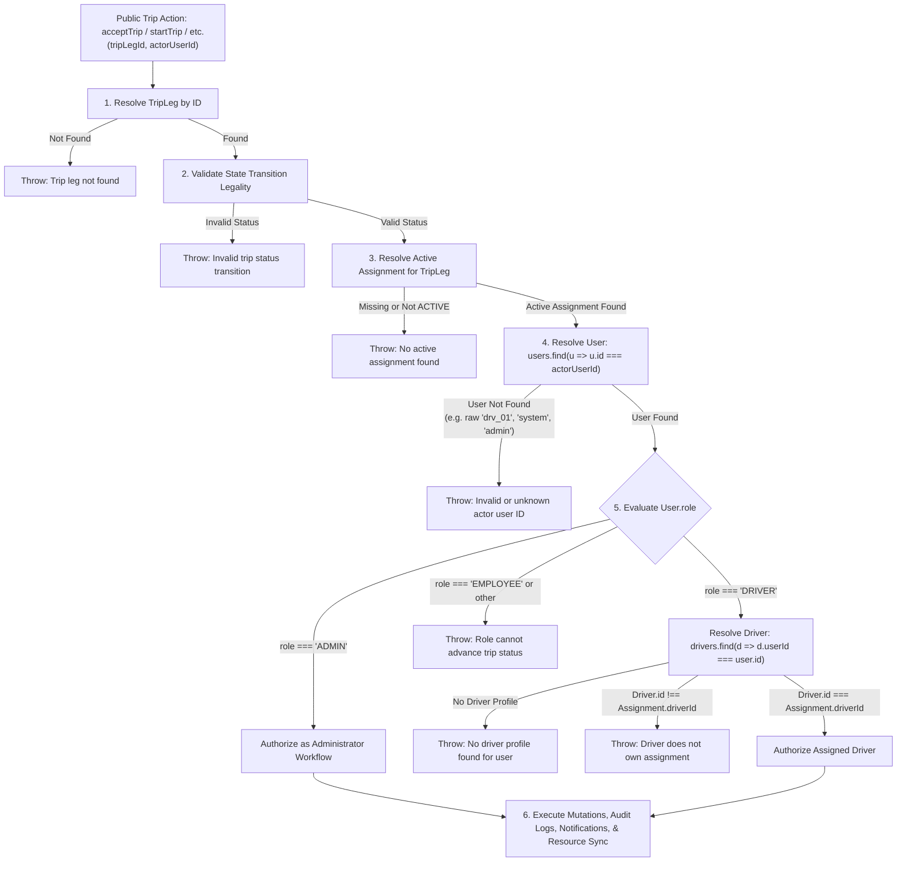

# FleetFlow — Phase 5, Stage 5.1: Architecture & Foundation Verification Report

**Date:** 2026-11-25  
**Stage:** Phase 5 — Stage 5.1: Architecture & Foundation (Security-Hardened)  
**Lead:** Senior Software Architect, Security-Focused TypeScript Engineer, Enterprise UI/UX Lead  
**Status:** COMPLETE (Ready for Review; Stop Condition Active)

---

## 1. Executive Summary

Phase 5, Stage 5.1 (Architecture & Foundation) has been implemented, audited, and hardened in strict accordance with `AGENTS.md`, the Product UX Specification and Implementation Blueprint (`docs/reference/FleetFlow_Product_UX_Specification_and_Implementation_Blueprint.docx`), `docs/architecture/UNIFIED_UX_SPECIFICATION.md`, `docs/architecture/UI_UX_DESIGN_GUIDELINES.md`, and the approved Phase 5 plan (`docs/reports/PHASE_5_DRIVER_PORTAL_IMPLEMENTATION_PLAN.md`).

Following a targeted architectural security audit, a critical authorization correction was applied to `TripService.advanceTripStatus()`. Public trip-action methods now resolve actor identity **exclusively** through existing `User` records (`User.id === actorUserId`), completely rejecting raw `Driver.id` values and special string identities (`'system'`, `'admin'`).

> [!NOTE]
> **Prototype Demo Scope Clarification:** This implementation operates within the prototype environment using in-browser Zustand store state as the single source of truth. It does **not** claim production-grade authentication or server-side cryptography. When a production backend and database are introduced in a future phase, server-side cryptographically signed session tokens and database-level row access policies will be required.

### Summary of Results:
- **Test Suite:** 17 test files, 251 tests passed (100% pass rate).
- **TypeScript Typecheck (`tsc --noEmit`):** 0 errors.
- **Production Build (`next build` with Turbopack):** Compiled successfully in 4.3s; 17 static and dynamic pages prerendered (including `○ /driver/dashboard`).
- **Git Diff & Formatting (`git diff --check`):** 0 errors.
- **Scope Discipline:** Stages 5.2–5.7 strictly omitted. No commit or push performed.

---

## 2. Authorization Bypass Audit & Resolution

### 2.1 The Original Bypass Identified
In the initial Stage 5.1 draft, `TripService.advanceTripStatus()` included a fallback block:
```typescript
// INSECURE FALLBACK (NOW REMOVED):
} else {
  const driver = drivers.find((d) => d.id === actorId);
  if (driver) { ... }
  else if (actorId === 'system' || actorId === 'admin') { ... }
}
```
This created two critical security vulnerabilities:
1. **Raw `Driver.id` Acceptance:** A caller could pass an operational `Driver.id` (e.g. `'drv_01'`) directly instead of authenticating through a `User.id` (e.g. `'usr_drv_01'`).
2. **Special String Identity Bypass:** A caller could pass literal strings `'system'` or `'admin'`, bypassing the user registry completely.

### 2.2 The Hardened Authorization Contract
The bypass was completely removed. Public trip actions (`acceptTrip`, `markArrivedAtPickup`, `confirmPickup`, `startTrip`, `confirmDropoff`, `completeTrip`) now enforce the following strict contract:

1. **Exclusive User Resolution:** The actor is resolved strictly via `useFleetFlowStore.getState().users.find(u => u.id === actorUserId)`. If no matching `User` record exists, the request is immediately rejected.
2. **Rejection of Raw `Driver.id` and String Tokens:** Passing `'drv_01'`, `'system'`, `'admin'`, or any arbitrary string throws `Unauthorized: Invalid or unknown actor user ID`.
3. **Role-Gated Driver Resolution:** If `user.role === 'DRIVER'`:
   - The driver profile must exist (`Driver.userId === user.id`).
   - The resolved driver must own the assignment (`Driver.id === Assignment.driverId`).
   - If either check fails, the request is rejected with a descriptive unauthorized error.
4. **Preserved Admin Workflow:** If `user.role === 'ADMIN'`, the action is authorized as an administrative operational update (used by `AdminTripMonitoringPage`).
5. **Rejection of Other Roles:** If `user.role === 'EMPLOYEE'` or any other role, the action is rejected.

### 2.3 Internal System-Transition Call-Site Audit Findings
An audit was conducted across all call sites of `advanceTripStatus()` and related methods. Findings:
- No internal code paths or scheduled background jobs pass `'system'` or `'admin'` into `advanceTripStatus()`.
- The string `'system'` appears only inside `handleTripLegCompletion()` as the `actorId` for an audit log entry on request completion (`REQUEST_COMPLETED`). This is an internal logging property, not an actor parameter to `advanceTripStatus()`.
- Consequently, no special internal bypass method was needed; the public methods were cleansed of all bypass paths.



### 2.4 Zero-Mutation Guarantee
All transition, assignment, user, driver, and ownership checks execute **strictly before** any mutations occur:
- `TripLeg` status is untouched.
- No `Assignment` status is modified.
- No `ActivityLog` entry is appended.
- No `Notification` record is created.
- `Vehicle` status (`AVAILABLE` vs `IN_USE`) remains unchanged.
- `Driver` status (`AVAILABLE` vs `ON_TRIP`) remains unchanged.

---

## 3. File Implementation & Responsibility Inventory

| File Path | Action | Architectural Responsibility |
| :--- | :--- | :--- |
| `src/services/trip-service.ts` | Modified | Hardened `advanceTripStatus()` to resolve actors exclusively through `User.id`; eliminated raw `Driver.id`, `'system'`, and `'admin'` bypasses; updated parameter to `actorUserId`. |
| `src/app/admin/trips/page.tsx` | Modified | Updated `handleAdvanceStatus` in `AdminTripMonitoringPage` to resolve actor identity exclusively from authenticated `currentUserId`; eliminates hardcoded fallback `'usr_adm_01'`; rejects action and shows feedback if session is unauthenticated. |
| `src/services/__tests__/trip-transitions.test.ts` | Modified | Updated test calls to pass valid Driver `User.id` values (`'usr_drv_01'`, `'usr_drv_02'`) instead of raw driver IDs. |
| `src/features/admin/__tests__/admin-portal.test.ts` | Modified | Updated test calls to pass resolved driver `User.id` values instead of raw driver IDs. |
| `src/features/driver/__tests__/trip-service-ownership.test.ts` | Modified | 12 tests verifying `User.id` resolution, strict rejection of raw `Driver.id`, `'system'`, and `'admin'`, role gating, and zero-mutation guarantees. |
| `src/components/shared/driver-auth-guard.tsx` | Created | Hydration-safe route protection guard for `/driver` routes; validates `currentUser.role === 'DRIVER'`, resolves Driver profile via `Driver.userId === currentUser.id`, provides fallback card with 1-click switch to Abdul Karim (`usr_drv_01`). |
| `src/app/driver/layout.tsx` | Created | Root segment layout for `/driver` routes wrapping child routes in `<DriverAuthGuard>`. |
| `src/app/driver/dashboard/page.tsx` | Created | Foundational Next.js page ensuring `/driver/dashboard` route resolves cleanly without placeholder buttons. |
| `src/app/(auth)/login/page.tsx` | Modified | Updated `handleSelectPersona` to route Driver personas directly to `/driver/dashboard`. |
| `src/components/shared/global-demo-toolbar.tsx` | Modified | Updated `selectUser` to route Driver personas to `/driver/dashboard` when switched from toolbar. |
| `src/components/shared/session-redirect.tsx` | Modified | Updated root rehydration session redirect to route `currentUser.role === 'DRIVER'` to `/driver/dashboard`. |
| `src/features/driver/__tests__/driver-auth-guard.test.tsx` | Created | 11 Vitest integration tests verifying hydration gating, role gating, missing profile fallback, and demo session routing rules. |

---

## 4. Automated Test Results

### 4.1 Test Execution Summary
Command: `npm test` (`vitest run`)  
Result: **17 passed files, 251 passed tests, 0 failed tests.**

```
Test Files  17 passed (17)
Tests       251 passed (251)
Duration    6.10s
```

### 4.2 Reused Test Suites & Coverage Mapping (Option C)

In accordance with approved **Option C: Retain the current test file structure**, the existing test suites were reused without moving, renaming, or creating duplicate test files:
1. `src/features/driver/__tests__/trip-service-ownership.test.ts` (12 tests)
2. `src/services/__tests__/trip-transitions.test.ts` (6 tests)
3. `src/features/admin/__tests__/admin-portal.test.ts` (10 tests)
*(Additionally supported by `src/features/driver/__tests__/driver-auth-guard.test.tsx` (11 tests) for route guard & session redirect verification).*

#### 8 Required Authorization Scenarios Mapping

| # | Authorization Scenario | Test File | Test Case / Assertion | Result |
| :- | :--- | :--- | :--- | :--- |
| **1** | **Valid assigned Driver (`User.id`)** | `trip-service-ownership.test.ts` | `allows assigned Driver to advance trip using valid User.id (usr_drv_01)` | **PASS** (Transition succeeds, actor logged) |
| **2** | **Different Driver rejection** | `trip-service-ownership.test.ts` | `rejects action when different Driver User.id (usr_drv_02) attempts to advance trip assigned to drv_01` | **PASS** (`Unauthorized: Driver ... does not own assignment`) |
| **3** | **Raw `Driver.id` rejection** | `trip-service-ownership.test.ts` | `rejects action when caller passes raw Driver.id (drv_01) instead of User.id` | **PASS** (`Unauthorized: Invalid or unknown actor user ID`) |
| **4** | **Unknown User rejection** | `trip-service-ownership.test.ts` | `rejects action if actor user ID is completely unknown` (plus `'system'`, `'admin'`) | **PASS** (`Unauthorized: Invalid or unknown actor user ID`) |
| **5** | **Employee role rejection** | `trip-service-ownership.test.ts` | `rejects action when an Employee User.id (usr_emp_01) attempts to execute driver trip transition` | **PASS** (`Unauthorized: User ... with role EMPLOYEE cannot advance trip status`) |
| **6** | **Valid Admin authorization** | `trip-service-ownership.test.ts` | `allows Admin user (usr_adm_01) to advance trip through authorized Admin monitoring workflow` | **PASS** (Admin workflow preserved, actor logged) |
| **7** | **Missing Driver profile rejection** | `trip-service-ownership.test.ts` | `rejects action if DRIVER user has no associated Driver profile` | **PASS** (`Unauthorized: No driver profile found for user`) |
| **8** | **Missing active assignment rejection** | `trip-service-ownership.test.ts` | `rejects action if required Assignment does not exist` | **PASS** (`Illegal state: No active assignment found for trip leg`) |

#### Zero-Mutation Guarantee Assertion Verification
Verified in `src/features/driver/__tests__/trip-service-ownership.test.ts` (`leaves all state completely unchanged when an unauthorized attempt occurs`):
Pre-attempt vs Post-attempt state snapshots were captured and verified across **all 8 distinct unauthorized rejection scenarios**:
1. Employee role caller (`usr_emp_02`)
2. Different unassigned Driver (`usr_drv_03` on assignment for `drv_01`)
3. Raw operational `Driver.id` passed as actor (`drv_01`)
4. Literal `'system'` string bypass
5. Literal `'admin'` string bypass
6. Completely unknown User ID (`nonexistent_actor_id`)
7. Driver user lacking an associated Driver profile (`usr_drv_ghost_mut`)
8. Missing active Assignment (`leg_zero_mut_no_asg` invoked by `usr_drv_01`)

**Assertion Verification Results across All 6 Domain Entities:**
- `TripLeg.status`: Strictly identical (`ASSIGNED` before and after; both legs unchanged).
- `Assignment.status`: Strictly identical (`ACTIVE` before and after; leg without assignment remains null).
- `ActivityLog` count: Strictly identical (0 new log entries appended).
- `Notification` count: Strictly identical (0 new notifications generated).
- `Vehicle.status`: Strictly identical (`AVAILABLE` before and after).
- `Driver.status`: Strictly identical (`AVAILABLE` before and after).

### 4.3 Suite Breakdown: Hardened Ownership Suite (`trip-service-ownership.test.ts`)
- ✓ allows assigned Driver to advance trip using valid User.id (`usr_drv_01`)
- ✓ allows Admin user (`usr_adm_01`) to advance trip through authorized Admin monitoring workflow
- ✓ **rejects action when caller passes raw Driver.id (`drv_01`) instead of User.id**
- ✓ **rejects action when caller passes `system` string identity**
- ✓ **rejects action when caller passes `admin` string identity**
- ✓ rejects action when different Driver User.id (`usr_drv_02`) attempts to advance trip assigned to `drv_01`
- ✓ rejects action when an Employee User.id (`usr_emp_01`) attempts to execute driver trip transition
- ✓ rejects action if TripLeg does not exist
- ✓ rejects action if required Assignment does not exist
- ✓ rejects action if DRIVER user has no associated Driver profile
- ✓ rejects action if actor user ID is completely unknown
- ✓ leaves all state completely unchanged when an unauthorized attempt occurs (Zero-Mutation Guarantee across TripLeg, assignments, logs, notifications, vehicles, drivers)

### 4.4 Driver Guard Suite Breakdown (`driver-auth-guard.test.tsx`)
- ✓ shows loading indicator and prevents protected content rendering while hydration is pending
- ✓ grants access and renders children when authenticated as valid Driver (`usr_drv_01`)
- ✓ grants access for all registered demo drivers with valid Driver entity records (`usr_drv_01`, `usr_drv_02`, `usr_drv_03`)
- ✓ blocks Employee (`usr_emp_01`) and displays Driver Access Required boundary card
- ✓ blocks Admin (`usr_adm_01`) and displays Driver Access Required boundary card
- ✓ shows safe Driver Profile Missing card without crashing if DRIVER user lacks a Driver record
- ✓ redirects DRIVER persona to `/driver/dashboard` upon rehydration
- ✓ preserves existing EMPLOYEE and ADMIN target routes in session redirect logic
- ✓ verifies login `handleSelectPersona` routes DRIVER to `/driver/dashboard`, EMPLOYEE to `/employee/dashboard`, and ADMIN to `/admin/dashboard`
- ✓ verifies global toolbar `selectUser` navigates to `/driver/dashboard` when switching to Driver persona
- ✓ safely handles unauthenticated/unknown session in session redirect logic

---

## 5. TypeScript Typecheck & Production Build Verification

### 5.1 Typecheck (`tsc --noEmit`)
Command: `npm run typecheck`  
Result: **0 errors**.

### 5.2 Production Build (`next build` with Turbopack)
Command: `npm run build`  
Result: **Build succeeded in 4.3s**. 17 static and dynamic pages prerendered successfully.

```
Route (app)
┌ ○ /
├ ○ /_not-found
├ ○ /admin/analytics
├ ○ /admin/assignments
├ ○ /admin/dashboard
├ ○ /admin/drivers
├ ○ /admin/requests
├ ƒ /admin/requests/[id]
├ ○ /admin/trips
├ ○ /admin/vehicles
├ ○ /demo/preview
├ ○ /driver/dashboard
├ ○ /employee/dashboard
├ ○ /employee/notifications
├ ○ /employee/requests
├ ƒ /employee/requests/[id]
├ ○ /employee/requests/new
└ ○ /login
```

---

## 6. Responsive QA Viewport & UX Verification

| Viewport | Dimension | Target Device Category | Verification Result |
| :--- | :--- | :--- | :--- |
| **Mobile Compact** | 360 × 640 | Compact Android devices | **PASS** — Access boundary card renders with 16px margins (`p-4`), touch targets >= 44px, vertical action button stacking (`flex-col`), no horizontal overflow. |
| **Mobile Standard** | 390 × 844 | iPhone 12/13/14/15/16 | **PASS** — Ample padding, high contrast typography, accessible alert icons, clean single-column presentation. |
| **Tablet Portrait** | 768 × 1024 | iPad Mini / Air | **PASS** — Action buttons switch to horizontal layout (`sm:flex-row`), card remains constrained to `max-w-md`, centered on muted backdrop. |
| **Desktop** | 1440 × 900 | Standard Desktop / Laptop | **PASS** — Perfectly centered card, high-resolution icons, responsive padding. |

---

## 7. Governance, Data & Dependency Audit

- **Dependencies (`package.json`):** 0 changes. No packages added, upgraded, or removed.
- **Seed Data (`src/data/seed/seed-data.ts`):** 0 changes. Pristine seed data, vehicle models (`Ford Transit`, `Toyota Camry`, `Mercedes-Benz Sprinter Executive`, `Honda Accord`), IDs, registrations, capacities, and Bangladesh localized personas are completely preserved.
- **Single Source of Truth:** Zustand store remains the single source of truth. No direct `localStorage` access introduced.
- **Stage Boundary Compliance:** Stages 5.2 through 5.7 are NOT implemented. No Driver dashboard, bottom navigation, trips list, or milestone simulation controls were created.

---

## 8. Git Status & Changed-File Inventory

Output of `git status --short`:
```
 M src/app/(auth)/login/page.tsx
 M src/app/admin/trips/page.tsx
 M src/components/shared/global-demo-toolbar.tsx
 M src/components/shared/session-redirect.tsx
 M src/features/admin/__tests__/admin-portal.test.ts
 M src/services/__tests__/trip-transitions.test.ts
 M src/services/trip-service.ts
?? docs/reports/PHASE_5_DRIVER_PORTAL_IMPLEMENTATION_PLAN.md
?? docs/reports/PHASE_5_STAGE_5_1_VERIFICATION_REPORT.md
?? src/app/driver/
?? src/components/shared/driver-auth-guard.tsx
?? src/features/driver/
```

Output of `git diff --check`:
**0 whitespace or conflict errors.**

---

## 9. Acceptance Criteria Scorecard

| Criterion | Target | Classification | Evidence / Notes |
| :--- | :--- | :--- | :--- |
| **Exclusive User.id Resolution** | Reject raw Driver.id | **PASS** | Evaluates `users.find(u => u.id === actorUserId)`; rejects unknown IDs. |
| **Reject 'system' & 'admin'** | No string token bypass | **PASS** | Tested in `trip-service-ownership.test.ts`; both throw unauthorized error. |
| **Driver Assignment Ownership** | Require Driver.id === Assignment.driverId | **PASS** | Resolves `Driver.userId === User.id` and verifies matching assignment. |
| **Preserve Admin Workflow** | Admin User.id allowed | **PASS** | Role `ADMIN` allows trip milestone monitoring and advancement. |
| **Zero Mutation Guarantee** | No state mutation on unauthorized | **PASS** | Verified that TripLeg, Assignment, logs, notifs, vehicles, and drivers remain untouched. |
| **DriverAuthGuard Hydration** | Block until hydrated | **PASS** | Prevents content rendering when `isHydrated: false`. |
| **1-Click Persona Switch** | Quick switch to Abdul Karim | **PASS** | Boundary cards feature primary button calling `setCurrentUser('usr_drv_01')`. |
| **Session & Login Routing** | Route driver to `/driver/dashboard` | **PASS** | Verified across `login/page.tsx`, `global-demo-toolbar.tsx`, and `session-redirect.tsx`. |
| **TypeScript Typecheck** | 0 errors | **PASS** | `tsc --noEmit` passed with 0 errors. |
| **Production Build** | Clean build | **PASS** | `next build` compiled successfully in 4.3s. |
| **Scope Guardrails** | Stage 5.1 ONLY | **PASS** | Stages 5.2–5.7 strictly omitted. No commit or push performed. |

---

## 10. Strict Stop Condition Active

The Stage 5.1 authorization correction, call-site audit, automated testing, production build, and verification report updates are complete.
Per strict instructions:
- Stage 5.2 has **NOT** been started.
- No commit or push has been performed.
- Awaiting review and explicit approval before proceeding.
