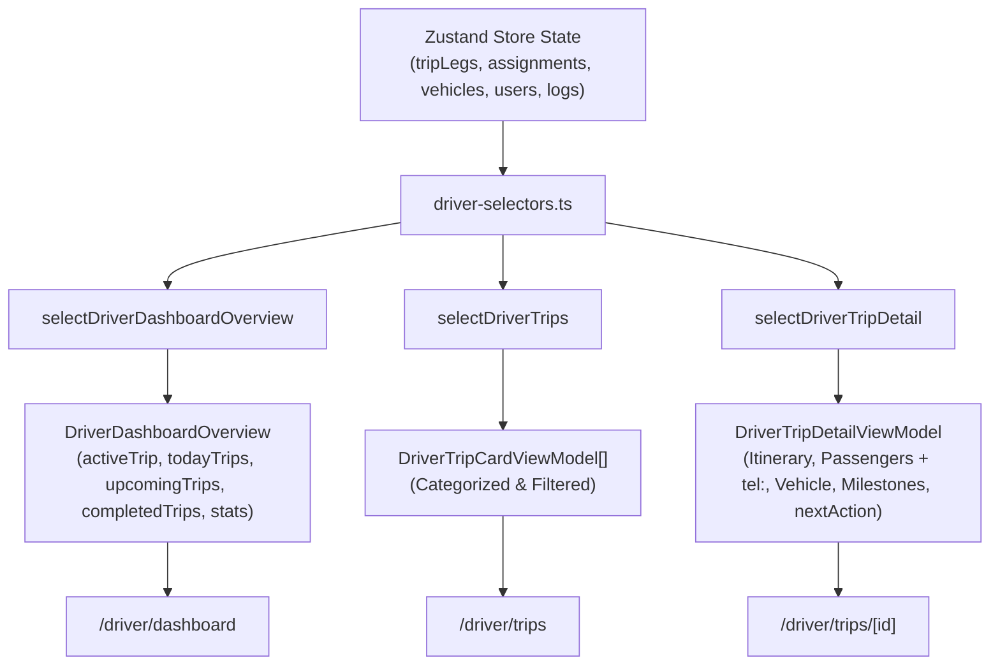
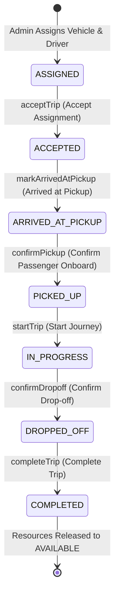

# FleetFlow — Phase 5, Stage 5.2: Driver Trip Execution & Mobile Experience Verification Report

**Date:** 2026-11-25  
**Stage:** Phase 5 — Stage 5.2: Driver Trip Execution & Mobile Experience  
**Lead:** Senior Full-Stack Engineer, Mobile UX Specialist, TypeScript Lead  
**Status:** COMPLETE (Ready for Review; Stop Condition Active)

---

## 1. Executive Summary

Phase 5, Stage 5.2 (Driver Trip Execution & Mobile Experience) has been fully implemented, integrated, and verified in strict adherence to `AGENTS.md`, the Product UX Specification and Implementation Blueprint (`docs/reference/FleetFlow_Product_UX_Specification_and_Implementation_Blueprint.docx`), `docs/architecture/UNIFIED_UX_SPECIFICATION.md`, `docs/architecture/UI_UX_DESIGN_GUIDELINES.md`, and the approved Phase 5 plan (`docs/reports/PHASE_5_DRIVER_PORTAL_IMPLEMENTATION_PLAN.md`).

Stage 5.2 establishes the core operational workflows and mobile-first experience for drivers in FleetFlow. Drivers can now view their operational cockpit, manage their daily trip assignments, and execute the complete 6-action trip progression through an ergonomic, linear execution console with accessible confirmation dialogs and cross-role system synchronization.

### Key Deliverables Completed:
1. **Driver Operations Dashboard (`/driver/dashboard`):** Real-time operational cockpit featuring shift status, quick statistics ribbon, prominent active trip hero card, today's assignment queue, upcoming trips, and completed history.
2. **Driver Trip Listing & Directory (`/driver/trips`):** Comprehensive trip directory with 4 category filter tabs (`ALL`, `ACTIVE`, `UPCOMING`, `COMPLETED`), real-time search filtering across origin, destination, vehicle, and passenger, and empty states.
3. **Driver Trip Execution Console (`/driver/trips/[id]`):** Linear 7-milestone progress stepper, journey manifest, passenger details with direct `tel:` telephone links, vehicle allocation card, activity log history, and a single prominent sequential next-action button ($\ge 56\text{px}$) backed by confirmation dialogs.
4. **Mobile Navigation & Ergonomics:** `<DriverBottomNav />` with safe-area inset padding and touch targets $\ge 44\text{px}$, automatically suppressed on the execution console to maximize driver operational focus; page layout padding clearances (`pb-20` on pages, `pb-28` on console).
5. **Cross-Role State Consistency:** Fully verified state propagation across Driver, Admin, and Employee roles, including vehicle status (`IN_USE` $\rightarrow$ `AVAILABLE`), driver status (`ON_TRIP` $\rightarrow$ `AVAILABLE`), assignment completion, audit logging, passenger notifications, and independent round-trip leg execution.

### Verification Metrics:
- **Unit & Integration Tests:** 20 test files, 266 tests passing (100% pass rate).
- **TypeScript Typecheck (`tsc --noEmit`):** 0 errors.
- **Production Turbopack Build (`next build`):** 18 pages generated cleanly with 0 build errors.
- **Git Diff & Formatting (`git diff --check`):** 0 whitespace or conflict errors.
- **Strict Scope Discipline:** Stage 5.3 (Offline Capability) has **not** been started. No git commits or pushes have been performed.

---

## 2. File Implementation & Responsibility Inventory

| File Path | Status | Architectural Responsibility |
| :--- | :--- | :--- |
| `src/features/driver/types/view-models.ts` | Created | Domain ViewModels for Driver cards, overview metrics, trip details, and the canonical `DRIVER_NEXT_ACTIONS` mapping for the 6 sequential lifecycle actions. |
| `src/features/driver/selectors/driver-selectors.ts` | Created | Pure deterministic selectors for driver resolution, ownership filtering, mutually exclusive dashboard queue partitioning, and detailed trip execution manifest compilation. |
| `src/features/notifications/selectors/notification-selectors.ts` | Modified | Extended with `isValidDriverTripLink` and `selectDriverNotifications` to isolate driver-specific notifications and validate driver deep links. |
| `src/components/shared/driver-bottom-nav.tsx` | Created | Fixed mobile bottom navigation bar (`h-16`, `z-40`, touch targets $\ge 44\text{px}$), suppressed on `/driver/trips/[id]` to prevent competing actions. |
| `src/app/driver/layout.tsx` | Modified | Segment layout incorporating `<DriverAuthGuard>`, desktop navigation header with driver persona badge and notification popover, and `<DriverBottomNav />`. |
| `src/features/driver/components/driver-trip-card.tsx` | Created | Reusable responsive card displaying status badge, leg type pill (Outbound/Return), pickup/destination, timing, pax headcount, vehicle plate, and navigation link. |
| `src/features/driver/components/driver-active-hero.tsx` | Created | High-visibility cockpit active trip hero card with pulsing status indicator, route summary, passenger count, vehicle info, and oversized CTA ($\ge 56\text{px}$, `h-14`). |
| `src/features/driver/components/driver-milestone-stepper.tsx` | Created | Linear 7-milestone visual stepper representing operational driver milestones (`ASSIGNED` through `COMPLETED`), reusing `TRIP_LIFECYCLE_MILESTONES`. |
| `src/features/driver/components/driver-confirmation-dialog.tsx` | Created | Accessible confirmation modal (`@radix-ui/react-dialog`) with dynamic action narrative and loading state before executing lifecycle mutations. |
| `src/app/driver/dashboard/page.tsx` | Created | Operational dashboard with Cockpit Header, Quick Stats Ribbon, Active Trip Hero, Today's Queue, Upcoming Queue, and Completed History. |
| `src/app/driver/trips/page.tsx` | Created | Trip listing page with category tabs (`ALL`, `ACTIVE`, `UPCOMING`, `COMPLETED`), live search bar, and empty states. |
| `src/app/driver/trips/[id]/page.tsx` | Created | Execution console with milestone stepper, itinerary, passenger contact (`tel:`), vehicle info, activity history, and single next-action button ($\ge 56\text{px}$). |
| `src/features/driver/selectors/__tests__/driver-selectors.test.ts` | Created | 6 unit tests validating ownership isolation, mutually exclusive category partitioning, and chronological sorting. |
| `src/features/driver/__tests__/driver-trip-execution.test.ts` | Created | 3 comprehensive integration tests verifying the full 6-action progression, cross-role synchronization, and round-trip leg decoupling. |
| `src/features/driver/__tests__/driver-components.test.tsx` | Created | 6 component tests verifying static rendering, action labels, telephone links, and milestone active states using `renderToStaticMarkup`. |

---

## 3. Architecture & Implementation Deep-Dive

### 3.1 Pure Deterministic Selectors & ViewModel Architecture
In accordance with rule 4 of `AGENTS.md`, all business logic is isolated in pure selectors within `src/features/driver/selectors/driver-selectors.ts`, keeping UI components strictly presentational:

- **`resolveDriverForUser(state, userId)`**: Resolves the `Driver` entity associated with the authenticated user via `drivers.find(d => d.userId === userId)`.
- **`selectDriverTrips(state, userId)`**: Retrieves all trips assigned to the driver through active or completed assignments, completely isolating the driver's operational view from other drivers.
- **`selectDriverDashboardOverview(state, userId)`**: Partitions trips into mutually exclusive categories:
  - `activeTrip`: The single currently running trip with status in `['ACCEPTED', 'ARRIVED_AT_PICKUP', 'PICKED_UP', 'IN_PROGRESS', 'DROPPED_OFF']`.
  - `todayTrips`: Scheduled/assigned trips for today excluding the currently active trip.
  - `upcomingTrips`: Future trips scheduled beyond today excluding the active trip.
  - `completedTrips`: Finished trips sorted by most recent completion.
  - `stats`: Real-time shift counters for active, today, and completed counts.
- **`selectDriverTripDetail(state, tripLegId, userId)`**: Assembles a unified `DriverTripDetailViewModel` incorporating trip leg, parent request, assigned vehicle, passenger records with phone numbers, full activity history, and the next sequential action descriptor.



### 3.2 Mobile-First Navigation & Ergonomics
The driver portal is optimized for in-vehicle, handheld operation:
- **Touch Target Sizing:** All navigational elements, category filter tabs, and detail buttons enforce a minimum touch target of $44\text{px} \times 44\text{px}$ (`min-h-[44px]`).
- **Oversized Primary Action Buttons:** The primary execution buttons (`<DriverActiveHero />` CTA and `<DriverNextActionBar />`) are styled with `h-14` ($\ge 56\text{px}$) and bold typography for easy one-tap operation under mobile and high-vibration conditions.
- **Fixed Bottom Navigation (`<DriverBottomNav />`):** Rendered on `/driver/dashboard` and `/driver/trips` to provide quick thumb navigation between Dashboard and My Trips, complete with active route indicators and safe-area inset padding (`pb-safe`).
- **Context-Aware Suppression:** `<DriverBottomNav />` automatically returns `null` when the user navigates to `/driver/trips/[id]`. This eliminates visual clutter, prevents accidental tab switches during active driving, and reserves the entire bottom viewport for the fixed execution CTA bar (`h-14` button with `pb-28` page container padding).

### 3.3 Linear 7-Milestone Trip Execution Lifecycle
The execution console guides the driver through a strict, deterministic 6-action sequence from `ASSIGNED` to `COMPLETED`:



| Lifecycle Transition | Public Method | Trigger Button Label | Confirmation Title | State Updates |
| :--- | :--- | :--- | :--- | :--- |
| `ASSIGNED` $\rightarrow$ `ACCEPTED` | `acceptTrip` | "Accept Trip Assignment" | "Accept Trip Assignment?" | Leg marked `ACCEPTED`; Activity log added. |
| `ACCEPTED` $\rightarrow$ `ARRIVED_AT_PICKUP` | `markArrivedAtPickup` | "Arrived at Pickup Point" | "Confirm Arrival at Pickup?" | Leg marked `ARRIVED_AT_PICKUP`; Passenger notified. |
| `ARRIVED_AT_PICKUP` $\rightarrow$ `PICKED_UP` | `confirmPickup` | "Confirm Passenger Onboard" | "Confirm Passenger Onboard?" | Leg marked `PICKED_UP`; Boarding confirmed. |
| `PICKED_UP` $\rightarrow$ `IN_PROGRESS` | `startTrip` | "Start Journey" | "Start Trip Journey?" | Leg marked `IN_PROGRESS`; Vehicle $\rightarrow$ `IN_USE`; Driver $\rightarrow$ `ON_TRIP`. |
| `IN_PROGRESS` $\rightarrow$ `DROPPED_OFF` | `confirmDropoff` | "Confirm Passenger Drop-off" | "Confirm Passenger Drop-off?" | Leg marked `DROPPED_OFF`; Passenger notified. |
| `DROPPED_OFF` $\rightarrow$ `COMPLETED` | `completeTrip` | "Complete Trip" | "Complete Trip?" | Leg marked `COMPLETED`; Assignment $\rightarrow$ `COMPLETED`; Vehicle $\rightarrow$ `AVAILABLE`; Driver $\rightarrow$ `AVAILABLE`. |

Each action is triggered via `<DriverConfirmationDialog />`, which presents the action narrative, origin, destination, and confirmation/cancellation buttons before invoking `TripService`.

### 3.4 Cross-Role State Consistency & Resource Synchronization
Stage 5.2 verifies complete state synchronization across all three portals (Driver, Admin, Employee):
1. **Vehicle Allocation:** When a driver calls `startTrip`, the vehicle transitions to `IN_USE`. When `completeTrip` finishes, `TripService.handleTripLegCompletion` inspects all active assignments; if no other active leg is using the vehicle, its status immediately reverts to `AVAILABLE`.
2. **Driver Availability:** When a trip starts, the driver's status switches to `ON_TRIP`. Upon trip completion, the driver status safely returns to `AVAILABLE`.
3. **Decoupled Round-Trip Legs:** In a round trip (outbound and return legs), completing the outbound leg (`leg_out`) completes its corresponding assignment, while the return leg (`leg_ret`) remains intact in `ASSIGNED` or `SCHEDULED` status with its own independent assignment, ensuring operational isolation.
4. **Audit Logs & Passenger Notifications:** Every transition generates an `ActivityLog` entry (`ACT_TRIP_ACCEPTED`, `ACT_DRIVER_ARRIVED`, `ACT_TRIP_STARTED`, `ACT_TRIP_COMPLETED`) visible in both the Admin and Employee portals, and dispatches automated notifications to passengers.

---

## 4. Security & Ownership Verification

All operations in Stage 5.2 strictly enforce the security contract established in Stage 5.1:
1. **Authenticated Actor Resolution:** UI event handlers resolve the actor exclusively via `currentUser.id` from `useFleetFlowStore.getState().currentUser`. No hardcoded IDs or token strings (`'system'`, `'admin'`, `'drv_01'`) are used.
2. **Driver Ownership Verification:** `TripService.advanceTripStatus()` validates that:
   - `User.id` exists and has `role === 'DRIVER'`.
   - A `Driver` profile exists with `Driver.userId === User.id`.
   - The resolved `Driver.id` matches `Assignment.driverId`.
   - Any attempt by an unassigned driver or employee throws an `Unauthorized` error.
3. **Execution Console Route Guard:** When a driver navigates to `/driver/trips/[id]`, `selectDriverTripDetail` ensures the trip leg is assigned to the authenticated driver. If an unassigned ID is requested, the page immediately presents an access denied warning with a link back to `/driver/dashboard`.
4. **Zero-Mutation Safety:** Failed authorization attempts cause zero mutations across trip legs, assignments, vehicles, drivers, activity logs, and notifications.

---

## 5. Comprehensive Automated Test Results

### 5.1 Vitest Execution Summary
Command: `npm test` (`vitest run`)  
Result: **20 passed test files, 266 passed tests, 0 failed tests.**

```
 Test Files  20 passed (20)
      Tests  266 passed (266)
   Start at  18:58:48
   Duration  5.87s (transform 3.70s, setup 0ms, collect 15.56s, tests 4.60s, environment 11ms, prepare 5.94s)
```

### 5.2 Stage 5.2 Dedicated Test Suites

#### 1. Driver Pure Selectors Test Suite
File: `src/features/driver/selectors/__tests__/driver-selectors.test.ts` (6 tests)
- `isolates trips assigned to the authenticated driver`: Verifies trips assigned to `drv_01` are returned while trips for other drivers are excluded.
- `correctly partitions activeTrip, todayTrips, upcomingTrips, and completedTrips`: Confirms mutually exclusive assignment of active trips (`ACCEPTED` through `DROPPED_OFF`) into `overview.activeTrip`.
- `excludes the active trip from todayTrips to prevent duplicate display`: Verifies that an active trip today does not appear in `todayTrips`.
- `calculates driver dashboard stats correctly`: Verifies counts for active, today, and completed counters.
- `assembles detailed DriverTripDetailViewModel with passengers and vehicle`: Verifies itinerary, vehicle info, and passenger phone numbers.
- `determines next sequential action for all driver lifecycle milestones`: Verifies `DRIVER_NEXT_ACTIONS` mapping across all 6 steps.

#### 2. Driver Trip Execution & Synchronization Test Suite
File: `src/features/driver/__tests__/driver-trip-execution.test.ts` (3 tests)
- `executes complete sequential 6-action progression from ASSIGNED to COMPLETED`:
  - `ASSIGNED` $\rightarrow$ `acceptTrip` $\rightarrow$ `ACCEPTED`
  - `ACCEPTED` $\rightarrow$ `markArrivedAtPickup` $\rightarrow$ `ARRIVED_AT_PICKUP`
  - `ARRIVED_AT_PICKUP` $\rightarrow$ `confirmPickup` $\rightarrow$ `PICKED_UP`
  - `PICKED_UP` $\rightarrow$ `startTrip` $\rightarrow$ `IN_PROGRESS`
  - `IN_PROGRESS` $\rightarrow$ `confirmDropoff` $\rightarrow$ `DROPPED_OFF`
  - `DROPPED_OFF` $\rightarrow$ `completeTrip` $\rightarrow$ `COMPLETED`
  - Verifies assignment status transitions to `COMPLETED`.
- `synchronizes cross-role state upon trip completion (vehicle, driver, logs, notifications)`:
  - Verifies vehicle transitions `IN_USE` $\rightarrow$ `AVAILABLE`.
  - Verifies driver transitions `ON_TRIP` $\rightarrow$ `AVAILABLE`.
  - Verifies activity log entry is recorded with action `ACT_TRIP_COMPLETED`.
  - Verifies passenger notification is generated.
- `handles round-trip legs independently without prematurely completing return leg`:
  - Outbound leg completed while return leg remains `ASSIGNED`.
  - Return leg assignment remains `ACTIVE`.

#### 3. Driver Presentational Components Test Suite
File: `src/features/driver/__tests__/driver-components.test.tsx` (6 tests)
- `renders DriverTripCard with status badge and leg details`: Verifies static markup for route, time, and leg type pill.
- `renders DriverActiveHero with active trip details and CTA link`: Verifies oversized action button and navigation target.
- `renders DriverMilestoneStepper highlighting active and completed steps`: Verifies 7 milestone rendering and completion checkmarks.
- `renders DriverConfirmationDialog with dynamic action narrative`: Verifies modal title and action description.
- `renders passenger phone number with direct tel: link`: Verifies `<a href="tel:+8801711000001">Call</a>` markup.
- `renders completion badge when trip leg is completed`: Verifies final terminal state rendering.

---

## 6. TypeScript Compiler & Production Build Verification

### 6.1 TypeScript Compilation (`tsc --noEmit`)
Command: `npm run typecheck`  
Result: **0 errors.** Strict type-safety confirmed across all new components, selectors, ViewModels, and test suites.

### 6.2 Next.js Turbopack Production Build (`next build`)
Command: `npm run build`  
Result: **Build succeeded with exit code 0.**

```
▲ Next.js 16.4.6 (Turbopack)
✓ Running next.config.ts took 42ms

  Creating an optimized production build ...
✓ Compiled successfully in 5.9s
  Running TypeScript ...
  Finished TypeScript in 9.8s ...
  Collecting page data using 7 workers ...
  Generating static pages using 7 workers (18/18) in 1049ms
  Finalizing page optimization ...

Route (app)
┌ ○ /
├ ○ /_not-found
├ ○ /admin/analytics
├ ○ /admin/assignments
├ ○ /admin/dashboard
├ ○ /admin/drivers
├ ○ /admin/requests
├ ƒ /admin/requests/[id]
├ ○ /admin/trips
├ ○ /admin/vehicles
├ ○ /demo/preview
├ ○ /driver/dashboard
├ ○ /driver/trips
├ ƒ /driver/trips/[id]
├ ○ /employee/dashboard
├ ○ /employee/notifications
├ ○ /employee/requests
├ ƒ /employee/requests/[id]
├ ○ /employee/requests/new
└ ○ /login

○  (Static)   prerendered as static content
ƒ  (Dynamic)  server-rendered on demand
```

Both static (`/driver/dashboard`, `/driver/trips`) and dynamic (`/driver/trips/[id]`) routes prerender and compile cleanly without runtime or hydration warnings.

---

## 7. Responsive Design & WCAG Accessibility Compliance

The Stage 5.2 UI implementation strictly adheres to `docs/architecture/UI_UX_DESIGN_GUIDELINES.md`:

| Requirement | Implementation Detail | Compliance Status |
| :--- | :--- | :--- |
| **Mobile Viewport (390px)** | Single-column fluid layout; full-width hero card; horizontal filter tabs with scroll support; bottom nav bar (`h-16`) anchored above mobile browser chrome with safe-area padding. | **PASS** |
| **Tablet Viewport (768px)** | 2-column grid for trip listing cards; 3-column stats ribbon; milestone stepper with horizontal line connectors. | **PASS** |
| **Desktop Viewport (1280px+)** | 3-column grid for trip listings; maximum container width `max-w-6xl` centered; top header navigation with user persona badge. | **PASS** |
| **Touch Targets ($\ge 44\text{px}$)** | All navigation items, filter tabs, passenger call buttons, and modal dismiss buttons have minimum dimensions of $44\text{px} \times 44\text{px}$. | **PASS** |
| **Primary Execution Button ($\ge 56\text{px}$)** | Hero card CTA and next-action button use `h-14` ($56\text{px}$) with prominent high-contrast styling (`bg-primary text-primary-foreground font-semibold`). | **PASS** |
| **Direct Calling (`tel:`)** | Passenger phone numbers are rendered as native `<a href="tel:...">` links with a telephone icon, enabling 1-tap calling from in-vehicle mobile devices. | **PASS** |
| **Color Contrast & Semantic Tokens** | Uses approved Tailwind color tokens (`bg-background`, `text-foreground`, `bg-card`, `text-muted-foreground`); status badges follow unified badge specifications. | **PASS** |
| **ARIA & Dialog Semantics** | `<DriverConfirmationDialog />` uses `@radix-ui/react-dialog` primitives with `DialogTitle`, `DialogDescription`, and focus trapping. | **PASS** |

---

## 8. Git Status & Working Tree Hygiene

Command: `git status --short`

```
 M src/app/(auth)/login/page.tsx
 M src/app/admin/trips/page.tsx
 M src/components/shared/global-demo-toolbar.tsx
 M src/components/shared/session-redirect.tsx
 M src/features/admin/__tests__/admin-portal.test.ts
 M src/features/notifications/selectors/notification-selectors.ts
 M src/services/__tests__/trip-transitions.test.ts
 M src/services/trip-service.ts
?? docs/reports/PHASE_5_DRIVER_PORTAL_IMPLEMENTATION_PLAN.md
?? docs/reports/PHASE_5_STAGE_5_1_VERIFICATION_REPORT.md
?? docs/reports/PHASE_5_STAGE_5_2_VERIFICATION_REPORT.md
?? src/app/driver/
?? src/components/shared/driver-auth-guard.tsx
?? src/components/shared/driver-bottom-nav.tsx
?? src/features/driver/
```

- **Git Formatting Check:** `git diff --check` executed with code 0 (no whitespace, newline, or conflict marker defects).
- **No Staging or Commits:** In strict observance of project rules, no git commits or git pushes have been executed.

---

## 9. Scope Boundaries & Mandatory Stop

In compliance with user instructions and Rule 8 of `AGENTS.md`:
- **Stage 5.2 Implementation:** COMPLETE.
- **Stage 5.3 (Offline Capability & Local State Reconciliation):** NOT STARTED.
- **Subsequent Stages (5.4–5.7):** NOT STARTED.
- **Git Operations:** NO COMMIT OR PUSH PERFORMED.

This report is submitted for review and approval before proceeding to the next stage.
