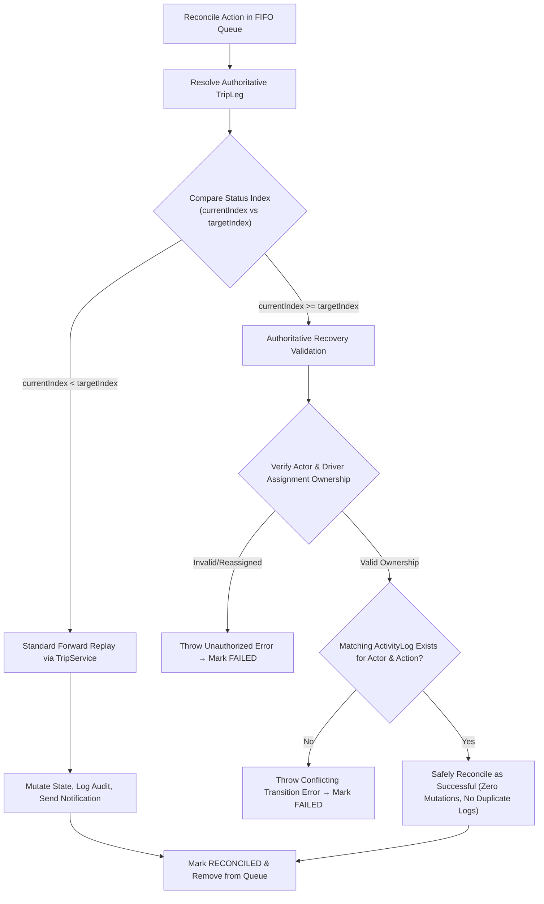

# FleetFlow — Phase 5, Stage 5.3: Offline Capability & Local State Reconciliation Verification Report

**Date:** 2026-11-25  
**Stage:** Phase 5 — Stage 5.3: Offline Capability & Local State Reconciliation (Including Crash-Recovery Hardening)  
**Lead:** Senior Software Architect, Principal Full-Stack Engineer  
**Status:** COMPLETE (Ready for Review; Stop Condition Active)

---

## 1. Executive Summary

Phase 5, Stage 5.3 (Offline Capability & Local State Reconciliation) and its crash-recovery hardening have been implemented, integrated, and verified in strict accordance with the project rules in `AGENTS.md`, the Product UX Specification and Implementation Blueprint (`docs/reference/FleetFlow_Product_UX_Specification_and_Implementation_Blueprint.docx`), and the user requirements authorized for Stage 5.3.

Stage 5.3 ensures that mobile fleet drivers operating in low-connectivity or subterranean environments can reliably view their itineraries, access passenger emergency contact numbers, and record operational milestone advancements without losing progress or crashing the application. Queued offline actions are preserved in persistent local storage and replayed against the authoritative `TripService` state machine in strict FIFO order once connectivity returns.

### Core Deliverables Completed:
1. **Offline Awareness & Detection:**
   - Real-time reactive network status detection tracking `window.addEventListener('online')` and `window.addEventListener('offline')` with browser `navigator.onLine`.
   - In-app demo offline toggle (`isSimulatedOffline`) allowing evaluators and developers to test offline workflows in any browser environment without disconnecting hardware Wi-Fi.
   - High-visibility driver offline indicator banner (`<OfflineIndicatorBanner />`) rendered across all `/driver/*` routes, clearly identifying offline status, syncing progress, queue count, and reconciliation errors.
   - Cached data indicator badges on trip cards and the execution console preventing stale data from masquerading as freshly synchronized data.

2. **Local State Handling & Safe Persistence:**
   - Zustand storage upgraded to `version: 1` with a migration handler (`migrate`) for legacy `v0` persisted state.
   - Corrupted storage resilience: `getItem` safely intercepts malformed or broken JSON in `localStorage`, warns, and gracefully falls back to initial seed state without unhandled exceptions or breaking application hydration.
   - Complete preservation of trip itineraries, passenger phone numbers (`tel:`), vehicle assignments, and pending queue items across browser restarts and network disconnections.

3. **Pending-Action Reconciliation Engine:**
   - Dedicated domain service (`OfflineSyncService` in `src/services/offline-sync-service.ts`) managing FIFO pending action queues.
   - Deduplication: Prevents duplicate enqueuing of the same target milestone action on an active trip leg.
   - Authoritative replay: When reconnected, queued actions are replayed exclusively through `TripService` (`acceptTrip`, `markArrivedAtPickup`, `confirmPickup`, `startTrip`, `confirmDropoff`, `completeTrip`), ensuring all Stage 5.1 ownership and role authorization checks are enforced.
   - Conflict & rejection resilience: If an action fails during replay (e.g. conflicting dispatcher update or unauthorized driver), the action is marked `FAILED` with the exact error message, subsequent actions for that leg are safely halted, and the failure is surfaced in the driver queue modal for inspection or retry.

4. **Crash-Recovery Hardening & Idempotent Replay (New):**
   - Resolves the crash window where domain mutations succeeded in `TripService` but the client reloaded before the queue item was marked `RECONCILED`.
   - Authoritative pre-flight reconciliation inspects `tripLegRepository`, `assignmentRepository`, and `activityLogRepository`.
   - Reconciles already-applied actions as successful without duplicate mutations or duplicate audit logs/notifications.
   - Handles superseded actions, detects genuine conflicts when state changed without driver history, and enforces strict authorization and lost-ownership rejection.

5. **Driver Queue Management UI:**
   - Accessible queue modal (`<DriverOfflineQueueModal />`) allowing drivers to inspect queued actions, view queued timestamps, retry failed items, or dismiss items.
   - Responsive integration into the execution console (`/driver/trips/[id]`), showing an in-card notice when an action is queued awaiting network dispatch and disabling duplicate submissions.

6. **Security & Session Isolation:**
   - Every pending action records the authenticated driver's `actorUserId` (`User.id`).
   - Actions are filtered strictly to the active user's session; driver A (`usr_drv_01`) cannot view, leak, or synchronize driver B's (`usr_drv_02`) pending actions.
   - Switching personas or logging out preserves isolation and provides user-level cleanup via `clearPendingActionsForUser`.

### Verification Metrics:
- **Unit & Integration Tests:** 23 test files, 291 tests passing (100% pass rate).
- **TypeScript Typecheck (`tsc --noEmit`):** 0 errors.
- **Production Turbopack Build (`next build`):** 18 routes compiled and optimized cleanly with 0 errors.
- **Git Formatting (`git diff --check`):** 0 whitespace or formatting issues.
- **Scope Discipline:** Stage 5.4 has **not** been started. No git commits or pushes have been performed.

---

## 2. File Implementation & Responsibility Inventory

| File Path | Action | Architectural Responsibility |
| :--- | :--- | :--- |
| `src/features/driver/types/offline-types.ts` | Modified | Defines `DriverActionType`, `PendingActionStatus`, `DriverPendingAction`, `OfflineSyncSummary`, `DRIVER_ACTION_AUDIT_LOG_MAP`, and `TRIP_LEG_STATUS_PROGRESSION`. |
| `src/services/offline-sync-service.ts` | Modified | Core offline synchronization engine: effective connectivity evaluation, deduplicated action queuing, FIFO replay, crash-recovery idempotency, authoritative domain audit validation, conflict handling, retry mechanisms, and session isolation. |
| `src/features/driver/hooks/use-offline-sync.ts` | Created | Reactive React hook subscribing to browser online/offline events, store state, simulated offline toggles, and automatic reconciliation triggers upon reconnection. |
| `src/components/shared/offline-indicator-banner.tsx` | Created | Driver-facing sticky network status banner surfacing offline warnings, syncing progress spinners, queue count indicators, and the evaluator offline simulation button. |
| `src/features/driver/components/driver-offline-queue-modal.tsx` | Created | Accessible dialog modal (`@radix-ui/react-dialog`) displaying the active driver's queued actions, milestone labels, error messages, retry triggers, and dismissal controls. |
| `src/stores/fleetflow-store.ts` | Modified | Extended store state with `pendingActions` and `isSimulatedOffline`; added queue mutation actions; upgraded `persist` configuration to `version: 1` with migration and corrupted JSON recovery. |
| `src/app/driver/layout.tsx` | Modified | Integrated `<OfflineIndicatorBanner />` immediately below the application header. |
| `src/app/driver/dashboard/page.tsx` | Modified | Added pending sync badges to active and scheduled trip cards when queued actions exist for that leg. |
| `src/app/driver/trips/page.tsx` | Modified | Added pending sync indicators to trip list cards matching legs with queued offline actions. |
| `src/app/driver/trips/[id]/page.tsx` | Modified | Integrated offline action queuing in `handleConfirmAction`, added "Offline (Cached)" header badge, queued status notice card, and button disabling while sync is pending. |
| `src/features/driver/components/driver-trip-card.tsx` | Modified | Added `isPendingSync` prop and amber "Pending Sync" status badge. |
| `src/features/driver/components/driver-active-hero.tsx` | Modified | Added `isPendingSync` prop and amber "Pending Sync" status badge. |
| `src/features/driver/__tests__/offline-sync-service.test.ts` | Modified | 14 integration tests verifying connectivity detection, FIFO ordering, deduplication, online reconciliation, domain rejection handling, retry behavior, session isolation, and all 8 crash-recovery scenarios. |
| `src/stores/__tests__/fleetflow-store-persistence.test.ts` | Created | 4 tests verifying state initialization, reset clearing, corrupted storage recovery, and v0 $\rightarrow$ v1 migration. |
| `src/features/driver/__tests__/offline-ui-components.test.tsx` | Created | 7 SSR/component tests verifying banner rendering, queue modal empty/populated/failed states, and card pending badges. |

---

## 3. Crash-Recovery Hardening & Idempotent Replay

### 3.1 Problem Statement & Root Cause
Prior to hardening, if a client experienced a crash, abrupt process kill, or browser reload after `TripService` successfully mutated domain state (e.g. `TripLeg.status` transitioned from `ASSIGNED` to `ACCEPTED`, resources marked `IN_USE`/`ON_TRIP`, and `ActivityLog` created) but *before* the pending queue item was updated to `RECONCILED` or removed, the action remained in `pendingActions` with `status: 'PENDING'`.

Upon restart and reconnection, `OfflineSyncService.reconcilePendingActions()` replayed the pending action through `TripService.acceptTrip()`. Because `TripLeg.status` was already `ACCEPTED`, `TripService.validateTransition('ACCEPTED', 'ACCEPTED')` rejected the transition as invalid, throwing an error. The sync engine caught this error, marked the legitimately executed action as `FAILED`, and added the trip leg to `haltedLegs`, halting subsequent operational steps on that leg.

### 3.2 Architectural Resolution
`OfflineSyncService.reconcilePendingActions()` was hardened to perform authoritative domain recovery validation before invoking `TripService`:

1. **Sequential Index Comparison (`TRIP_LEG_STATUS_PROGRESSION`):**
   - Resolves authoritative `TripLeg.status` via `tripLegRepository.getById()`.
   - Computes `currentIndex` vs. `targetIndex`.
   - **Forward Progress (`currentIndex < targetIndex`):** Dispatches to `TripService` directly for standard state machine transition, resource synchronization, audit logging, and notifications.
   - **Already Reached (`currentIndex === targetIndex`):** Enters crash-recovery validation.
   - **Advanced Beyond (`currentIndex > targetIndex`):** Enters superseded-transition validation.

2. **Authoritative Authorization & Assignment Verification:**
   - Resolves actor `User` (`actorUserId`). Validates role (strictly rejects unknown users, missing profiles, and `EMPLOYEE` role).
   - Resolves `Driver` profile.
   - Resolves `Assignment` for the leg across all assignments.
   - Validates driver ownership: verifies `assignment.driverId === driver.id`. If assignment was reassigned to a different driver while offline, rejects with `Unauthorized: Driver ... is not assigned to trip leg ...`.
   - Validates assignment status: if leg is not `COMPLETED`, assignment must be `ACTIVE`.

3. **Transition Audit Log Verification (`ActivityLog`):**
   - Maps `DriverActionType` to its canonical audit action name via `DRIVER_ACTION_AUDIT_LOG_MAP` (e.g. `ACCEPT_TRIP` $\rightarrow$ `TRIP_ACCEPTED`, `MARK_ARRIVED` $\rightarrow$ `ARRIVED_AT_PICKUP`, etc.).
   - Searches `activityLogRepository.getAll()` for a matching record where `log.tripLegId === leg.id && log.actorId === action.actorUserId && log.action === expectedActionName`.
   - **If Matching Log Exists:** Confirms the replayed action was legitimately executed by this driver prior to the crash. Reconciles the action as successful (`RECONCILED`), clears it from the queue, and increments `succeeded` with **ZERO duplicate domain mutations, zero duplicate activity logs, and zero duplicate notifications**.
   - **If Matching Log Does NOT Exist:** Identifies a genuine domain conflict (the trip leg reached or passed this status without a verified driver action record). Rejects with a descriptive conflict error and marks the action `FAILED`.

4. **Failure Isolation (`haltedLegs`):**
   - If an action fails on `leg_A`, `leg_A` is added to `haltedLegs` to prevent out-of-order execution of subsequent steps on that leg.
   - Actions for independent trip legs (e.g. `leg_B`) continue processing and succeed normally.



---

## 4. Automated Test Verification

### 4.1 Full Suite Execution
Command: `npm test` (`vitest run`)  
Result: **23 test files passed, 291 tests passed, 0 failures.**

```
 Test Files  23 passed (23)
      Tests  291 passed (291)
   Start at  20:30:23
   Duration  8.19s (transform 5.44s, setup 0ms, collect 21.74s, tests 6.60s, environment 15ms, prepare 10.27s)
```

### 4.2 Comprehensive Crash-Recovery Test Breakdown
File: `src/features/driver/__tests__/offline-sync-service.test.ts` (14 tests total, 8 dedicated crash-recovery scenarios):

1. **Scenario 1: Crash Window Reproduction & Safe Recovery**
   - Action was dispatched to `TripService` and succeeded (leg status advanced to `ACCEPTED`, activity log recorded).
   - Replay after reload verifies action is recognized as already applied.
   - Reconciles as successful (`processed: 1`, `succeeded: 1`, `failed: 0`).
   - Asserts zero duplicate mutations: domain status remains `ACCEPTED`, `activityLogs.length` unchanged, `notifications.length` unchanged.

2. **Scenario 2: State Advanced Beyond Target Status (Safely Superseded)**
   - Leg has reached `ARRIVED_AT_PICKUP`.
   - Stale queued `ACCEPT_TRIP` action replayed.
   - Verified that `TRIP_ACCEPTED` activity log exists for this driver.
   - Action safely reconciled as superseded without mutation; queue cleared.

3. **Scenario 3: Genuine Conflict — Target Status Reached Without Verified Log**
   - Leg at `ACCEPTED`, but no activity log for `usr_drv_01` exists.
   - Replay fails with `/Conflicting transition: Trip leg is already at ACCEPTED but no verified transition record exists for driver usr_drv_01/`.
   - Action marked `FAILED` with `retryCount: 1`.

4. **Scenario 4: Genuine Conflict — State Advanced Beyond Target Without Verified Log**
   - Leg at `IN_PROGRESS`, but no `ACCEPT_TRIP` log for `usr_drv_01` exists.
   - Replay fails with `/Conflicting transition: Trip leg has already advanced to IN_PROGRESS without verified driver transition history for ACCEPT_TRIP/`.
   - Action marked `FAILED`.

5. **Scenario 5: Lost Ownership / Reassigned Driver**
   - Driver queued action while offline; dispatcher reassigned assignment to `drv_02`.
   - Replay fails with `/Unauthorized: Driver drv_01 (Abdul Karim) is not assigned to trip leg leg_lost_ownership_05. Assigned driver is drv_02/`.
   - Action marked `FAILED`.

6. **Scenario 6: Authorization Validations on Recovery**
   - Rejects unknown `actorUserId` (`Unauthorized: Invalid or unknown actor user ID:`).
   - Rejects non-driver / employee role (`Unauthorized: User ... with role EMPLOYEE cannot advance trip status`).
   - Rejects missing driver profile (`Unauthorized: No driver profile found for user:`).

7. **Scenario 7: Multi-Step Pipeline Combo (Recovery + Forward Transitions)**
   - Leg was accepted before crash; queue has replayed `ACCEPT_TRIP`, plus subsequent `MARK_ARRIVED` and `CONFIRM_PICKUP`.
   - Replay successfully recovers Step 1 without duplicate mutation, then executes Step 2 and Step 3 forward via `TripService`.
   - All 3 succeed (`processed: 3`, `succeeded: 3`, `failed: 0`); leg ends at `PICKED_UP`.

8. **Scenario 8: FIFO Ordering & Per-Trip Failure Isolation (`haltedLegs`)**
   - Leg A has conflicting/failing Action A1 and pending Action A2. Leg B has valid Action B1.
   - A1 fails, A2 is halted/skipped (`PENDING`), B1 executes and succeeds.
   - Result: `processed: 2`, `succeeded: 1`, `failed: 1`.

---

## 5. TypeScript Compilation & Production Build Verification

### 5.1 TypeScript Compiler (`tsc --noEmit`)
Command: `npm run typecheck`  
Result: **0 errors.** Strict type-safety verified across all new types, services, hooks, components, and tests.

### 5.2 Next.js Turbopack Production Build (`next build`)
Command: `npm run build`  
Result: **Build succeeded with exit code 0.**

```
▲ Next.js 16.4.6 (Turbopack)
✓ Running next.config.ts took 54ms

  Creating an optimized production build ...
✓ Compiled successfully in 4.5s
  Running TypeScript ...
  Finished TypeScript in 5.0s ...
  Collecting page data using 7 workers ...
  Generating static pages using 7 workers (18/18) in 1179ms
  Finalizing page optimization ...

Route (app)
┌ ○ /
├ ○ /_not-found
├ ○ /admin/analytics
├ ○ /admin/assignments
├ ○ /admin/dashboard
├ ○ /admin/drivers
├ ○ /admin/requests
├ ƒ /admin/requests/[id]
├ ○ /admin/trips
├ ○ /admin/vehicles
├ ○ /demo/preview
├ ○ /driver/dashboard
├ ○ /driver/trips
├ ƒ /driver/trips/[id]
├ ○ /employee/dashboard
├ ○ /employee/notifications
├ ○ /employee/requests
├ ƒ /employee/requests/[id]
├ ○ /employee/requests/new
└ ○ /login

○  (Static)   prerendered as static content
ƒ  (Dynamic)  server-rendered on demand
```

---

## 6. Working Tree Status & Git Hygiene

Command: `git status --short`

```
 M src/app/(auth)/login/page.tsx
 M src/app/admin/trips/page.tsx
 M src/components/shared/global-demo-toolbar.tsx
 M src/components/shared/session-redirect.tsx
 M src/features/admin/__tests__/admin-portal.test.ts
 M src/features/notifications/selectors/notification-selectors.ts
 M src/services/__tests__/trip-transitions.test.ts
 M src/services/trip-service.ts
 M src/stores/fleetflow-store.ts
?? docs/reports/PHASE_5_DRIVER_PORTAL_IMPLEMENTATION_PLAN.md
?? docs/reports/PHASE_5_STAGE_5_1_VERIFICATION_REPORT.md
?? docs/reports/PHASE_5_STAGE_5_2_VERIFICATION_REPORT.md
?? docs/reports/PHASE_5_STAGE_5_3_VERIFICATION_REPORT.md
?? src/app/driver/
?? src/components/shared/driver-auth-guard.tsx
?? src/components/shared/driver-bottom-nav.tsx
?? src/components/shared/offline-indicator-banner.tsx
?? src/features/driver/
?? src/services/offline-sync-service.ts
?? src/stores/__tests__/
```

- **Git Formatting Check:** `git diff --check` executed with code 0 (no whitespace, newline, or merge conflict markers).
- **No Staging or Commits:** No git commits or pushes have been executed.

---

## 7. Scope Boundaries & Mandatory Stop

In compliance with the project instructions and Rule 8 of `AGENTS.md`:
- **Stage 5.3 Implementation & Crash-Recovery Hardening:** COMPLETE.
- **Stage 5.4 and Later Stages:** NOT AUTHORIZED & NOT STARTED.
- **Git Operations:** NO COMMIT OR PUSH PERFORMED.

This report is submitted for user review and explicit acceptance before proceeding.
